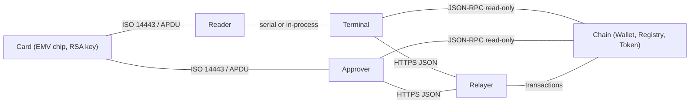
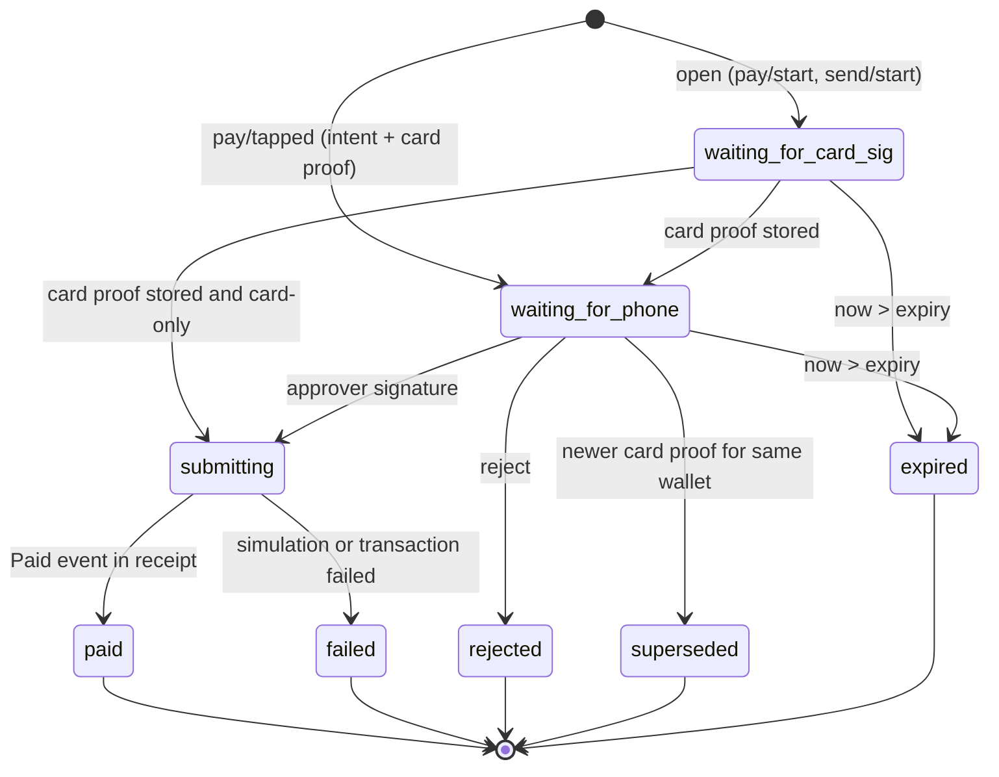
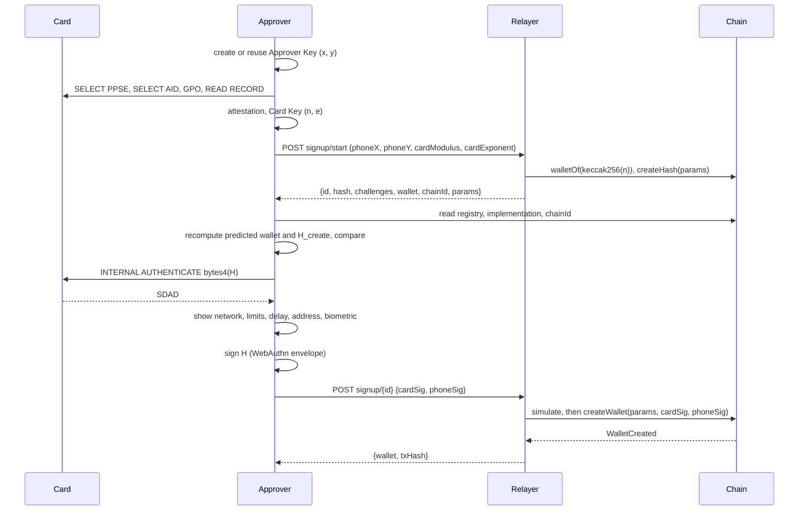
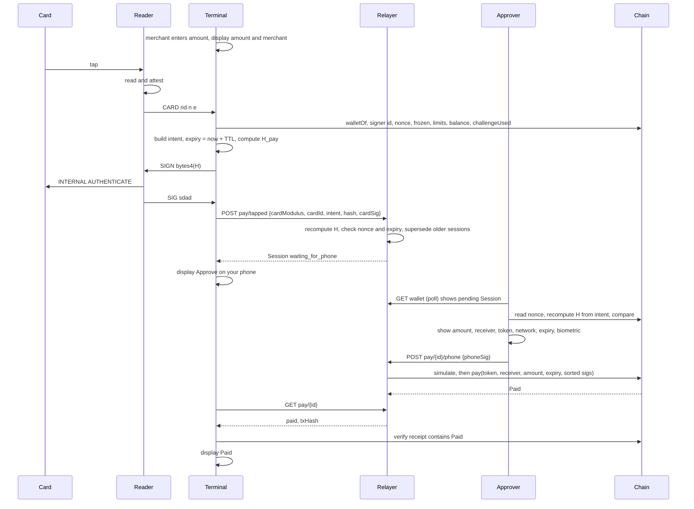
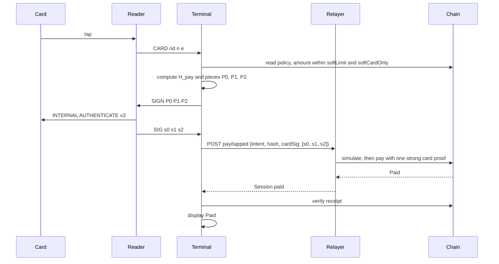
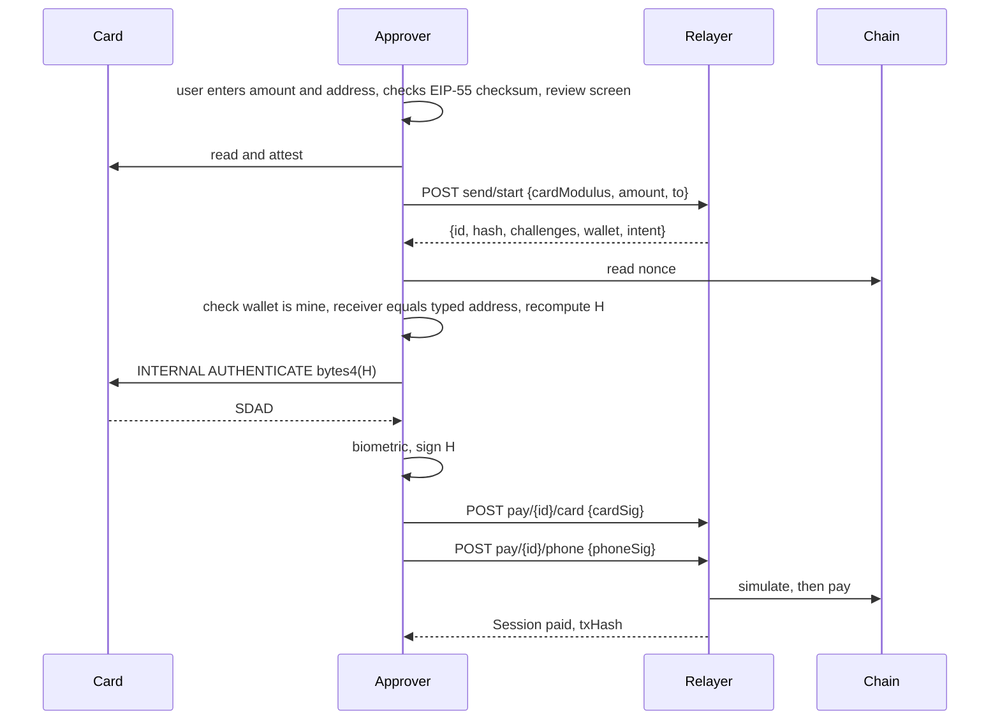
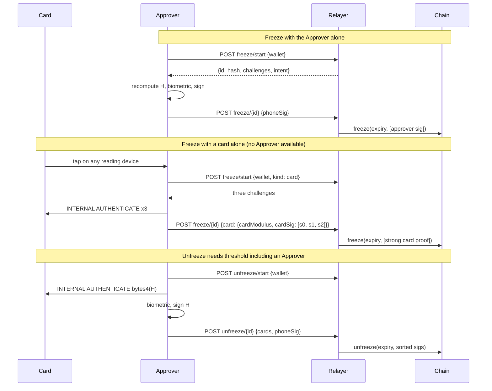
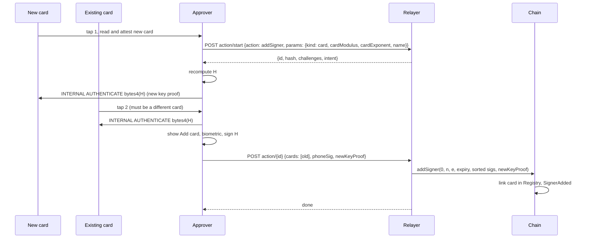
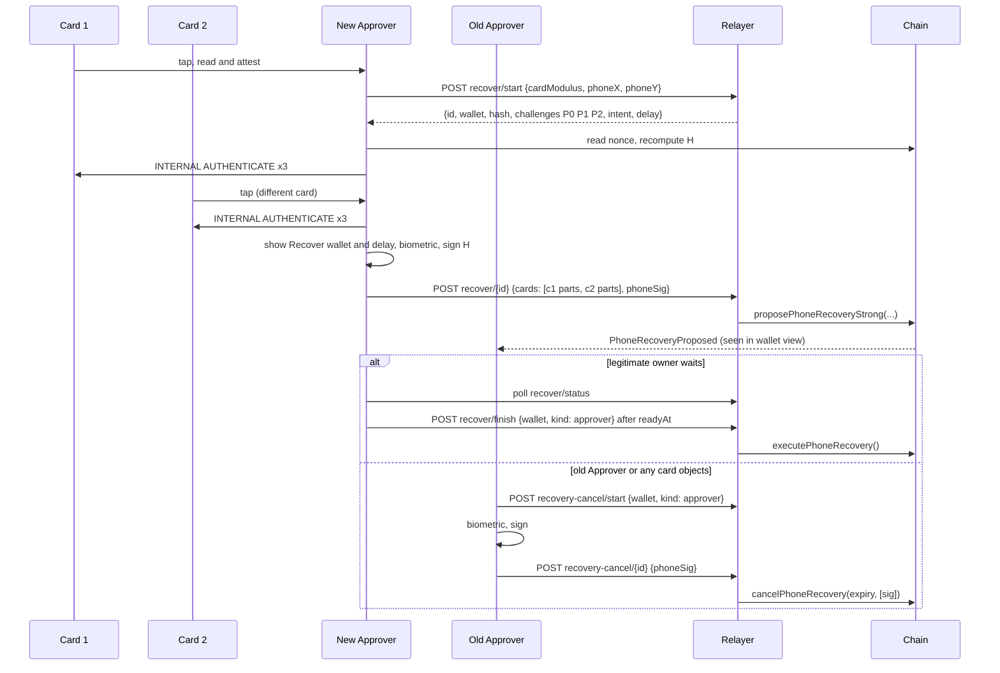

# Tap2ETH Protocol Specification

| | |
|---|---|
| Version | Draft 1 |
| Authors | team-somehow |
| License (text) | CC0 1.0 Universal (public domain dedication) |
| Companion document | [`WHITEPAPER.md`](./WHITEPAPER.md) |

---

## 1. Abstract

Tap2ETH turns an ordinary, unmodified contactless bank card (debit or credit, Visa or Mastercard) into one signer of a self-custodial smart-contract wallet. The card's EMV chip holds an RSA private key that never leaves the chip. Through EMV offline data authentication (INTERNAL AUTHENTICATE, "DDA") the chip signs a 4-byte challenge chosen by the reader. The card's public key is certified by the issuing bank, and the bank's key is certified by the payment network's certification authority, so anyone can check that a key belongs to a genuine bank card. A second signer, the Approver, is a biometric-gated P-256 key on the user's phone. The wallet contract verifies the card's RSA signature on-chain (modexp precompile plus SHA-1) and the Approver's signature (P-256 precompile). It enforces t-of-n thresholds, requires at least one Approver signature on every normal approval, and applies spending limits, freeze, and time-locked recovery. A Relayer sponsors gas, so the user never needs to hold a gas token. Merchant Terminals let a customer tap a card and approve the payment on their phone.

The card is used only as a **key**. No card payment is processed, no authorisation request reaches the issuer, and the card account is never charged. Value is held as stablecoins in the wallet.

This document specifies three layers:

1. **Layer 1, card attestation and card signatures.** How any verifier, including a smart wallet that is not a Tap2ETH wallet, reads a card, checks its certificate chain, and verifies a card signature over a challenge derived from a 32-byte intent hash.
2. **Layer 2, account rules.** The signer set, approval algorithm, limits, freeze, signer management, recovery, wallet creation, and the byte-exact hash preimages.
3. **Layer 3, sessions and messages.** The payment-session state machine, the HTTP relayer binding, the Reader-to-Terminal serial binding, end-to-end sequences, and what each device must display before anyone signs.

The goal is that independent teams can build a conforming wallet contract, Terminal, Reader, Approver app, and Relayer that interoperate, with no vendor to trust.

---

## 2. Conventions and terminology

### 2.1 Requirements language

The key words "MUST", "MUST NOT", "REQUIRED", "SHALL", "SHALL NOT", "SHOULD", "SHOULD NOT", "RECOMMENDED", "NOT RECOMMENDED", "MAY", and "OPTIONAL" in this document are to be interpreted as described in BCP 14 [RFC 2119] [RFC 8174] when, and only when, they appear in all capitals, as shown here.

### 2.2 Notation

- `‖` is byte concatenation.
- `X[i..j]` is the byte range of `X` from index `i` to index `j`, **inclusive**, zero-based. `X[i:j]` is the half-open range `[i, j)`.
- `len(X)` is the length of `X` in bytes.
- Hex values are written `0x…` or as space-separated byte pairs such as `6A 05`. EMV tags are written as hex without a prefix, for example `9F46`.
- `keccak256`, `sha256`, and `SHA-1` are the usual hash functions. `abi.encode` is the standard (non-packed) Solidity ABI encoding. `abi.encodePacked` is the packed encoding.
- `bytes4(H)` is the first 4 bytes of the 32-byte value `H`, that is `H[0..3]`.
- `base64url` is the URL-safe base64 alphabet of RFC 4648 §5 **without padding**.
- Integers in the EVM are big-endian 256-bit words unless stated otherwise.

### 2.3 Terms

| Term | Definition |
|---|---|
| **Card** | An EMV contactless chip card issued by a bank under a payment network (Visa, Mastercard). Debit or credit. Unmodified. |
| **Card Key** | The card's RSA public key `(n, e)` (the "ICC public key"), recovered from the card's certificate chain. `n` is encoded as exactly `N` big-endian bytes, where `N = N_IC` is the modulus length stated in the ICC certificate. `e` is encoded as minimal big-endian bytes (`0x03` or `0x010001`). The private key never leaves the chip. |
| **Card Key ID** | `keccak256(n)`, the keccak-256 hash of the `N`-byte modulus. It identifies a card in the Registry and in challenge-consumption records. The exponent is not part of the Card Key ID. |
| **Card Profile** | A defined way of making a card sign a challenge and of verifying the result (§4.1). |
| **SDAD** | Signed Dynamic Application Data (tag `9F4B` or format-1 response body). The card's RSA signature in response to INTERNAL AUTHENTICATE. Exactly `N` bytes. |
| **Attestation** | Verification of the chain CA key → issuer key → Card Key against a trusted CA public key (§4.6). |
| **CAPK** | Certification Authority Public Key of a payment network, identified by (RID, index). |
| **Approver** | A device, normally the user's phone, holding an **Approver Key**. In the reference code and in on-chain names an Approver is called a "phone" (`Kind.Phone`, `phoneX`, `phoneSig`). |
| **Approver Key** | A P-256 (secp256r1) key pair whose private key is held in hardware-backed storage and whose every use requires user verification (biometric). The public key is the affine point `(x, y)`, each coordinate 32 bytes. |
| **Signer** | A Card Key or an Approver Key registered in a Wallet, with a sequential id. |
| **Wallet** | A smart-contract account that holds funds and implements Layer 2. |
| **Registry** | The on-chain contract that creates Wallets deterministically and maps each Card Key ID to at most one Wallet. In the single-contract pattern the Registry is also the Wallet implementation ("master"). |
| **Terminal** | A merchant point-of-sale device. It shows the amount, asks the card to sign, talks to the Relayer, and shows the result. |
| **Reader** | The component that speaks ISO/IEC 14443 and EMV to the card. It is either a separate device attached to the Terminal (serial binding, §6.7), an in-process driver of the Terminal, or the NFC controller of an Approver. |
| **Relayer** | An off-chain service that holds sessions, forwards requests to Approvers, and submits transactions while paying gas. It is never a custodian and cannot move funds. |
| **Receiver** | The address that receives a payment: a merchant address, or any address the user sends to. In contract code this parameter is named `merchant`. |
| **Settlement Token** | The ERC-20 stablecoin a deployment uses for payments and limits. |
| **Intent** | A structured request whose hash `H` is signed: a Create Intent, a Payment Intent, or an Action Intent (§5.6). |
| **Intent Hash (`H`)** | `keccak256` of the ABI encoding of an Intent with its domain tag. 32 bytes. |
| **Challenge** | The 4 bytes a card signs. For a single-piece proof it is `bytes4(H)`. |
| **Piece** | One 4-byte slice of `H` used as a Challenge in a multi-piece proof (§4.9). |
| **Card Proof** | One or more SDADs from one card over the Pieces of one `H`. A *k-piece* proof covers `4k` bytes of `H`. |
| **Strong Card Proof** | A Card Proof with `k ≥ K_STRONG` pieces. |
| **Threshold (t)** | The number of signatures a normal approval requires, `2 ≤ t ≤ n`, where `n` is the number of active Signers. |
| **Normal approval** | An approval that needs `t` signatures including at least one Approver. |
| **Soft tier** | An optional policy under which payments up to `softLimit` need one signature. |
| **Policy** | The wallet's configurable rules: threshold, per-transaction limit, daily limit, soft tier, recovery delay. |
| **Nonce** | The wallet's single sequential counter, shared by payments and all actions. |
| **Expiry** | A unix time in seconds after which an Intent is invalid. |
| **Session** | A Relayer-side record that tracks one Intent from creation to a final state (§6.2). |

### 2.4 Protocol constants

| Name | Value | Meaning |
|---|---|---|
| `MAX_SIGNERS` | 8 | Maximum active Signers after any transaction. |
| `MIN_THRESHOLD` | 2 | Minimum threshold. |
| `K_STRONG` | 3 | Pieces per card in any approval that contains no Approver signature. |
| `K_MAX` | 8 | Maximum pieces per Card Proof (8 × 4 = 32 bytes). |
| `RECOVERY_CARDS` | 2 | Distinct cards needed to start Approver recovery. |
| `MIN_MODULUS_BYTES` | 128 | Minimum Card Key modulus length (1024 bits). |
| `MAX_MODULUS_BYTES` | 248 | Maximum Card Key modulus length (1984 bits, the EMV maximum). |
| `ALLOWED_EXPONENTS` | `0x03`, `0x010001` | Allowed Card Key exponents, minimal encoding. |
| `DAY` | 86400 s | Daily-limit bucket length. Buckets are `floor(timestamp / 86400)` (UTC days). |
| `PAYMENT_TTL` | 300 s (RECOMMENDED) | Default lifetime of a Payment Intent. |
| `ACTION_TTL` | 300 s (RECOMMENDED) | Default lifetime of an Action Intent. |
| `RECOVERY_TTL` | 900 s (RECOMMENDED) | Default lifetime of a recovery Intent. |
| `MAX_SIGN_AHEAD` | 3600 s | Approvers and Terminals MUST NOT sign an Intent whose expiry is further ahead than this. |
| `MIN_RECOVERY_DELAY` | 86400 s (RECOMMENDED) | Approvers SHOULD refuse to create a wallet with a shorter recovery delay. |

---

## 3. Architecture overview

### 3.1 Roles



- The **Card** answers APDUs. It signs any 4-byte challenge presented to it without a PIN and without user consent. It has no screen and no clock.
- The **Approver** shows what is being approved, asks for a biometric, and signs the full 32-byte Intent Hash. On platforms that permit it, the Approver also reads cards (enrollment, adding a card, recovery, sends).
- The **Terminal** and its **Reader** read the customer's card at a point of sale, check its attestation, compute the Payment Intent, have the card sign it, and report the outcome to the merchant.
- The **Relayer** coordinates Sessions and submits transactions, paying gas.
- The **Wallet** and **Registry** enforce every rule on-chain.

### 3.2 The three layers

| Layer | Content | Consumers |
|---|---|---|
| 1. Card attestation and signatures | Card profiles, APDUs, certificate-chain validation, challenge derivation, SDAD verification, multi-piece proofs, data hygiene | Any wallet or verifier that wants a bank card as a signer |
| 2. Account rules | Signer set, approval algorithm, limits, freeze, recovery, creation, hash preimages, contract interface | Tap2ETH Wallets and Registries |
| 3. Sessions and messages | Session state machine, HTTP binding, serial binding, sequences, display rules, submission bindings | Terminals, Readers, Approvers, Relayers |

Layer 1 does not depend on Layer 2. A different account design (an ERC-7579 validator module, for example) MAY use Layer 1 alone.

### 3.3 Trust assumptions per role

| Role | Trusted for | Can never |
|---|---|---|
| **Payment network CA** | Certifying issuer keys. | Move funds. Sign on the card's behalf. |
| **Issuing bank** | Having generated the card key pair and having certified it. The bank MAY have retained a copy of the card private key; this protocol assumes it might have. | Move funds alone: every value-moving action needs an Approver, or several strong card proofs and a cancellable time lock (§5.13). |
| **Card** | Keeping its private key secret; signing exactly the challenge it receives. | Show what it signs. Bind more than 4 bytes per signature. Refuse a reader. |
| **Approver** | Keeping its key in hardware, requiring user verification for each signature, recomputing `H` from the fields it displays, displaying them faithfully. | Move funds alone above the soft tier. |
| **Terminal / Reader** | Displaying the amount to the merchant; following the data-hygiene rules; reporting status honestly to the merchant. | Redirect a payment: the Receiver is bound in `H` and shown on the Approver. Complete a normal payment without the user's Approver. |
| **Relayer** | Liveness (submitting transactions) and sponsoring gas. | Forge signatures; alter an Intent without the Approver noticing; move funds; hold funds. Its worst cases are censorship, delay, metadata collection, and false status reports. |
| **Wallet contract** | Enforcing Layer 2 exactly. It is immutable code and the root of authority. | (Not applicable.) |
| **Tap2ETH authors** | Nothing at run time. The protocol has no privileged key, no upgrade key, and no server whose cooperation is required. | Move funds, freeze wallets, or change rules. |

### 3.4 Core security invariants

A conforming system MUST maintain these invariants:

1. **No single factor moves value above the soft tier.** Every payment above `softLimit` needs `t ≥ 2` signatures, of which at least one is an Approver signature over the full `H`.
2. **No 4-byte-only authority.** Every approval that contains no Approver signature uses Strong Card Proofs (`k ≥ K_STRONG`, 96 bits of binding per card).
3. **No harvested-signature reuse.** A wallet never accepts a card signature over a challenge value it has already accepted for that card (§5.5).
4. **Recovery is slow and cancellable.** Replacing a lost signer takes effect only after `recoveryDelay`, and any single active Signer can cancel it before then.
5. **No card data leaves the reading device except the Card Key and SDADs.** PAN, track data, certificates, and cryptograms are never logged, transmitted, or put on-chain.
6. **Users can always act without the Relayer.** Every wallet function is callable by any account.

---

## 4. Layer 1: card attestation and card signatures

### 4.1 Card profiles

A Card Profile defines the command that makes the card sign and the exact preimage the card hashes.

| Profile id | Name | Command | Terminal dynamic data the card hashes | Status in Draft 1 |
|---|---|---|---|---|
| `0x01` | **IA-DDA** | INTERNAL AUTHENTICATE (`00 88 00 00`) | Exactly the 4 bytes of the data field | REQUIRED for every conforming party |
| `0x02` | Visa fDDA | Returned with GET PROCESSING OPTIONS | `9F37 ‖ 9F02 ‖ 5F2A ‖ 9F69` | Registered extension point (§12.3). Not used for wallet signers. |
| `0x03` | CDA | GENERATE AC with CDA requested | Includes the application cryptogram and transaction data hash | Not used (see below) |

**IA-DDA** is the profile of this specification. It applies to Mastercard and Visa cards whose chip answers INTERNAL AUTHENTICATE with a format-05 SDAD. With DDA the card signs the data it receives. The default Dynamic Data Object List (DDOL, tag `9F49`) is `9F37 04`, a 4-byte Unpredictable Number, so the card commits to 32 bits chosen by the reader. The ICC dynamic data inside the SDAD is a card-generated random number, not a counter.

**Visa fDDA** signatures cover terminal fields beyond the challenge, and their ICC dynamic number is the ATC. A card that supports only fDDA and does not answer INTERNAL AUTHENTICATE cannot enroll under Draft 1; enrollment fails at the proof-of-possession step.

**CDA** produces a signature only together with an application cryptogram (TC or ARQC) from GENERATE AC. Publishing a CDA signature would publish a cryptogram, and GENERATE AC advances the card's transaction counter. Readers MUST NOT send GENERATE AC.

### 4.2 Physical and transport layer

- Readers MUST support ISO/IEC 14443-4 (ISO-DEP) over Type A. Readers SHOULD also support Type B.
- Readers MUST implement ISO-DEP block chaining in both directions, R(NAK) retransmission, and S(WTX) waiting-time extension. A Reader MUST honour the card's Frame Waiting Time and Frame Size from the ATS.
- Readers MUST allow at least 1500 ms for the response to INTERNAL AUTHENTICATE (including WTX extensions).
- Readers SHOULD run polling at nominal field strength and MAY raise field strength after the card is selected.
- If a transport error occurs during a card session, the Reader MUST restart from SELECT PPSE and MUST NOT assume any card state survived. The Reader MAY retry with the same Challenges; each retry produces fresh SDADs, all of which are valid.

### 4.3 APDU sequence (IA-DDA profile)

A conforming Reader MUST send the following commands, in this order, and no others (apart from ISO-DEP control blocks):

1. **SELECT PPSE.** `00 A4 04 00 0E 32 50 41 59 2E 53 59 53 2E 44 44 46 30 31 00` (`"2PAY.SYS.DDF01"`). Status word MUST be `90 00`.
2. **Choose the application.** From the FCI, collect every Application Template's AID (tag `4F`) whose RID (first 5 bytes) is `A000000003` (Visa) or `A000000004` (Mastercard). If tag `87` (Application Priority Indicator) is present, choose the lowest priority number; otherwise choose the first AID in FCI order. If no AID has a supported RID, abort with `NOT_SUPPORTED`.
3. **SELECT AID.** `00 A4 04 00 Lc <AID> 00`. Status word MUST be `90 00`. Read the PDOL (tag `9F38`) from the FCI if present.
4. **GET PROCESSING OPTIONS.** `80 A8 00 00 Lc 83 Lp <PDOL data> 00`, or `80 A8 00 00 02 83 00 00` if there is no PDOL. Status word MUST be `90 00`. PDOL data is built from the PDOL entries using the values below. A tag not listed is zero-filled. Values are truncated or left-padded with zeros to the length the card requests; numeric (format n) values are right-aligned.

   | Tag | Value | Notes |
   |---|---|---|
   | `9F66` TTQ | `27 80 00 00` | qVSDC, online PIN, signature, ODA for online authorisations, online cryptogram required |
   | `9F02` Amount, authorised | `00 00 00 00 00 00` | Zero. No authorisation is ever sent, so no amount is charged. |
   | `9F03` Amount, other | `00 00 00 00 00 00` | |
   | `9F1A` Terminal country code | ISO 3166-1 numeric of the Terminal | e.g. `03 56` |
   | `5F2A` Transaction currency code | ISO 4217 numeric | e.g. `03 56` |
   | `9A` Transaction date | Current date, `YY MM DD` BCD | MUST be the real current date |
   | `9C` Transaction type | `00` | |
   | `9F37` Unpredictable number | 4 bytes from a CSPRNG | This is not the signing challenge |
   | `9F35` Terminal type | `22` | |
   | `9F33` Terminal capabilities | `E0 F0 C8` | |
   | `9F40` Additional terminal capabilities | `60 00 F0 A0 01` | |

   Parse the response. Format 1 (tag `80`): AIP = bytes 0–1 of the value, AFL = the rest. Format 2 (tag `77`): AIP = tag `82`, AFL = tag `94`. If a Reader cannot complete GPO with a zero amount on a given card, it MAY use a nominal amount; this has no financial effect because no cryptogram is ever sent to an issuer.
5. **READ RECORD.** For each 4-byte AFL entry `(b0, first, last, odaCount)`, with `SFI = b0 >> 3`, for each record `r` from `first` to `last`: `00 B2 r ((SFI << 3) | 4) 00`. Records with a status word other than `90 00` are skipped.
6. **Attestation** (§4.6), performed by the Reader or by the device that hosts it, before any signing.
7. **INTERNAL AUTHENTICATE**, once per Piece, in piece order `j = 0 … k−1`, all within the same card session: `00 88 00 00 04 <P_j (4 bytes)> 00`. Status word MUST be `90 00`. The data field MUST be exactly the 4 Piece bytes, whatever DDOL (`9F49`) the card declares, because verifiers hash exactly these 4 bytes (§4.10).
8. **SDAD extraction.** If the response starts with tag `80` (format 1), the SDAD is the value of that tag (length in one byte, or `81 LL`). Otherwise the response is a template (tag `77`) and the SDAD is the value of tag `9F4B`. The SDAD length MUST equal `N`.

Readers MUST NOT send VERIFY (no PIN is ever requested or presented), GENERATE AC, GET DATA for the PIN try counter, or any issuer script. Readers MUST discard any application cryptogram (tag `9F26`) returned during GPO.

Readers SHOULD check that AIP byte 0 bit `0x20` (DDA supported) is set. If it is not, the Reader MAY still attempt INTERNAL AUTHENTICATE and MUST report `NO_DDA` if it fails.

### 4.4 Tags used

| Tag | Name | Use |
|---|---|---|
| `4F` | AID | Application selection; RID = first 5 bytes selects the CAPK namespace |
| `87` | Application Priority Indicator | Application selection |
| `9F38` | PDOL | GPO data |
| `82`, `94` | AIP, AFL | Records to read; DDA capability |
| `8F` | CA Public Key Index | CAPK lookup |
| `90` | Issuer Public Key Certificate | Attestation |
| `92` | Issuer Public Key Remainder | Attestation (optional) |
| `9F32` | Issuer Public Key Exponent | Attestation |
| `9F46` | ICC Public Key Certificate | Attestation |
| `9F47` | ICC Public Key Exponent | Attestation |
| `9F48` | ICC Public Key Remainder | Attestation (optional) |
| `9F4A` | Static Data Authentication Tag List | Attestation (value `82` appends the AIP) |
| `5A` | Application PAN | Attestation cross-check only. Never leaves the reading process. |
| `5F24` | Application Expiration Date | Optional local warning only |
| `9F4B` | Signed Dynamic Application Data | Signature extraction |

TLV parsing MUST support multi-byte tags (first byte `& 0x1F == 0x1F`, continuing while `& 0x80`), long-form lengths (`81`, `82`), recursion into constructed tags (`& 0x20`), skipping of `00` and `FF` padding bytes, and bounds checking on every length. Tag searches use the first match in depth-first order over the concatenation of all record bodies.

### 4.5 CA public keys

- Each verifier MUST hold a table of CAPKs keyed by `(RID, index)`, each entry with modulus, exponent, and expiry date.
- The table MUST contain only **live production** keys of the payment networks. Test and certification keys MUST NOT be trusted. Where two keys share an `(RID, index)`, the table is malformed and MUST be corrected; a verifier MUST NOT resolve such a conflict by load order.
- A CAPK whose expiry date has passed MUST NOT be used.
- CAPK tables are public data. Verifiers SHOULD obtain them from the payment networks' published lists and SHOULD verify them against the published SHA-1 checksums.

### 4.6 Certificate-chain validation algorithm

Input: the records read in §4.3, the AIP, the AID, and the CAPK table. Output: the Card Key `(n, e)` or failure. The algorithm fails closed: any failed check aborts attestation, and there is no fallback to a weaker path.

**Step 0: CAPK.** `RID = AID[0..4]`, `idx = 8F`. Look up `(RID, idx)`. Let `(n_CA, e_CA)` be the key and `N_CA = len(n_CA)`. Fail if the key is missing or expired.

**Step 1: Issuer certificate.** Require `len(90) == N_CA`. Compute `X = (int(90))^e_CA mod n_CA` as exactly `N_CA` big-endian bytes. Check:

| Offset | Field | Check |
|---|---|---|
| `X[0]` | Header | MUST be `6A` |
| `X[1]` | Format | MUST be `02` |
| `X[2..5]` | Issuer identifier (leftmost PAN digits, `F`-padded) | MUST match the leading digits of `5A` |
| `X[6..7]` | Expiry `MMYY` | MUST NOT be before the current month |
| `X[8..10]` | Serial number | (no check) |
| `X[11]` | Hash algorithm indicator | MUST be `01` (SHA-1) |
| `X[12]` | Public-key algorithm indicator | MUST be `01` (RSA) |
| `X[13]` | `N_I` (issuer modulus length) | MUST satisfy `N_I ≤ N_CA` |
| `X[14]` | Issuer exponent length | MUST equal `len(9F32)` |
| `X[15 .. N_CA−22]` | Leftmost `N_CA − 36` bytes of the issuer modulus | |
| `X[N_CA−21 .. N_CA−2]` | SHA-1 hash | See below |
| `X[N_CA−1]` | Trailer | MUST be `BC` |

If `N_I > N_CA − 36`, tag `92` MUST be present with `len(92) == N_I − (N_CA − 36)`. Compute
`SHA-1( X[1 .. N_CA−22] ‖ 92 (or empty) ‖ 9F32 )` and require equality with `X[N_CA−21 .. N_CA−2]`.
The issuer key is `n_I = (X[15 .. N_CA−22] ‖ 92)[0 : N_I]` and `e_I = int(9F32)`.

**Step 2: Static data to be authenticated.** For each AFL entry, for each record from `first` to `first + odaCount − 1`: if `SFI ≤ 10`, append the value of the record's tag `70` (which MUST be present); if `SFI ≥ 11`, append the entire record including tag and length. Then, if `9F4A` is present and equal to `82`, append the 2-byte AIP. If `9F4A` is present with any other value, fail.

**Step 3: ICC certificate.** Require `len(9F46) == N_I`. Compute `Y = (int(9F46))^e_I mod n_I` as exactly `N_I` bytes. Check:

| Offset | Field | Check |
|---|---|---|
| `Y[0]` | Header | MUST be `6A` |
| `Y[1]` | Format | MUST be `04` |
| `Y[2..11]` | Application PAN (`F`-padded) | MUST equal `5A` (`F`-padded) |
| `Y[12..13]` | Expiry `MMYY` | MUST NOT be before the current month |
| `Y[14..16]` | Serial number | (no check) |
| `Y[17]` | Hash algorithm indicator | MUST be `01` |
| `Y[18]` | Public-key algorithm indicator | MUST be `01` |
| `Y[19]` | `N_IC` | MUST satisfy `N_IC ≤ N_I` |
| `Y[20]` | ICC exponent length | MUST equal `len(9F47)` |
| `Y[21 .. N_I−22]` | Leftmost `N_I − 42` bytes of the ICC modulus | |
| `Y[N_I−21 .. N_I−2]` | SHA-1 hash | See below |
| `Y[N_I−1]` | Trailer | MUST be `BC` |

If `N_IC > N_I − 42`, tag `9F48` MUST be present with `len(9F48) == N_IC − (N_I − 42)`. Compute
`SHA-1( Y[1 .. N_I−22] ‖ 9F48 (or empty) ‖ 9F47 ‖ staticData )` and require equality with `Y[N_I−21 .. N_I−2]`.

**Step 4: Card Key.** `n = (Y[21 .. N_I−22] ‖ 9F48)[0 : N_IC]`, `e = 9F47` in minimal big-endian form. Require `n[0] ≠ 0`, `MIN_MODULUS_BYTES ≤ N_IC ≤ MAX_MODULUS_BYTES`, and `e ∈ ALLOWED_EXPONENTS`.

Attestation proves that `(n, e)` was certified by the issuer of the card whose PAN was read, under a live network CA key. It reveals the PAN to the verifier, which is why it is performed only on the device that read the card (§4.12, §9).

**Where attestation happens.** The Approver MUST perform attestation for every card it enrolls: at wallet creation, when adding a card, and when proposing a card replacement. A Terminal SHOULD perform attestation on every tap before asking the card to sign. The Wallet and the Relayer do not receive certificate material and do not perform attestation. Consequently, the on-chain wallet proves possession of an RSA key in EMV format and relies on the enrolling Approver for the claim that the key belongs to a genuine bank card. An on-chain or zero-knowledge attestation that hides the PAN is a defined extension point (§12.2).

### 4.7 Card Key encoding and Card Key ID

- `cardModulus` = `n` as exactly `N` bytes, most significant byte non-zero.
- `cardExponent` = `0x03` or `0x010001`.
- **Card Key ID** = `keccak256(cardModulus)`.
- Signer key hash (used for duplicate detection and in `SignerAdded`) = `keccak256(abi.encode(cardModulus, cardExponent))`.

### 4.8 Challenge derivation

Given an Intent Hash `H` (32 bytes, the raw output of keccak-256):

- The single-piece Challenge is `C = H[0..3]`, the 4 most significant bytes of `H`. In Solidity, `bytes4(H)`.
- On the wire, a Challenge is written as 8 lowercase hex characters without a prefix. For `H = 0x1a2b3c4d…`, the Challenge is `"1a2b3c4d"`.
- The Reader places `C[0]` as the first data byte of INTERNAL AUTHENTICATE, `C[1]` second, and so on. These 4 bytes occupy the position of the Unpredictable Number `9F37` in the card's default DDOL.

### 4.9 Multi-piece Card Proofs

A k-piece proof (`1 ≤ k ≤ K_MAX`) binds `4k` bytes of `H`. Piece `j` (`0 ≤ j < k`) is

```
P_j = H[4j .. 4j+3]          (in Solidity: bytes4(H << (32 * j)))
```

The card signs each Piece with a separate INTERNAL AUTHENTICATE in the same card session, in order `j = 0 … k−1`. A k-piece proof is valid if and only if every SDAD `S_j` verifies against `P_j` under the same Card Key (§4.10).

Test vector (copied from the reference test suite): for
`H = 0x0102030405060708090a0b0c0d0e0f101112131415161718191a1b1c1d1e1f20`, the three pieces are `0x01020304`, `0x05060708`, `0x090a0b0c`.

Where this specification requires a Strong Card Proof, `k = K_STRONG = 3` (96 bits). A wallet MUST reject a Card Proof that does not have exactly the required number of pieces. A wallet MUST reject a proof in which two pieces have the same value (probability 2⁻³² per pair for honest requests; clients resolve it by re-issuing the Intent with a different expiry).

### 4.10 SDAD verification algorithm (IA-DDA)

Input: Card Key `(n, e)` with `N = len(n)`, Challenge `C` (4 bytes), signature `S`. Output: valid or invalid.

1. Require `len(S) == N` and `MIN_MODULUS_BYTES ≤ N ≤ MAX_MODULUS_BYTES`. Verifiers SHOULD require `int(S) < int(n)`.
2. Compute `M = S^e mod n` as exactly `N` bytes. On the EVM this uses the modexp precompile at address `0x05` (EIP-198) with input
   `abi.encodePacked(uint256(N), uint256(len(e)), uint256(N), S, e, n)`,
   that is, three 32-byte length words (base, exponent, modulus) followed by base `S`, exponent `e`, and modulus `n`. Require the call to succeed and to return exactly `N` bytes.
3. Recovered block layout (ISO/IEC 9796-2 scheme 1, EMV Book 2 format `05`):

   ```
   M = 6A | 05 | HashAlg | L_DD | ICC Dynamic Data (L_DD bytes) | BB … BB | SHA-1 (20 bytes) | BC
   ```

   Verifiers MUST check `M[0] == 6A`, `M[1] == 05`, `M[N−1] == BC`.
   Verifiers SHOULD also check `M[2] == 01`, `L_DD = M[3] ≤ N − 25`, and that every byte of `M[4 + L_DD .. N−22]` equals `BB`. These additional checks never reject a genuine card signature.
4. Compute `D = SHA-1( M[1 .. N−22] ‖ C )`. The hashed input is `N − 22 + 4` bytes: everything from the format byte through the padding, followed by the 4 Challenge bytes (the "terminal dynamic data").
5. The signature is valid if and only if `D == M[N−21 .. N−2]`.

There is no SHA-1 precompile on the EVM. Wallets compute SHA-1 in EVM code. For `N = 128` the hashed input is 110 bytes, which is two 64-byte SHA-1 blocks.

A verifier MUST NOT accept a format-05 SDAD whose hash covers terminal dynamic data other than exactly the 4 Challenge bytes.

### 4.11 Card Proof encoding in signature containers

Inside a Wallet `Sig` (§5.4), the `data` of a card entry is:

- **k = 1:** the raw SDAD, exactly `N` bytes.
- **k ≥ 2:** `abi.encode(bytes[] parts)`, where `parts[j]` is the SDAD over `P_j`, each exactly `N` bytes.

A wallet distinguishes the two forms by length: `len(data) == N` means a single piece; any other length MUST decode as `bytes[]`. The two cannot collide, because the ABI encoding of two or more `N`-byte parts is at least 320 bytes, which is more than `MAX_MODULUS_BYTES`.

Approver recovery (§5.13) uses the `StrongSig { uint256 id; bytes[] parts; }` container, which carries the same `parts` array as a struct field.

### 4.12 Card data hygiene

These rules apply to every Reader, Terminal, and Approver:

1. The following MUST NOT leave the process that read the card, MUST NOT be written to persistent storage, MUST NOT be logged, and MUST NOT be sent to a Relayer, put on-chain, or sent over any network: PAN (`5A`), track-2 equivalent data (`57`), cardholder name (`5F20`), expiry date (`5F24`), certificates and remainders (`90`, `92`, `9F46`, `9F48`), raw records, AIP/AFL, application cryptograms (`9F26`), and the ATC (`9F36`).
2. The only card-derived data that may leave the reading process are the Card Key (`cardModulus`, `cardExponent`), SDADs, and the RID (to show the card network).
3. A device MAY display the last four digits of the PAN locally, for the user to recognise a card.
4. All card data MUST be discarded at the end of the card session. Implementations SHOULD overwrite buffers that held card data.
5. No component may ever request, accept, store, or verify the card PIN. The VERIFY command MUST NOT be sent.
6. A Reader's diagnostic output MUST NOT include raw APDU responses in production builds.

### 4.13 Key-size floor

Card Keys with a modulus shorter than 128 bytes (1024 bits) MUST be rejected at attestation and at enrollment on-chain (`BadKey`). A 1024-bit RSA key is treated as legacy-grade: it is revealed on every tap and can be attacked offline indefinitely. This is one reason a card is never the sole signer for value (§10.3).

---

## 5. Layer 2: account rules

### 5.1 Wallet state

A Wallet holds the following state. The storage layout is not normative; the observable behaviour is.

| Field | Type | Meaning |
|---|---|---|
| `signers[id]` | `(Kind kind, bool active, bytes a, bytes b)` | Card: `a = modulus`, `b = exponent`. Approver: `a = abi.encode(x)`, `b = abi.encode(y)` (each exactly 32 bytes, raw affine coordinates, no `04` prefix). |
| `signerCount` | `uint256` | Ids handed out so far. Ids are sequential, never reused, and remain allocated after removal. |
| `activeCount`, `phoneCount` | `uint256` | Active Signers; active Approvers. |
| `threshold` | `uint256` | `MIN_THRESHOLD ≤ threshold ≤ activeCount`. |
| `perTxLimit`, `dailyLimit` | `uint256` | Settlement Token base units. |
| `spentToday`, `spentDay` | `uint256` | Daily accounting. |
| `softLimit`, `softCardOnly` | `uint256`, `bool` | Soft tier. `softLimit = 0` means off. |
| `nonce` | `uint256` | Shared by payments and every action. |
| `frozen` | `bool` | Blocks payments. |
| `recoveryDelay` | `uint256` | Seconds; fixed at creation. |
| `recovery` | `(oldId, modulus, exponent, readyAt)` | Pending card replacement; `readyAt = 0` means none. |
| `phoneRecovery` | `(x, y, readyAt)` | Pending Approver replacement; `readyAt = 0` means none. |
| `usedChallenge` | set of `(Card Key ID, bytes4)` | Challenge-consumption record (§5.5). |
| `factory` | `address` | The Registry that created the Wallet. |

`Kind` is ABI-encoded as `uint8`: `Card = 0`, `Phone = 1` (Approver).

### 5.2 Signer set

- A Wallet MUST hold at most `MAX_SIGNERS = 8` active Signers at the end of every transaction.
- A Wallet MUST hold at least one active Approver at all times (`phoneCount ≥ 1`).
- Duplicate keys are rejected: a Signer whose key hash `keccak256(abi.encode(a, b))` matches an active Signer MUST be refused (`DuplicateKey`).
- Card keys MUST satisfy §4.13: `MIN_MODULUS_BYTES ≤ len(a) ≤ MAX_MODULUS_BYTES`, `a[0] ≠ 0`, and `b ∈ ALLOWED_EXPONENTS` (`BadKey`).
- Approver keys MUST have `len(a) == len(b) == 32` (`BadKey`). Validity of the point on the curve is checked by every P-256 verification.
- Every card added to a Wallet MUST be linked in the Registry under its Card Key ID, and every card removed MUST be unlinked. A Card Key ID belongs to at most one Wallet per Registry.

### 5.3 Approver signature format

Approvers sign with a **WebAuthn assertion envelope**, never a raw ECDSA signature over `H`. The envelope carries the user-presence and user-verification flags that make the signature biometric-gated, and it lets platform passkeys and native hardware keys share one verifier.

```solidity
struct PhoneSig {
    bytes   authenticatorData;  // ≥ 37 bytes: rpIdHash(32) | flags(1) | signCount(4) | …
    string  clientDataJSON;     // contains "challenge":"<base64url(H)>" and "type":"webauthn.get"
    uint256 challengeIndex;     // byte offset of `"challenge":"` in clientDataJSON
    uint256 typeIndex;          // byte offset of `"type":"webauthn.get"` in clientDataJSON
    bytes32 r;
    bytes32 s;
}
```

**Producing a signature (Approver).**

1. `authenticatorData`: for a platform passkey, as returned by the authenticator. For a native hardware key that is not a platform passkey, `sha256(UTF-8 "tap2eth.app") ‖ 0x05 ‖ 0x00000000` (37 bytes; flags `0x05` = UP and UV; sign count 0). A native Approver MUST set UV only when the key itself enforces user verification on every use (§5.3.1).
2. `clientDataJSON`: for a native key, exactly
   `{"type":"webauthn.get","challenge":"<base64url(H)>","origin":"android:app:tap2eth"}`
   with no whitespace. `base64url(H)` is 43 characters. With this layout, `typeIndex = 1` and `challengeIndex = 23`.
3. Sign `digest = sha256(authenticatorData ‖ sha256(clientDataJSON))` with ECDSA P-256. (A key configured for "SHA256withECDSA" over `authenticatorData ‖ sha256(clientDataJSON)` produces exactly this.)
4. Convert the DER signature to `(r, s)`, each a 32-byte big-endian integer. **Normalise to low-s:** if `s > n/2`, set `s = n − s`, where `n = 0xffffffff00000000ffffffffffffffffbce6faada7179e84f3b9cac2fc632551` and `n/2 = 0x7fffffff800000007fffffffffffffffde737d56d38bcf4279dce5617e3192a8` (integer division).

**Verifying a signature (Wallet).** Given `H`, `PhoneSig ps`, and the Approver Key `(x, y)`:

1. `clientDataJSON[challengeIndex ..]` MUST begin with the exact bytes `"challenge":"` ‖ `base64url(H)` ‖ `"`.
2. `clientDataJSON[typeIndex ..]` MUST begin with the exact bytes `"type":"webauthn.get"`.
3. `len(authenticatorData) ≥ 37`, and `authenticatorData[32]` MUST have bits `0x01` (UP) and `0x04` (UV) set.
4. `digest = sha256(authenticatorData ‖ sha256(clientDataJSON))`.
5. Require `0 < r < n`, `0 < s ≤ n/2`, and a valid ECDSA P-256 verification of `(digest, r, s)` under `(x, y)`. The Wallet SHOULD use the P256VERIFY precompile at address `0x100` (RIP-7212 / EIP-7951): input is the 160 bytes `digest ‖ r ‖ s ‖ x ‖ y`; output is the 32-byte value `1` on success and empty on failure. On a chain without the precompile the Wallet MUST use an EVM-code implementation, and MUST NOT interpret an empty return as success.

Wallets MUST NOT require a particular `rpIdHash`, `origin`, or sign count, so that any WebAuthn-format Approver interoperates. The relying-party binding is provided by the authenticator itself: a platform passkey can only be exercised by its own relying party, and a native key only by its own app.

#### 5.3.1 Approver key requirements

- The private key MUST be generated and held in hardware-backed key storage (TEE or secure element). StrongBox or an equivalent secure element SHOULD be requested where available.
- Every signature MUST require a fresh strong biometric (per-use authentication). Device-credential fallback SHOULD NOT be offered.
- The key SHOULD NOT be invalidated when biometric enrollment changes, because an Approver whose only key disappears can approve nothing; recovery then depends on cards (§5.13).
- An Approver MAY provide platform key attestation to the user's own other devices; the protocol does not require it.

### 5.4 Approval algorithm

Signatures travel in a `Sig[]` array:

```solidity
struct Sig { uint256 id; bytes data; }   // card: §4.11; approver: abi.encode(PhoneSig)
```

`Approve(H, sigs, required, needApprover)`:

1. If `len(sigs) < required`, revert `NotEnoughSignatures`.
2. Ids MUST be strictly increasing (`sigs[i].id > sigs[i−1].id`), else revert `SignaturesNotSorted`. This also rejects duplicates.
3. Each referenced Signer MUST be active, else revert `UnknownSigner`.
4. Every supplied signature MUST verify; extra signatures beyond `required` are allowed but are still verified. Any failure reverts `BadSignature`.
   - Card: decode the Card Proof (§4.11) into `k` pieces and verify each against `P_j(H)` (§4.10).
   - Approver: decode `data` as `PhoneSig` and verify over the full `H` (§5.3).
5. If no Approver signature is present, every Card Proof MUST have `k = K_STRONG`, else revert `WeakCardProof`.
6. If `needApprover` and no Approver signature is present, revert `PhoneRequired`.
7. Record every accepted card Piece in the challenge-consumption set (§5.5), reverting `ChallengeReused` on a repeat.

**Why at least one Approver on every normal approval.** A card binds 4 bytes per signature, signs for any reader in range, has no screen, and holds a key its bank generated. Two or more cards therefore never suffice for a normal approval: a thief holding a purse of cards, or a skimmer near a stack of cards, could otherwise approve anything. The Approver signs all 32 bytes of `H` after showing the user what `H` means.

**Approval requirements per entry point:**

| Function | `required` | Approver needed | Card-only possible |
|---|---|---|---|
| `pay`, normal | `threshold` | yes | no |
| `pay`, soft tier, `softCardOnly = false` | 1 | yes | no |
| `pay`, soft tier, `softCardOnly = true` | 1 | no | yes, Strong Card Proof |
| `freeze` | 1 | no | yes, Strong Card Proof |
| `unfreeze`, `setLimits`, `setSoftLimit`, `setThreshold`, `addSigner`, `removeSigner` | `threshold` | yes | no |
| `proposeRecovery` (lost card) | 1 | yes | no |
| `cancelRecovery`, `cancelPhoneRecovery` | 1 | no | yes, Strong Card Proof |
| `proposePhoneRecoveryStrong` | ≥ `RECOVERY_CARDS` distinct cards, each a Strong Card Proof | n/a (no existing Approver) | cards only, plus the new Approver's proof |

### 5.5 Challenge consumption

Card signatures are published in calldata. Without further measures, a published SDAD over Challenge `C` would be valid for every future Intent whose Piece equals `C`, and an attacker could search for such an Intent (§10.1, §10.2).

- A Wallet MUST record each accepted `(Card Key ID, Piece)` pair and MUST revert `ChallengeReused` if a later approval presents a card Piece already recorded for that Card Key ID. This applies to every card signature the Wallet accepts: in `initialize`, in `Approve`, in new-key proofs (`addSigner`, `proposeRecovery`), and in Approver recovery.
- Records are never deleted, including when a card is removed.
- A Registry SHOULD keep the same record keyed by Card Key ID across all its Wallets, so that the record follows a card that moves between Wallets.
- Before asking a card to sign, a Terminal or Approver SHOULD check `challengeUsed(cardKeyId, piece)` for each Piece and, on a hit, re-issue the Intent with expiry increased by one second. Honest collisions occur with probability about `S / 2³²` per Piece after `S` accepted pieces.

### 5.6 Intent hash preimages

All Intent Hashes are `keccak256(abi.encode(…))` with standard ABI head/tail encoding. Each starts with a domain tag, an ABI `string`. Domain separation comes from the tag, `block.chainid`, the Wallet address, and, for actions, the action name. The `V2` inside the tag strings names the hash-format generation used by Draft 1 of this protocol; a future incompatible hash format MUST use new tags.

#### 5.6.1 Create Intent

```
H_create = keccak256(abi.encode(
    "TAP2ETH_V2_CREATE",          // string
    block.chainid,                // uint256
    wallet,                       // address: predicted Wallet address (§5.14)
    keccak256(cardModulus),       // bytes32 (= Card Key ID)
    keccak256(cardExponent),      // bytes32
    phoneX,                       // bytes32
    phoneY,                       // bytes32
    perTxLimit,                   // uint256
    dailyLimit,                   // uint256
    recoveryDelay                 // uint256
))
```

Layout: 10 head words. Word 0 is the string offset `0x140`. Words 1–9 are the static fields in order. The tail is the length word `0x11` (17) followed by `"TAP2ETH_V2_CREATE"` right-padded with zeros to 32 bytes. Total 384 bytes.

A newly created Wallet has `threshold = 2`, `softLimit = 0`, `softCardOnly = false`, `frozen = false`, `nonce = 0`. These are fixed values and are therefore not in the preimage.

#### 5.6.2 Payment Intent

```
H_pay = keccak256(abi.encode(
    "TAP2ETH_V2_PAY",             // string
    block.chainid,                // uint256
    wallet,                       // address: address(this)
    token,                        // address
    receiver,                     // address (named `merchant` in code)
    amount,                       // uint256, token base units
    nonce,                        // uint256, current wallet nonce
    expiry                        // uint256, unix seconds
))
```

Layout: 8 head words. Word 0 is the string offset `0x100`; words 1–7 are `chainid, wallet, token, receiver, amount, nonce, expiry`. Tail: length word `0x0e` (14), then `"TAP2ETH_V2_PAY"` right-padded to 32 bytes. Total 320 bytes. The same preimage covers merchant payments and sends to any address.

#### 5.6.3 Action Intent

```
H_action = keccak256(abi.encode(
    "TAP2ETH_V2_ACTION",          // string
    action,                       // string, action name
    block.chainid,                // uint256
    wallet,                       // address: address(this)
    params,                       // bytes, action parameters
    nonce,                        // uint256, current wallet nonce
    expiry                        // uint256
))
```

Layout: 7 head words: offset of the tag (`0xe0`), offset of `action` (`0x120`), `chainid`, `wallet`, offset of `params` (`0x120 + 32 + 32·⌈len(action)/32⌉`), `nonce`, `expiry`. The tails follow in order: tag (length 17, padded), `action` (length, padded), `params` (length, padded). The tag comes before the action name, and `chainid` comes after it.

| Action name | `params` |
|---|---|
| `"freeze"` | empty bytes |
| `"unfreeze"` | empty bytes |
| `"limits"` | `abi.encode(uint256 perTx, uint256 daily)` |
| `"softLimit"` | `abi.encode(uint256 soft, bool cardOnly)` |
| `"threshold"` | `abi.encode(uint256 m)` |
| `"addSigner"` | `abi.encode(uint8 kind, bytes32 keccak256(a), bytes32 keccak256(b))`. For an Approver, `a = abi.encode(x)`, so `keccak256(a) = keccak256(x)`. |
| `"removeSigner"` | `abi.encode(uint256 id)` |
| `"proposeRecovery"` | `abi.encode(uint256 oldId, bytes32 keccak256(newModulus), bytes32 keccak256(newExponent))` |
| `"cancelRecovery"` | empty bytes |
| `"cancelPhoneRecovery"` | empty bytes |
| `"proposePhoneRecoveryStrong"` | `abi.encode(bytes32 newX, bytes32 newY)` |

The action name `"proposePhoneRecovery"` (single-piece Approver recovery) is reserved and MUST NOT be accepted (§5.13).

### 5.7 Nonce and expiry

- One sequential `nonce` covers payments and all actions. Every successful state-changing call increments it exactly once, including the permissionless `executeRecovery` and `executePhoneRecovery`.
- Consequently, any accepted transaction invalidates every other outstanding signed Intent for that Wallet. Clients MUST be prepared to re-issue Intents.
- `pay` and actions use the **current storage** nonce when computing `H`. Replay is impossible because the nonce changes after use.
- Every entry point that takes an expiry MUST check it first: revert `Expired` if `block.timestamp > expiry`. An Intent is still valid when `block.timestamp == expiry`.
- Approvers and Terminals MUST NOT sign Intents with `expiry > now + MAX_SIGN_AHEAD`.
- `Paid` and `Frozen` events carry the nonce value that was consumed.

### 5.8 Payments and limits

`pay(token, receiver, amount, expiry, sigs)` MUST perform, in this order:

1. Expiry check (`Expired`).
2. `frozen` check (`IsFrozen`).
3. Compute `H_pay` with the current nonce. Let `soft = softLimit > 0 && amount ≤ softLimit`. Run `Approve(H, sigs, soft ? 1 : threshold, !(soft && softCardOnly))`.
4. Day roll: `today = floor(block.timestamp / 86400)`; if `today ≠ spentDay`, set `spentDay = today` and `spentToday = 0`.
5. If `amount > perTxLimit` or `spentToday + amount > dailyLimit`, revert `OverLimit`.
6. `spentToday += amount`; `nonce += 1`.
7. Transfer `amount` of `token` to `receiver` using a safe ERC-20 transfer.
8. Emit `Paid(token, receiver, amount, usedNonce)`.

Rules:

- `pay` is permissionless: anyone holding valid signatures may submit it.
- Limits are expressed in token base units and one daily counter covers all tokens. A deployment MUST therefore use a single Settlement Token (or tokens with identical decimals and value), and Approvers MUST display amounts in that token's units.
- Daily buckets are fixed UTC days, not a rolling 24-hour window.
- Soft-tier payments count towards the daily limit.

### 5.9 Soft tier (optional)

- `setSoftLimit(soft, cardOnly, expiry, sigs)` sets `softLimit` and `softCardOnly` with a normal approval. It MUST revert `OverLimit` if `soft > perTxLimit` (checked before approval). `soft = 0` turns the tier off.
- `setLimits` MUST clamp `softLimit` down to the new `perTxLimit`.
- The tier is off by default. With `softCardOnly = false`, a single Approver signature suffices for small payments. With `softCardOnly = true`, a single Strong Card Proof also suffices.
- Approvers MUST warn the user, before signing `"softLimit"` with `cardOnly = true`, that anyone who can tap the card can spend up to the soft limit per payment and up to the daily limit per day.
- Approvers SHOULD recommend a soft limit well below the local no-PIN contactless limit of card payments.

### 5.10 Freeze and unfreeze

- `freeze(expiry, sigs)`: `Approve(H_action("freeze", ""), sigs, 1, false)`. Any single active Signer can freeze: an Approver signature, or a Strong Card Proof. Freezing never moves funds.
- `unfreeze(expiry, sigs)`: `Approve(H_action("unfreeze", ""), sigs, threshold, true)`.
- Both increment the nonce and emit `Frozen(bool, usedNonce)`. Neither checks the current state; freezing a frozen wallet is permitted.
- `frozen` blocks `pay` only. Signer management, limits, and recovery remain available so a user can repair a compromised wallet while it is frozen.

### 5.11 Signer and threshold management

- `setThreshold(m, expiry, sigs)`: MUST revert `BadThreshold` unless `MIN_THRESHOLD ≤ m ≤ activeCount` (checked before approval). Approval uses the old threshold.
- `setLimits(perTx, daily, expiry, sigs)`: normal approval; takes effect immediately; clamps `softLimit`.
- `addSigner(kind, a, b, expiry, sigs, proof)`:
  1. Expiry; `activeCount < MAX_SIGNERS` (`TooManySigners`).
  2. `H = H_action("addSigner", abi.encode(kind, keccak256(a), keccak256(b)))`; normal approval.
  3. **Proof of possession by the new key** over the same `H`: a card signs `bytes4(H)` (single piece is sufficient, because an Approver signature is present in the same approval); an Approver signs `H` with a `PhoneSig` (`proof = abi.encode(PhoneSig)`).
  4. `nonce += 1`; add the Signer; for a card, call `Registry.link(keccak256(a))` (reverts if the card is linked to another Wallet).
  5. Emit `SignerAdded(id, kind, keccak256(abi.encode(a, b)))`.
- `removeSigner(id, expiry, sigs)`: the Signer MUST be active; normal approval; then MUST revert `BelowThreshold` if `activeCount − 1 < threshold`, and `LastPhone` if it is the last Approver. Removing a card calls `Registry.unlink`. Emit `SignerRemoved(id)`.

Invariants maintained after every transaction: `phoneCount ≥ 1`; `MIN_THRESHOLD ≤ threshold ≤ activeCount`; `activeCount ≤ MAX_SIGNERS`.

### 5.12 Card replacement (lost, stolen, or reissued card)

- `proposeRecovery(oldId, newModulus, newExponent, expiry, sigs, newCardSig)` checks, in order: expiry; no card replacement pending (`RecoveryPending`); `oldId` active (`UnknownSigner`) and a card (`NotCard`); new key not already a Signer (`DuplicateKey`); new key valid (`BadKey`); `Approve(H, sigs, 1, true)` over `H = H_action("proposeRecovery", abi.encode(oldId, keccak256(newModulus), keccak256(newExponent)))`; and the new card's proof of possession over `bytes4(H)`. Then `nonce += 1`, store the pending replacement with `readyAt = block.timestamp + recoveryDelay`, and emit `RecoveryProposed(oldId, readyAt)`.
- The new card MUST have passed attestation on the proposing Approver (§4.6).
- `executeRecovery()` is callable by anyone once `block.timestamp ≥ readyAt`. It clears the pending replacement, increments the nonce, removes the old card (unlinking it), adds the new card (linking it), and emits `RecoveryExecuted(oldId, newId)`. If the old card has been removed or the new card linked elsewhere in the meantime, execution reverts and the pending replacement can only be cleared by cancellation.
- `cancelRecovery(expiry, sigs)`: any single active Signer (`required = 1`, Approver not needed; a card uses a Strong Card Proof). Emits `RecoveryCancelled()`.
- Card replacement bypasses the threshold by design: a user with one card and one Approver must be able to replace a lost card. The delay plus cancellation by any other Signer is the defence.

### 5.13 Approver recovery (lost or wiped phone)

Approver recovery replaces every Approver with a new one using cards only. Because no existing Approver signs, each card MUST provide a Strong Card Proof.

- `proposePhoneRecoveryStrong(newX, newY, expiry, StrongSig[] cardSigs, newPhoneProof)`:
  1. Expiry; no Approver recovery pending (`RecoveryPending`); the new key is not already a Signer (`DuplicateKey`).
  2. `H = H_action("proposePhoneRecoveryStrong", abi.encode(newX, newY))`, also exposed as `strongRecoveryHash(newX, newY, expiry)`.
  3. `len(cardSigs) ≥ RECOVERY_CARDS` (`NotEnoughCards`); ids strictly increasing (`SignaturesNotSorted`); each Signer active (`UnknownSigner`) and a card (`NotCard`); each `parts` has exactly `K_STRONG` entries (`WrongPartCount`); each part `j` verifies against `P_j(H)` (`BadSignature`); every Piece is recorded (§5.5).
  4. The new Approver's proof `newPhoneProof = abi.encode(PhoneSig)` MUST verify over the full `H`.
  5. `nonce += 1`; store `(newX, newY, readyAt = block.timestamp + recoveryDelay)`; emit `PhoneRecoveryProposed(keccak256(abi.encode(newX, newY)), readyAt)`.
- `proposePhoneRecovery` (single-piece) MUST revert `UseStrongRecovery`.
- `executePhoneRecovery()`: callable by anyone once ready. It clears the pending record, increments the nonce, adds the new Approver, removes every previously active Approver, clamps `threshold` to `activeCount`, and emits `SignerAdded(newId, Phone, keccak256(abi.encode(abi.encode(x), abi.encode(y))))` followed by `PhoneRecoveryExecuted(newId)`.
- `cancelPhoneRecovery(expiry, sigs)`: any single active Signer (an old Approver, or a card with a Strong Card Proof). Emits `PhoneRecoveryCancelled()`.
- A Wallet with fewer than two cards cannot perform Approver recovery. Approvers SHOULD urge users to enroll a second card.
- Card replacement and Approver recovery use independent slots and may be pending at the same time.

The `keyHash` in `PhoneRecoveryProposed` is `keccak256(x ‖ y)` (64 bytes), while `SignerAdded.keyHash` is the signer key hash `keccak256(abi.encode(abi.encode(x), abi.encode(y)))`. Indexers MUST NOT compare the two directly.

### 5.14 Wallet creation, Registry, and deterministic address

**Registry.** A Registry deploys Wallets as EIP-1167 minimal-proxy clones with CREATE2 and maps Card Key IDs to Wallets. In the single-contract pattern, one deployed contract (the master) is both the Registry and the clone implementation. Registry functions MUST only work on the master (`"registry only on the master"`), and the master MUST NOT be usable as a Wallet (its constructor marks it initialised, and it has no Signers).

**Deterministic address.** With `salt = Card Key ID = keccak256(cardModulus)` of the first card:

```
initCode = 0x3d602d80600a3d3981f3363d3d373d3d3d363d73 ‖ implementation (20 bytes) ‖ 0x5af43d82803e903d91602b57fd5bf3
wallet   = keccak256(0xff ‖ registry ‖ salt ‖ keccak256(initCode))[12:32]
```

In the single-contract pattern, `implementation = registry = master`. Anyone who reads a card's modulus can compute its Wallet address before the Wallet exists. The address stays the same for the Wallet's life, even if the first card is later replaced; later lookups use `walletOf(cardKeyId)` for any linked card.

**Creation.** `createWallet(InitParams p, bytes cardSig, PhoneSig phoneSig)`:

1. Require `walletOf[keccak256(p.cardModulus)] == 0` (`"card already registered"`).
2. Clone deterministically, set `isWallet[wallet] = true` and `walletOf[key] = wallet`.
3. Call `wallet.initialize(p, cardSig, phoneSig)`, which runs once (`AlreadyInitialized`), sets `factory = msg.sender`, computes `H_create` with `wallet = address(this)`, verifies the card's single-piece proof over `bytes4(H_create)` and the Approver's `PhoneSig` over `H_create` (**proof of possession of both keys**), records the card Piece, adds the card as id 0 and the Approver as id 1, and sets `threshold = 2`, the limits, and `recoveryDelay`.
4. Emit `WalletCreated(cardKeyHash, wallet)`.

`createWallet` is permissionless. Front-running it with the same signatures produces the same Wallet with the same Signers.

**Registry links.** `link(cardKeyHash)` requires the caller to be a Registry Wallet and the card to be unlinked (`"not a wallet"`, `"card already registered"`). `unlink(cardKeyHash)` requires the caller to be the Wallet that owns the link (`"not the wallet"`).

### 5.15 ERC-1271 (optional)

A Wallet MAY implement ERC-1271 `isValidSignature(bytes32 hash, bytes signature)`. If it does, it MUST treat `signature` as `abi.encode(Sig[])`, MUST compute `H = H_action("erc1271", abi.encode(hash))` with the current nonce and an expiry carried as `abi.encode(Sig[], uint256 expiry)`, MUST require a normal approval (`threshold`, Approver required), and MUST NOT accept card-only signatures. Externally supplied hashes (permits, sign-in messages) are chosen by third parties, and a 4-byte card binding over them offers no protection.

### 5.16 Solidity interface

The following interface is normative for the external ABI of a conforming Wallet and Registry. Identifiers keep the names used on-chain (`phone`, `merchant`); in prose these are the Approver and the Receiver.

```solidity
// SPDX-License-Identifier: CC0-1.0
pragma solidity ^0.8.24;

/// @notice Wallet creation parameters, hashed identically by Registry and Wallet.
struct InitParams {
    bytes   cardModulus;   // first card: RSA modulus, exactly N bytes
    bytes   cardExponent;  // first card: 0x03 or 0x010001
    bytes32 phoneX;        // first Approver: P-256 affine x
    bytes32 phoneY;        // first Approver: P-256 affine y
    uint256 perTxLimit;    // Settlement Token base units
    uint256 dailyLimit;    // Settlement Token base units
    uint256 recoveryDelay; // seconds
}

/// @notice Approver (WebAuthn-format) assertion.
struct PhoneSig {
    bytes   authenticatorData;
    string  clientDataJSON;
    uint256 challengeIndex;
    uint256 typeIndex;
    bytes32 r;
    bytes32 s;
}

interface ITap2EthWallet {
    enum Kind { Card, Phone } // ABI: uint8, Card = 0, Phone (Approver) = 1

    /// card: data = SDAD (k = 1) or abi.encode(bytes[] parts) (k >= 2); approver: data = abi.encode(PhoneSig)
    struct Sig { uint256 id; bytes data; }
    /// one card's multi-piece proof: parts[j] signs piece j of the hash
    struct StrongSig { uint256 id; bytes[] parts; }

    // ---- events
    event Paid(address indexed token, address indexed merchant, uint256 amount, uint256 nonce);
    event Frozen(bool frozen, uint256 nonce);
    event LimitsChanged(uint256 perTxLimit, uint256 dailyLimit);
    event SoftLimitChanged(uint256 softLimit, bool cardOnly);
    event ThresholdChanged(uint256 threshold);
    event SignerAdded(uint256 indexed id, Kind kind, bytes32 keyHash);
    event SignerRemoved(uint256 indexed id);
    event RecoveryProposed(uint256 indexed oldId, uint256 readyAt);
    event RecoveryCancelled();
    event RecoveryExecuted(uint256 indexed oldId, uint256 indexed newId);
    event PhoneRecoveryProposed(bytes32 keyHash, uint256 readyAt);
    event PhoneRecoveryCancelled();
    event PhoneRecoveryExecuted(uint256 indexed newId);

    // ---- errors
    error Expired();
    error IsFrozen();
    error OverLimit();
    error BadSignature();
    error NotEnoughSignatures();
    error SignaturesNotSorted();
    error UnknownSigner();
    error PhoneRequired();
    error BadKey();
    error DuplicateKey();
    error TooManySigners();
    error BelowThreshold();
    error LastPhone();
    error BadThreshold();
    error NoRecovery();
    error RecoveryPending();
    error RecoveryNotReady();
    error AlreadyInitialized();
    error NotCard();
    error NotEnoughCards();
    error UseStrongRecovery();
    error WrongPartCount();
    error WeakCardProof();
    error ChallengeReused();

    // ---- constants and state
    function MAX_SIGNERS() external view returns (uint256);      // 8
    function RECOVERY_CARDS() external view returns (uint256);   // 2
    function RECOVERY_PARTS() external view returns (uint256);   // K_STRONG = 3
    function factory() external view returns (address);
    function signerCount() external view returns (uint256);
    function activeCount() external view returns (uint256);
    function phoneCount() external view returns (uint256);
    function threshold() external view returns (uint256);
    function softLimit() external view returns (uint256);
    function softCardOnly() external view returns (bool);
    function perTxLimit() external view returns (uint256);
    function dailyLimit() external view returns (uint256);
    function spentToday() external view returns (uint256);
    function spentDay() external view returns (uint256);
    function nonce() external view returns (uint256);
    function frozen() external view returns (bool);
    function recoveryDelay() external view returns (uint256);
    function recovery() external view
        returns (uint256 oldId, bytes memory modulus, bytes memory exponent, uint256 readyAt);
    function phoneRecovery() external view returns (bytes32 x, bytes32 y, uint256 readyAt);
    function getSigner(uint256 id) external view
        returns (Kind kind, bool active, bytes memory a, bytes memory b);
    function challengeUsed(bytes32 cardKeyId, bytes4 piece) external view returns (bool);

    // ---- hashes
    function paymentHash(address token, address merchant, uint256 amount, uint256 nonce_, uint256 expiry)
        external view returns (bytes32);
    function actionHash(string calldata action, bytes calldata params, uint256 expiry)
        external view returns (bytes32);                         // uses the current nonce
    function strongRecoveryHash(bytes32 newX, bytes32 newY, uint256 expiry) external view returns (bytes32);
    function recoveryParts(bytes32 h) external pure returns (bytes4[3] memory);

    // ---- lifecycle
    function initialize(InitParams calldata p, bytes calldata cardSig, PhoneSig calldata phoneSig) external;

    // ---- payments
    function pay(address token, address merchant, uint256 amount, uint256 expiry, Sig[] calldata sigs) external;

    // ---- management
    function freeze(uint256 expiry, Sig[] calldata sigs) external;
    function unfreeze(uint256 expiry, Sig[] calldata sigs) external;
    function setLimits(uint256 perTx, uint256 daily, uint256 expiry, Sig[] calldata sigs) external;
    function setSoftLimit(uint256 soft, bool cardOnly, uint256 expiry, Sig[] calldata sigs) external;
    function setThreshold(uint256 m, uint256 expiry, Sig[] calldata sigs) external;
    function addSigner(Kind kind, bytes calldata a, bytes calldata b, uint256 expiry,
                       Sig[] calldata sigs, bytes calldata proof) external;
    function removeSigner(uint256 id, uint256 expiry, Sig[] calldata sigs) external;

    // ---- card replacement
    function proposeRecovery(uint256 oldId, bytes calldata newModulus, bytes calldata newExponent,
                             uint256 expiry, Sig[] calldata sigs, bytes calldata newCardSig) external;
    function executeRecovery() external;
    function cancelRecovery(uint256 expiry, Sig[] calldata sigs) external;

    // ---- approver recovery
    function proposePhoneRecovery(bytes32, bytes32, uint256, Sig[] calldata, bytes calldata) external; // MUST revert UseStrongRecovery
    function proposePhoneRecoveryStrong(bytes32 newX, bytes32 newY, uint256 expiry,
                                        StrongSig[] calldata cardSigs, bytes calldata newPhoneProof) external;
    function executePhoneRecovery() external;
    function cancelPhoneRecovery(uint256 expiry, Sig[] calldata sigs) external;
}

interface ITap2EthRegistry {
    event WalletCreated(bytes32 indexed cardKeyHash, address wallet);

    function walletOf(bytes32 cardKeyHash) external view returns (address);
    function isWallet(address wallet) external view returns (bool);
    function predict(bytes32 cardKeyHash) external view returns (address);
    function createHash(InitParams calldata p) external view returns (bytes32);
    function createWallet(InitParams calldata p, bytes calldata cardSig, PhoneSig calldata phoneSig)
        external returns (address wallet);
    function link(bytes32 cardKeyHash) external;   // only Registry wallets
    function unlink(bytes32 cardKeyHash) external; // only the owning wallet
}
```

Registry reverts are the strings `"card already registered"`, `"not a wallet"`, `"not the wallet"`, and `"registry only on the master"`.

---

## 6. Layer 3: sessions and messages

### 6.1 Transports

- **Terminal ↔ Relayer, Approver ↔ Relayer:** HTTPS with JSON bodies (§6.4). Cleartext HTTP MUST NOT be used outside a local development network. Clients SHOULD pin or otherwise authenticate the Relayer's TLS identity.
- **Terminal → Chain, Approver → Chain:** read-only JSON-RPC. Each MUST check `eth_chainId` against the Chain Info and MUST use the chain to recompute Intent Hashes rather than trusting the Relayer.
- **Reader ↔ Terminal host:** the serial line binding (§6.7) or an in-process driver with equivalent semantics.
- **Approver notification:** Approvers discover pending Sessions by polling the Wallet View (§6.5) and MAY additionally use a push channel. A push message MUST carry only a Session id; the Approver MUST fetch and verify the Session before showing it.

### 6.2 Payment-session state machine

A Session is created for each Payment Intent (merchant payment or send).



Rules:

1. Status strings are exactly `waiting_for_card_sig`, `waiting_for_phone`, `submitting`, `paid`, `failed`, `rejected`, `superseded`, `expired`. The last five are final; a Session in a final state never changes again.
2. Session ids MUST be unguessable (at least 122 random bits, e.g. UUIDv4). A Session id is a capability to read the Session and to reject it.
3. **Supersede by newer tap.** When a card proof is stored for a Session of Wallet `W`, every other Session of `W` in `waiting_for_phone` MUST move to `superseded`. All Sessions of a Wallet share one nonce, so at most one can succeed; superseding keeps the Approver from showing stale requests.
4. **Card-only.** A Session is card-only when it is a merchant payment (never a send), the soft tier applies to its amount, and `softCardOnly` is true. Its card proof MUST be a Strong Card Proof, and the Relayer submits it immediately without an Approver.
5. **Expiry.** The Relayer MUST move a non-final Session to `expired` when `now > expiry` (with `now = max(latest block timestamp, wall clock)`) and MUST NOT submit it afterwards.
6. **Decline.** An Approver's decline moves `waiting_for_phone` to `rejected`. Rejecting a Session in any other state has no effect. A Terminal that cancels a bill MUST reject its Session.
7. **Atomic submission.** The transition into `submitting` MUST be atomic: of two concurrent Approver signatures, exactly one proceeds; the other receives HTTP 409.
8. A Relayer MAY keep Sessions in memory but MUST garbage-collect final Sessions after a retention period, and MUST NOT retain card proofs after a Session is final, except as part of the on-chain transaction.

### 6.3 Display requirements (anti-blind-signing)

**The Approver MUST, before requesting the biometric:**

1. Recompute `H` locally from the fields it is about to display and the chain context (chainId, Wallet address, token, nonce read from chain, Registry and implementation address for creation), and refuse to sign if it differs from the `hash` the Relayer supplied.
2. Verify that each card Challenge it asks a card to sign equals the matching Piece of the recomputed `H`.
3. Display, for a **payment or send**: the amount in Settlement Token units with symbol; the Receiver name (if known) **and** the Receiver address (at least the first 6 and last 4 hex characters, with the full address one tap away); the network name and chain id; the expiry countdown. A first-time Receiver SHOULD be flagged.
4. Display, for an **action**: the action in plain words and every new value (new limits, new soft limit and whether it is card-only, new threshold, the card or Approver being added or removed, the replacement delay).
5. Display, for **wallet creation**: the network, per-transaction limit, daily limit, recovery delay, and predicted Wallet address. It SHOULD refuse a recovery delay below `MIN_RECOVERY_DELAY`.
6. Refuse to sign if the expiry has passed or exceeds `now + MAX_SIGN_AHEAD`, and disable the approve control at expiry.
7. Use a biometric prompt whose text summarises the same amount and Receiver (the prompt text is not cryptographically bound; the on-screen review is the binding step).

**The Terminal MUST:**

1. Display the amount and the merchant name to the customer before the tap.
2. Compute `H_pay` itself from chain state (Wallet from `walletOf`, current nonce, configured token and Receiver, amount, its own expiry), or, when the Relayer computes it, recompute and compare before sending any Challenge to the card.
3. Display "Approve on your phone" while waiting, then "Paid" only after confirming, through its own RPC, a transaction receipt for `txHash` that contains `Paid(token, receiver, amount, nonce)` from the Wallet with the expected values. Otherwise it displays "Declined" with the reason.
4. Treat `superseded`, `expired`, `rejected`, and `failed` as final and stop polling.
5. Protect its merchant control interface (starting and cancelling charges) with authentication or restrict it to the local device.

### 6.4 HTTP relayer binding: common rules

- All bodies are UTF-8 JSON, `Content-Type: application/json`. Maximum request body 64 KiB.
- Byte strings are `0x`-prefixed hex; Relayers MUST emit lowercase and SHOULD accept either case and an unprefixed form for `cardModulus`, `cardExponent`, and card signatures. Challenges are 8 hex characters without prefix.
- Token amounts for display are decimal strings in token units (`"12.50"`). Amounts inside an `intent` object are decimal strings of base units (`"12500000"`). Large integers (nonce, limits) are decimal strings.
- Errors return `{"error": "<message>", "code": "<code>"}` with HTTP 400 (bad request or contract revert; `code` is the revert name such as `Expired`, `IsFrozen`, `OverLimit`, `BadSignature`, `PhoneRequired`, `ChallengeReused`), 404 (unknown wallet, card, or Session), 409 (stale nonce, wrong state, conflict), 429 (rate limited), or 503 (gas budget or gas-price cap reached).
- Endpoints need no authentication: all authority is in signatures. Relayers MUST rate-limit every write endpoint per client and per Wallet (§7.1).
- Every response that asks a party to sign MUST contain enough fields for that party to recompute `H` (§6.3).
- Relayers MAY accept the aliases `"soft"` for `"softLimit"` and `"addCard"` for `"addSigner"` with `kind = 0`.

### 6.5 Message schemas

The following JSON Schema (draft 2020-12) defines every message. Each endpoint in §6.6 names its request and response definitions.

```json
{
  "$schema": "https://json-schema.org/draft/2020-12/schema",
  "$id": "https://tap2eth.org/schemas/relayer-v1.json",
  "$defs": {
    "Hex":      { "type": "string", "pattern": "^0x([0-9a-fA-F]{2})*$" },
    "Bytes32":  { "type": "string", "pattern": "^0x[0-9a-fA-F]{64}$" },
    "Address":  { "type": "string", "pattern": "^0x[0-9a-fA-F]{40}$" },
    "UintStr":  { "type": "string", "pattern": "^[0-9]+$" },
    "DecAmount":{ "type": "string", "pattern": "^[0-9]+(\\.[0-9]+)?$" },
    "UnixTime": { "type": "integer", "minimum": 0 },
    "Challenge":{ "type": "string", "pattern": "^[0-9a-f]{8}$" },
    "Challenges": { "type": "array", "items": { "$ref": "#/$defs/Challenge" }, "minItems": 1, "maxItems": 8 },
    "CardSig": {
      "description": "k = 1: one SDAD. k >= 2: SDADs in piece order.",
      "oneOf": [ { "$ref": "#/$defs/Hex" },
                 { "type": "array", "items": { "$ref": "#/$defs/Hex" }, "minItems": 2, "maxItems": 8 } ]
    },
    "CardEntry": {
      "type": "object", "required": ["cardModulus", "cardSig"],
      "properties": { "cardModulus": { "$ref": "#/$defs/Hex" }, "cardSig": { "$ref": "#/$defs/CardSig" } }
    },
    "PhoneSig": {
      "type": "object",
      "required": ["authenticatorData", "clientDataJSON", "challengeIndex", "typeIndex", "r", "s"],
      "properties": {
        "authenticatorData": { "$ref": "#/$defs/Hex" },
        "clientDataJSON": { "type": "string" },
        "challengeIndex": { "type": "integer", "minimum": 0 },
        "typeIndex": { "type": "integer", "minimum": 0 },
        "r": { "$ref": "#/$defs/Bytes32" },
        "s": { "$ref": "#/$defs/Bytes32" }
      }
    },
    "PaymentIntent": {
      "type": "object",
      "required": ["chainId", "wallet", "token", "receiver", "amount", "nonce", "expiry"],
      "properties": {
        "chainId": { "type": "integer" }, "wallet": { "$ref": "#/$defs/Address" },
        "token": { "$ref": "#/$defs/Address" }, "receiver": { "$ref": "#/$defs/Address" },
        "amount": { "$ref": "#/$defs/UintStr" }, "nonce": { "$ref": "#/$defs/UintStr" },
        "expiry": { "$ref": "#/$defs/UnixTime" }
      }
    },
    "ActionIntent": {
      "type": "object",
      "required": ["chainId", "wallet", "action", "params", "nonce", "expiry"],
      "properties": {
        "chainId": { "type": "integer" }, "wallet": { "$ref": "#/$defs/Address" },
        "action": { "type": "string" },
        "params": { "$ref": "#/$defs/Hex", "description": "ABI-encoded params, section 5.6.3" },
        "decoded": { "type": "object", "description": "Human-readable params for display" },
        "nonce": { "$ref": "#/$defs/UintStr" }, "expiry": { "$ref": "#/$defs/UnixTime" }
      }
    },
    "SigningRequest": {
      "type": "object", "required": ["id", "hash", "challenges"],
      "properties": {
        "id": { "type": "string" }, "hash": { "$ref": "#/$defs/Bytes32" },
        "challenges": { "$ref": "#/$defs/Challenges" },
        "challenge": { "$ref": "#/$defs/Challenge", "description": "= challenges[0], for single-piece clients" }
      }
    },
    "Error": {
      "type": "object", "required": ["error"],
      "properties": { "error": { "type": "string" }, "code": { "type": "string" } }
    },

    "ChainInfo": {
      "type": "object",
      "required": ["v", "chainId", "registry", "implementation", "token", "decimals", "symbol", "network", "ttl"],
      "properties": {
        "v": { "const": 1 }, "chainId": { "type": "integer" },
        "registry": { "$ref": "#/$defs/Address" }, "implementation": { "$ref": "#/$defs/Address" },
        "token": { "$ref": "#/$defs/Address" }, "decimals": { "type": "integer" }, "symbol": { "type": "string" },
        "receiver": { "$ref": "#/$defs/Address", "description": "Receiver bound to the requesting Terminal" },
        "receiverName": { "type": "string" }, "network": { "type": "string" },
        "explorer": { "type": "string" }, "ttl": { "type": "integer" }
      }
    },

    "SignupStartReq": {
      "type": "object", "required": ["phoneX", "phoneY", "cardModulus", "cardExponent"],
      "properties": { "phoneX": { "$ref": "#/$defs/Bytes32" }, "phoneY": { "$ref": "#/$defs/Bytes32" },
                      "cardModulus": { "$ref": "#/$defs/Hex" }, "cardExponent": { "$ref": "#/$defs/Hex" } }
    },
    "SignupStartRes": {
      "oneOf": [
        { "allOf": [ { "$ref": "#/$defs/SigningRequest" }, {
            "type": "object", "required": ["wallet", "chainId", "params"],
            "properties": {
              "wallet": { "$ref": "#/$defs/Address" }, "chainId": { "type": "integer" },
              "params": { "type": "object", "required": ["perTxLimit", "dailyLimit", "recoveryDelay"],
                "properties": { "perTxLimit": { "$ref": "#/$defs/UintStr" }, "dailyLimit": { "$ref": "#/$defs/UintStr" },
                                "recoveryDelay": { "$ref": "#/$defs/UintStr" } } } } } ] },
        { "type": "object", "required": ["existing", "wallet"],
          "properties": { "existing": { "const": true }, "wallet": { "$ref": "#/$defs/Address" } } }
      ]
    },
    "SignupFinishReq": {
      "type": "object", "required": ["cardSig", "phoneSig"],
      "properties": { "cardSig": { "$ref": "#/$defs/Hex" }, "phoneSig": { "$ref": "#/$defs/PhoneSig" } }
    },
    "SignupFinishRes": {
      "type": "object", "required": ["wallet", "txHash"],
      "properties": { "wallet": { "$ref": "#/$defs/Address" }, "txHash": { "$ref": "#/$defs/Bytes32" } }
    },

    "PayStartReq": {
      "type": "object", "required": ["cardModulus", "amount"],
      "properties": { "cardModulus": { "$ref": "#/$defs/Hex" }, "amount": { "$ref": "#/$defs/DecAmount" } }
    },
    "SendStartReq": {
      "type": "object", "required": ["cardModulus", "amount", "to"],
      "properties": { "cardModulus": { "$ref": "#/$defs/Hex" }, "amount": { "$ref": "#/$defs/DecAmount" },
                      "to": { "$ref": "#/$defs/Address" } }
    },
    "PayStartRes": {
      "allOf": [ { "$ref": "#/$defs/SigningRequest" }, {
        "type": "object", "required": ["wallet", "cardId", "cardOnly", "intent"],
        "properties": { "wallet": { "$ref": "#/$defs/Address" }, "cardId": { "type": "integer" },
                        "cardOnly": { "type": "boolean" }, "intent": { "$ref": "#/$defs/PaymentIntent" } } } ]
    },
    "PayTappedReq": {
      "type": "object", "required": ["cardModulus", "cardId", "intent", "hash", "cardSig"],
      "properties": { "cardModulus": { "$ref": "#/$defs/Hex" }, "cardId": { "type": "integer", "minimum": 0 },
                      "intent": { "$ref": "#/$defs/PaymentIntent" }, "hash": { "$ref": "#/$defs/Bytes32" },
                      "cardSig": { "$ref": "#/$defs/CardSig" } }
    },
    "CardSigReq":  { "type": "object", "required": ["cardSig"], "properties": { "cardSig": { "$ref": "#/$defs/CardSig" } } },
    "PhoneSigReq": { "type": "object", "required": ["phoneSig"], "properties": { "phoneSig": { "$ref": "#/$defs/PhoneSig" } } },
    "Session": {
      "type": "object",
      "required": ["id", "kind", "status", "wallet", "intent", "hash", "amount", "symbol", "decimals", "cardOnly"],
      "properties": {
        "id": { "type": "string" }, "kind": { "enum": ["payment", "send"] },
        "status": { "enum": ["waiting_for_card_sig", "waiting_for_phone", "submitting", "paid",
                             "failed", "rejected", "superseded", "expired"] },
        "wallet": { "$ref": "#/$defs/Address" }, "intent": { "$ref": "#/$defs/PaymentIntent" },
        "hash": { "$ref": "#/$defs/Bytes32" }, "amount": { "$ref": "#/$defs/DecAmount" },
        "symbol": { "type": "string" }, "decimals": { "type": "integer" },
        "receiverName": { "type": "string" }, "cardOnly": { "type": "boolean" },
        "txHash": { "$ref": "#/$defs/Bytes32" }, "gasUsed": { "$ref": "#/$defs/UintStr" },
        "error": { "type": "string" }
      }
    },

    "WalletReq": { "type": "object", "required": ["wallet"], "properties": { "wallet": { "$ref": "#/$defs/Address" } } },
    "ActionStartReq": {
      "type": "object", "required": ["wallet", "action", "params"],
      "properties": {
        "wallet": { "$ref": "#/$defs/Address" },
        "action": { "enum": ["limits", "softLimit", "threshold", "addSigner", "removeSigner", "proposeRecovery"] },
        "params": { "type": "object", "description": "limits: {perTx, daily}; softLimit: {amount, cardOnly}; threshold: {m}; addSigner: {kind: card|approver, cardModulus, cardExponent | phoneX, phoneY, name?}; removeSigner: {id}; proposeRecovery: {oldId, cardModulus, cardExponent}" }
      }
    },
    "ActionStartRes": {
      "allOf": [ { "$ref": "#/$defs/SigningRequest" },
                 { "type": "object", "required": ["intent"], "properties": { "intent": { "$ref": "#/$defs/ActionIntent" } } } ]
    },
    "ActionFinishReq": {
      "type": "object",
      "properties": {
        "cards": { "type": "array", "items": { "$ref": "#/$defs/CardEntry" } },
        "phoneSig": { "$ref": "#/$defs/PhoneSig" },
        "newKeyProof": { "oneOf": [ { "$ref": "#/$defs/Hex" }, { "$ref": "#/$defs/PhoneSig" } ],
                         "description": "addSigner / proposeRecovery: the new key's proof over the same hash" }
      }
    },
    "TxRes": {
      "type": "object", "required": ["status", "txHash"],
      "properties": { "status": { "enum": ["done", "frozen", "active", "waiting", "cancelled"] },
                      "txHash": { "$ref": "#/$defs/Bytes32" },
                      "readyAt": { "$ref": "#/$defs/UnixTime" }, "now": { "$ref": "#/$defs/UnixTime" } }
    },

    "RecoverStartReq": {
      "type": "object", "required": ["cardModulus", "phoneX", "phoneY"],
      "properties": { "cardModulus": { "$ref": "#/$defs/Hex" }, "phoneX": { "$ref": "#/$defs/Bytes32" },
                      "phoneY": { "$ref": "#/$defs/Bytes32" } }
    },
    "RecoverStartRes": {
      "oneOf": [
        { "allOf": [ { "$ref": "#/$defs/SigningRequest" }, {
            "type": "object", "required": ["wallet", "intent", "delay"],
            "properties": { "wallet": { "$ref": "#/$defs/Address" }, "intent": { "$ref": "#/$defs/ActionIntent" },
                            "delay": { "type": "integer" } } } ] },
        { "type": "object", "required": ["existing", "wallet"],
          "properties": { "existing": { "const": true }, "wallet": { "$ref": "#/$defs/Address" } } },
        { "type": "object", "required": ["pending", "wallet", "readyAt", "now"],
          "properties": { "pending": { "const": true }, "wallet": { "$ref": "#/$defs/Address" },
                          "readyAt": { "$ref": "#/$defs/UnixTime" }, "now": { "$ref": "#/$defs/UnixTime" } } }
      ]
    },
    "RecoverSubmitReq": {
      "type": "object", "required": ["cards", "phoneSig"],
      "properties": {
        "cards": { "type": "array", "minItems": 2,
                   "items": { "type": "object", "required": ["cardModulus", "parts"],
                              "properties": { "cardModulus": { "$ref": "#/$defs/Hex" },
                                              "parts": { "type": "array", "items": { "$ref": "#/$defs/Hex" },
                                                         "minItems": 3, "maxItems": 3 } } } },
        "phoneSig": { "$ref": "#/$defs/PhoneSig" }
      }
    },
    "RecoverFinishReq": {
      "type": "object", "required": ["wallet", "kind"],
      "properties": { "wallet": { "$ref": "#/$defs/Address" }, "kind": { "enum": ["approver", "card"] } }
    },
    "RecoverStatusRes": {
      "type": "object", "required": ["pending", "readyAt", "now", "active", "mine"],
      "properties": { "pending": { "type": "boolean" }, "readyAt": { "$ref": "#/$defs/UnixTime" },
                      "now": { "$ref": "#/$defs/UnixTime" }, "active": { "type": "boolean" },
                      "mine": { "type": "boolean" } }
    },
    "CancelStartReq": {
      "type": "object", "required": ["wallet", "kind"],
      "properties": { "wallet": { "$ref": "#/$defs/Address" }, "kind": { "enum": ["approver", "card"] } }
    },
    "SingleSignerReq": {
      "description": "Freeze and cancels: exactly one of phoneSig or a strong card proof.",
      "type": "object",
      "properties": { "phoneSig": { "$ref": "#/$defs/PhoneSig" }, "card": { "$ref": "#/$defs/CardEntry" } }
    },

    "WalletView": {
      "type": "object",
      "required": ["wallet", "chainId", "network", "token", "symbol", "decimals", "balance", "perTxLimit",
                   "dailyLimit", "spentToday", "frozen", "softLimit", "softCardOnly", "threshold", "nonce",
                   "signers", "recovery", "phoneRecovery", "pending", "stale", "updatedAt"],
      "properties": {
        "wallet": { "$ref": "#/$defs/Address" }, "chainId": { "type": "integer" }, "network": { "type": "string" },
        "token": { "$ref": "#/$defs/Address" }, "symbol": { "type": "string" }, "decimals": { "type": "integer" },
        "balance": { "$ref": "#/$defs/DecAmount" }, "perTxLimit": { "$ref": "#/$defs/DecAmount" },
        "dailyLimit": { "$ref": "#/$defs/DecAmount" }, "spentToday": { "$ref": "#/$defs/DecAmount" },
        "frozen": { "type": "boolean" }, "softLimit": { "$ref": "#/$defs/DecAmount" },
        "softCardOnly": { "type": "boolean" }, "threshold": { "type": "integer" }, "nonce": { "$ref": "#/$defs/UintStr" },
        "signers": { "type": "array", "items": { "type": "object", "required": ["id", "kind", "active"],
          "properties": { "id": { "type": "integer" }, "kind": { "enum": ["card", "approver"] },
                          "active": { "type": "boolean" }, "name": { "type": "string", "maxLength": 24 } } } },
        "recovery": { "type": "object", "properties": { "pending": { "type": "boolean" }, "oldId": { "type": "integer" },
                                                         "readyAt": { "$ref": "#/$defs/UnixTime" } } },
        "phoneRecovery": { "type": "object", "properties": { "pending": { "type": "boolean" },
                                                              "readyAt": { "$ref": "#/$defs/UnixTime" } } },
        "pending": { "type": "array", "items": { "$ref": "#/$defs/Session" },
                     "description": "Unexpired merchant-payment Sessions in waiting_for_phone" },
        "history": { "type": "array", "items": { "type": "object" } },
        "stale": { "type": "boolean" }, "updatedAt": { "$ref": "#/$defs/UnixTime" }
      }
    }
  }
}
```

### 6.6 Endpoints

| Endpoint | Request | Response | Notes |
|---|---|---|---|
| `GET /api/terminal/config` | none | `ChainInfo` | Chain info. A Terminal identifies itself (e.g. by client certificate or API key) so the Relayer returns its bound `receiver`. |
| `POST /api/signup/start` | `SignupStartReq` | `SignupStartRes` | `existing` only if this Approver key is already a Signer of the card's Wallet; 409 if the card is linked to a Wallet without this Approver. |
| `POST /api/signup/{id}` | `SignupFinishReq` | `SignupFinishRes` | Single use. Submits `createWallet`. |
| `POST /api/pay/start` | `PayStartReq` | `PayStartRes` | Relayer-computed intent (Terminal recomputes before tapping). |
| `POST /api/pay/tapped` | `PayTappedReq` | `Session` | Terminal-computed intent with card proof. The Relayer recomputes `H` with its own token and the Terminal's bound Receiver and current nonce; mismatch → 400; stale nonce → 409; expiry outside `(now, now + MAX_SIGN_AHEAD]` → 400. |
| `POST /api/send/start` | `SendStartReq` | `PayStartRes` | `to` MUST NOT be zero, the token, or the Wallet itself. Never card-only. |
| `POST /api/pay/{id}/card` | `CardSigReq` | `Session` | Only in `waiting_for_card_sig`; otherwise 409. Triggers supersede. |
| `POST /api/pay/{id}/phone` | `PhoneSigReq` | `Session` | Only in `waiting_for_phone`; otherwise 409. |
| `POST /api/pay/{id}/reject` | `{}` | `Session` | Idempotent. |
| `GET /api/pay/{id}` | none | `Session` | Status. |
| `POST /api/action/start` | `ActionStartReq` | `ActionStartRes` | |
| `POST /api/action/{id}` | `ActionFinishReq` | `TxRes` (`done`) | Relayer sorts signatures by signer id. |
| `POST /api/freeze/start` | `WalletReq` + optional `"kind"` | `SigningRequest` + `intent` | `kind = "card"` returns `K_STRONG` challenges. |
| `POST /api/freeze/{id}` | `SingleSignerReq` | `TxRes` (`frozen`) | |
| `POST /api/unfreeze/start` | `WalletReq` | `ActionStartRes` | |
| `POST /api/unfreeze/{id}` | `ActionFinishReq` | `TxRes` (`active`) | |
| `POST /api/recover/start` | `RecoverStartReq` | `RecoverStartRes` | Approver recovery. `K_STRONG` challenges. 400 if the Wallet has fewer than 2 cards; 409 if another replacement is pending. |
| `POST /api/recover/{id}` | `RecoverSubmitReq` | `TxRes` (`waiting`) | Submits `proposePhoneRecoveryStrong`. Card ids MUST be distinct. |
| `POST /api/recover/finish` | `RecoverFinishReq` | `TxRes` (`done`) | `executePhoneRecovery` or `executeRecovery`. |
| `GET /api/recover/status/{wallet}?x=&y=` | none | `RecoverStatusRes` | |
| `POST /api/recovery-cancel/start` | `CancelStartReq` | `SigningRequest` + `intent` | Cancels whichever replacement `kind` names (`approver` → `cancelPhoneRecovery`, `card` → `cancelRecovery`); field naming the canceller is in the finish request. |
| `POST /api/recovery-cancel/{id}` | `SingleSignerReq` | `TxRes` (`cancelled`) | |
| `GET /api/wallet/{address}` | none | `WalletView` | `?fresh=1` bypasses caches. |

Note on `recovery-cancel/start`: the `kind` field names the pending replacement to cancel. Whether the canceller is an Approver or a card is determined by the finish request; a card canceller MUST present `K_STRONG` pieces, so the start response always returns `K_STRONG` challenges.

### 6.7 Reader ↔ Terminal serial binding

This binding applies when the Reader is a separate device. Lines are ASCII, at most 2048 bytes, terminated by `\n` (a preceding `\r` is ignored). The Reader performs the APDU sequence (§4.3) and attestation (§4.6) itself; the binding carries no card data other than the Card Key and SDADs. Hex is uppercase or lowercase without prefix.

**Host → Reader**

| Line | Meaning |
|---|---|
| `SIGN <c0>[ <c1> … <c(k−1)>]` | Sign Pieces `c0 … c(k−1)` (each 8 hex chars, `1 ≤ k ≤ 8`) in order, in the current card session. Valid only after `CARD`. |
| `SKIP` | End the card session without signing. |
| `SHOW <G\|R\|Y\|B\|W>\|<line1>\|<line2>` | Optional display on the Reader (colour, two lines of at most 26 printable ASCII characters each). |

**Reader → Host**

| Line | Meaning |
|---|---|
| `CARD <rid> <modulus> <exponent>` | A card was read and attested. `rid` is 10 hex chars. |
| `SIG <sdad0>[ <sdad1> …]` | One SDAD per requested Piece, same order, each `2N` hex chars. |
| `ERR <code>[ <text>]` | Failure. Codes: `NOT_PAYMENT_CARD`, `NOT_SUPPORTED`, `GPO_FAILED`, `NO_CAPK`, `ATTEST_FAILED`, `WEAK_KEY`, `NO_DDA`, `SIGN_FAILED`, `CARD_LOST`, `NO_CHALLENGE`, `BAD_COMMAND`. `text` MUST NOT contain card data. |
| `GONE` | The card left the field. |

Timing: after `CARD`, the Reader waits up to 8 s for `SIGN` or `SKIP`, then emits `ERR NO_CHALLENGE`. The host waits up to `4 s + 2 s × k` for `SIG`. The Reader MUST NOT emit raw APDU data, PAN, or certificates on this link. (The diagnostic line protocol of the reference proof-of-concept firmware, `CHAL` and `RAW`, forwards raw records and is deliberately not this binding.)

When the Reader is an in-process driver of the Terminal, the same steps and the same data-hygiene rules apply within the process.

### 6.8 End-to-end sequences

Participants: **Card**, **Reader** (R), **Terminal** (T), **Approver** (A), **Relayer** (L), **Chain** (W: Wallet, Registry, token).

#### 6.8.1 Signup



The card stays in the field while the Approver contacts the Relayer, so the whole exchange is one tap.

#### 6.8.2 Merchant payment (card + Approver)



If the Terminal cannot read chain state, it uses `POST /api/pay/start`, recomputes `H` from the returned intent and its own amount and Receiver, has the card sign, and sends `POST /api/pay/{id}/card`.

#### 6.8.3 Card-only payment (soft tier with `softCardOnly`)



#### 6.8.4 Send to any address



#### 6.8.5 Freeze and unfreeze



A card-only freeze can be performed with any device that implements the Reader role, including a merchant Terminal offering a "freeze my wallet" function.

#### 6.8.6 Add a card



With `threshold > 2`, the Approver collects additional card taps or Approver signatures before finishing. Card names are kept off-chain only.

#### 6.8.7 Approver recovery and cancel



Card replacement (§5.12) follows the same pattern with `action/start {action: proposeRecovery}`, one Approver signature, the new card's proof, and `recover/finish {kind: card}`.

Approvers MUST show a prominent alert whenever the Wallet View reports a pending replacement of any kind, with a one-step cancel.

---

## 7. Submission and gas

### 7.1 Relayer requirements

A conforming Relayer:

1. MUST simulate every transaction (`eth_call` against the latest block) before submitting it, and MUST NOT submit a transaction whose simulation fails.
2. MUST only send transactions whose target is the Registry or a Wallet with `isWallet(target) == true`, or, in the bindings of §7.3 and §7.4, the EntryPoint or frame-transaction mechanism carrying such calls. It MUST NOT send token transfers on its own behalf from user funds and MUST NOT hold user funds.
3. MUST rate-limit every write endpoint per client network address (taking trusted proxy headers into account), per Wallet, and per Card Key ID.
4. MUST enforce a gas budget per period and a maximum gas price, returning 503 when either is exceeded. It SHOULD reserve the estimated cost before submitting, so that a single transaction cannot overshoot the budget.
5. MUST compute `H` independently for every request it accepts, and MUST reject a Terminal-supplied intent whose Receiver is not the Receiver bound to that Terminal.
6. MUST NOT request, accept, or store card certificates, PAN, or any data listed in §4.12.
7. MUST provide every field needed for Approvers and Terminals to recompute `H` (§6.3).
8. MUST NOT be required for safety. Users MAY submit any wallet call themselves from any account, and MAY use any Relayer. Recovery execution is permissionless.
9. SHOULD keep the Wallet View fresh with short-lived caches and mark stale data as `stale: true`.

The Relayer cannot forge or alter signed Intents. Its residual powers are censorship, delay (until expiry), metadata collection, false status reports to a Terminal (countered by on-chain receipt checks, §6.3), and, at signup, proposing parameters (countered by the Approver display, §6.3).

### 7.2 Binding A: direct call

The Relayer, or the user, calls the Wallet or Registry function directly from an externally owned account and pays gas in the native token. All Tap2ETH signatures are function arguments. This binding supports every operation.

### 7.3 Binding B: ERC-4337 UserOperation with paymaster

A Wallet that supports ERC-4337 implements `validateUserOp`:

1. `userOp.callData` MUST be an ABI call from the account to itself, to one of the entry points of §5.16. Any other call data MUST fail validation.
2. `userOp.signature` MUST be empty. The Tap2ETH signatures travel inside `callData`. The account MUST NOT verify a signature over `userOpHash`: a card can bind only 4 bytes, and binding them to `userOpHash` would add grindable gas fields.
3. Validation recomputes `H` from `callData` and the current nonce, and runs the approval algorithm (§5.4) without the timestamp-dependent checks. It returns `validationData` with `validUntil = min(expiry, 2⁴⁸ − 1)` and `validAfter = 0`, so expiry is enforced by the EntryPoint rather than by reading `TIMESTAMP` during validation.
4. Execution then runs the entry point, which repeats the expiry check, applies frozen, limits, and the day roll (which need the clock), and records consumed challenges. A Wallet MAY skip re-verifying signatures in execution if validation recorded, in transient storage, that this exact `H` was approved.
5. The paymaster MUST sponsor only UserOperations whose sender is a Registry Wallet and whose call data selects a Tap2ETH entry point, and MUST bind the gas fields in its own signature or policy. Per-Wallet sponsorship quotas are RECOMMENDED.

ERC-7562 caps validation gas. A single-piece card verification costs on the order of 150,000 gas and an Approver verification on the order of 10,000–65,000 gas, so normal approvals fit. Strong proofs with two cards (six RSA verifications) can exceed the cap. Approver recovery and card-only actions with Strong Card Proofs MUST therefore be submitted through Binding A, or through a deferred-verification pattern as in Binding C.

### 7.4 Binding C: EIP-8141 frame transactions with a quota paymaster

In a frame transaction, a VERIFY frame approves execution and payment. The frame mempool limits VERIFY frames to about 100,000 gas and forbids precompile calls and clock reads, so RSA (modexp) and P-256 verification cannot run there. The design response is to defer signature verification to execution and to bound the cost of invalid proofs with a quota paymaster.

Frame layout:

| # | Mode | Target | Purpose |
|---|---|---|---|
| 0 | VERIFY (scope EXECUTION) | Wallet | Cheap checks only (below). |
| 1 | DEFAULT | Paymaster `consume()` | Charges the transaction's maximum cost to the Wallet's daily quota and to the paymaster's global daily budget. |
| 2 | VERIFY (scope PAYMENT) | Paymaster | Approves payment only if frame 1 targeted this paymaster's `consume()` and succeeded. |
| 3 | SENDER | Wallet `pay(...)` | Full Tap2ETH approval (card + Approver), day roll, limits, transfer, and a quota roll. |

The Wallet's VERIFY frame MUST check:

1. There is exactly one SENDER frame, it is the last frame, it targets this Wallet with value 0, and its selector is `pay`. (Execution approval covers every SENDER frame, so this prevents an appended draining call.)
2. The Wallet is not frozen.
3. The `amount` argument does not exceed `perTxLimit` (the daily limit needs the clock and is checked in execution).
4. The transaction carries exactly one envelope signature, secp256k1, from a Terminal key enrolled in the Wallet.

Consequences: an invalid card or Approver proof moves no funds but consumes sponsored quota; a compromised Terminal key is bounded by the per-Wallet quota and is stopped entirely by a freeze, which the VERIFY frame checks. Writing the paymaster's shared budget during validation requires a staked paymaster. Quotas roll forward during execution (the VERIFY frame has no clock); a Wallet whose quota is exhausted is re-enrolled by the paymaster operator.

---

## 8. Chain requirements

A chain hosting Tap2ETH Wallets MUST provide:

1. **EVM equivalence** for the opcodes used by Solidity 0.8 (Cancun or later), CREATE2, and `block.chainid`.
2. **Modexp precompile at `0x05`** (EIP-198, with EIP-2565 or EIP-7883 pricing). Chains whose provers restrict large modexp calls are unsuitable.
3. **SHA-256 precompile at `0x02`** (for the WebAuthn digest).
4. **P-256 verification:** the P256VERIFY precompile at `0x100` (EIP-7951 on L1, RIP-7212 on rollups) is RECOMMENDED. Without it, Wallets use EVM-code verification at much higher gas cost.
5. **A Settlement Token:** an ERC-20 stablecoin with `transfer`, `balanceOf`, `decimals`, and the `Transfer` event. Fee-on-transfer and rebasing tokens MUST NOT be used.

Deployments are chain-agnostic. Each chain has its own Registry. Every Intent Hash includes `block.chainid` and the Wallet address, so signatures never transfer between chains or Registries. A Registry deployed at the same address on several chains (through a deterministic deployer) yields the same Wallet address for the same card on each, while the Wallets remain independent.

---

## 9. Privacy considerations

1. **The Card Key is a public, stable identifier.** It is stored on-chain, and the Wallet address is derived from its Card Key ID. Anyone who has ever read the card (any reader within range, any merchant terminal) can compute the Wallet address and see its balance and full history. Tap2ETH does not provide unlinkability between a physical card and its Wallet.
2. **No PAN on-chain.** The PAN, its hash, the expiry date, the cardholder name, and certificates never leave the reading device (§4.12). A PAN hash would not protect the PAN: with the public BIN prefix and the Luhn check digit, the remaining search space is small enough to brute-force.
3. **SDADs** recover only to the card's random dynamic number and padding. They contain no PAN.
4. **The Relayer sees metadata:** IP addresses, Wallet addresses, amounts, merchants, and timing. Users who object can run their own Relayer or submit directly.
5. **The Wallet View is public** to anyone who knows the Wallet address. Relayers SHOULD NOT expose card names or history beyond what is on-chain and SHOULD NOT expose pending Session ids to clients that cannot prove control of an Approver; a Relayer MAY require an Approver signature over a fresh nonce to read pending Sessions.
6. **Approver keys** are random P-256 keys, unrelated to any identity, and are not reused across wallets by conforming Approvers.
7. Stronger privacy is an extension point (§12.2): a salted signer commitment or a zero-knowledge card proof would avoid putting the raw Card Key on-chain.

---

## 10. Security considerations

Each item states the threat and the normative mitigation.

### 10.1 Challenge entropy: 4 bytes versus 12 bytes

A single-piece proof binds 32 bits of `H`. An attacker who holds one SDAD over Challenge `C` and can vary free Intent fields (Receiver, amount, expiry, a fresh Approver key) needs about 2³² ≈ 4.3 × 10⁹ keccak evaluations to find an Intent with `bytes4(H) = C`. At around 10⁹ keccak per second on one consumer GPU, this is seconds (estimate). If the attacker holds `S` usable SDADs of the card, the expected work drops to 2³²/S.

A 3-piece proof binds 96 bits: 2⁹⁶ ≈ 7.9 × 10²⁸ evaluations, which is far beyond any realistic attacker. Pieces are position-independent (a SDAD over value `v` verifies for any Piece equal to `v`), so with `S` harvested SDADs the work is about `(2³²/S)³`; for `S = 10⁴` this is about 8 × 10¹⁶, which is substantial but not out of reach for a large GPU fleet. Challenge consumption (§5.5) removes the harvested pool entirely, which is why both measures are required.

Mitigations: (a) every normal approval contains an Approver signature over all 32 bytes, so card grinding alone achieves nothing there; (b) every approval without an Approver requires 3-piece proofs; (c) challenge consumption; (d) Approvers and Terminals compute `H` from displayed fields and never sign a hash supplied by someone else without recomputing it.

### 10.2 Replay of public card signatures

Every SDAD submitted on-chain is public. Without consumption, an attacker could reuse it for a card-only payment, a card-only cancel, a card-only freeze, or as a recovery Piece. With consumption (§5.5), a Wallet accepts each `(Card Key ID, Piece)` once, so a published SDAD is useless to everyone. The remaining pool consists of SDADs that someone observed but that never reached the chain: a malicious Terminal or Relayer may withhold one. For approvals without an Approver, the 3-piece rule makes searching against a few withheld SDADs infeasible.

Replay of an entire transaction is prevented by the nonce inside `H`.

### 10.3 1024-bit card keys

Many cards carry 1024-bit RSA keys, about 80-bit security, which is below current recommendations for new signatures. The key is revealed on every tap, so an attacker can attempt factoring offline for as long as they like. Public factoring records have advanced to 896 bits as of 2026 (according to recent reports), and a 1024-bit factorisation is a matter of cost rather than possibility. Mitigations: keys under 1024 bits are rejected (§4.13); the card is never the sole signer for value above the soft tier; users SHOULD rotate to a card with a longer key when one is reissued; deployments SHOULD keep soft limits small. Factoring a card key gives the attacker the card's signing power, which is exactly what physical possession gives, and no more.

### 10.4 Bank-generated keys ("so now I trust the bank instead?")

The issuer, or its personalisation bureau, generated the card's key pair in its HSM and loaded it into the chip. It may have kept a copy. This protocol therefore treats the card as a possession factor co-controlled by the bank. The bank alone can never move funds: every value-moving approval needs an Approver key that only the user's phone holds. The bank can at most act as one card: within the soft tier if card-only payments are enabled, by freezing, by cancelling a pending replacement, or, together with a second card from the same wallet, by proposing an Approver recovery, which the user's Approver can cancel during the delay. Users SHOULD enroll recovery cards from different issuers.

### 10.5 Skimming and relay

A card answers any reader within a few centimetres; purpose-built antennas have read cards at around 25 cm. Relay attacks forward the card's responses to a distant reader. Neither can be prevented by binding, because the attacker's reader can request any challenge. Mitigations: normal approvals need the Approver; card-only power is limited to the soft tier and the daily limit (and freeze and cancels, which cannot move funds); the soft tier is off by default; Approvers SHOULD show a notification for every card-only payment, so users can freeze promptly.

### 10.6 Malicious terminal

A Terminal can ask the card to sign anything while it is in the field. It cannot complete a normal payment without the user's Approver, and the Approver shows the Receiver and amount it recomputed from `H`. A Terminal can trigger card-only payments within the soft tier, so card-only payments SHOULD only be enabled by users who accept that risk; the extension in §12.4 restricts card-only payments to an allowlist. A Terminal can also spam Sessions to supersede a legitimate one (denial of service only). Terminal software MUST follow §4.12; merchants MUST NOT run Terminal software that logs card data.

### 10.7 Malicious relayer

A Relayer cannot forge signatures and cannot change an Intent without the Approver detecting it (§6.3). It can censor, delay, lie about status (Terminals verify receipts), learn metadata, reject or fail Sessions (denial of service), and propose bad signup parameters (shown to the user). Because the Approver recomputes `H` from fields it displays and checks the card Challenges against it, the Relayer cannot use 4-byte grinding to make a card and an Approver sign different Intents.

### 10.8 Coercion ("wrench attacks")

An attacker who coerces the user can obtain any approval the user can give, including raising limits, which take effect immediately. Limits therefore cap a quick grab of a stolen card or a skimmer, not a coerced owner. Deployments that need coercion resistance SHOULD adopt the delayed-loosening extension (§12.5), under which tightening is immediate and loosening waits a cancellable delay. Tap2ETH does not claim coercion resistance without it.

### 10.9 Lost, stolen, expired, or reissued card

A lost card keeps signing: the issuer's block reaches the chip only during an online transaction, which this protocol never performs, and the chip has no clock, so it does not stop at its expiry date. Mitigations: a thief with the card alone cannot pass a normal approval; the user freezes with the Approver, removes the card (`removeSigner`) or replaces it (`proposeRecovery`); the Wallet address does not change. Reissued cards carry new keys and are added as new Signers. Approvers SHOULD warn when an enrolled card's certificate approaches expiry.

### 10.10 Lost or stolen phone

A thief with the phone alone cannot sign: every Approver signature needs the owner's biometric. A thief who can also unlock the biometric (coercion, a compromised device) still needs a card for normal approvals and is limited to the soft tier otherwise. A thief with the phone and the card can act as the user up to the limits; the user's defences are a second card (cancel any pending change, propose Approver recovery) and the recovery delay. Users recover a lost phone with two cards (§5.13). A wallet with a single card and a single Approver cannot recover from losing the Approver; Approvers MUST warn about this and SHOULD encourage enrolling a second card at signup.

### 10.11 Proposal and cancel stalemates

Any single Signer can cancel a pending replacement. A thief holding one card (or one Approver) can therefore keep cancelling the owner's recovery, and the owner can keep cancelling the thief's. This is deliberate: liveness yields to safety. The owner SHOULD freeze the wallet and remove the compromised Signer through a normal approval when possible. Challenge consumption and the 3-piece rule ensure that cancels by card require live access to the card.

### 10.12 Registration squatting

Anyone who can briefly tap a victim's card can create a Wallet bound to that card and the attacker's own Approver, which occupies the card's Registry slot. This cannot steal funds (the Wallet needs the attacker's Approver and holds nothing of the victim's) but denies that card to its owner on that Registry. The owner can enroll a different card first and the affected card is lost to them on that Registry. Proof of possession at creation prevents squatting by anyone who has not had the card in range.

### 10.13 Non-bank RSA keys

The Wallet verifies possession of an EMV-format RSA key, not bank origin. A user, or an attacker controlling an Approver, could enroll a software key. This harms only the wallet that enrolls it, except where enrollment is part of an attack on someone else's wallet: replacing a card requires an Approver signature and survives a cancellable delay, and adding a card requires a normal approval. Conforming Approvers MUST attest every enrolled card (§4.6). Exponent `1` and other degenerate keys are rejected (§4.13).

### 10.14 ATC side effects

Some card applications advance the Application Transaction Counter (ATC, 2 bytes, at most 65,535) during GET PROCESSING OPTIONS; INTERNAL AUTHENTICATE does not generate a cryptogram. Issuers check the ATC on online transactions and may decline a card whose counter has moved far beyond what they expect. Mitigations: Readers MUST NOT send GENERATE AC; Readers SHOULD perform one GPO per tap and obtain all Pieces in that session; users SHOULD prefer a card they also use for normal purchases, which resynchronises the issuer's view.

### 10.15 PIN-harvesting apps

Malware families ask victims to tap their card and type the PIN, then relay both. Tap2ETH components never ask for a PIN (§4.12), and Approvers SHOULD tell users so during onboarding: "Tap2ETH never asks for your card PIN."

### 10.16 SHA-1 and ISO/IEC 9796-2

The card computes SHA-1 over data it mostly chooses itself (format byte, its random number, padding) followed by the reader's Challenge. Forging a signature requires an RSA forgery or a SHA-1 second preimage under the card's key, not a collision. Published attacks on ISO/IEC 9796-2 signatures with message recovery exploit freedom in the signed content; verifiers MUST apply the format checks of §4.10 and SHOULD apply the optional strict checks.

### 10.17 WebAuthn envelope checks

The Wallet checks the challenge, the type, and the UP and UV flags, but not the `rpIdHash` or `origin`. A conforming Approver key is usable only by its relying party (platform passkey) or by its own app (native key), so a foreign origin cannot obtain a signature from it. Native Approvers MUST NOT set the UV flag unless the key requires user verification for every use.

### 10.18 Shared-nonce denial of service

Any accepted transaction increments the nonce and invalidates all outstanding Intents of the Wallet. Because only signers can produce accepted transactions (and permissionless recovery execution occurs only at a known time), the impact is limited to retries. Clients MUST re-issue Intents on a stale-nonce error.

### 10.19 Card data exposure on the Terminal

A Terminal handles the same card data as any card-reading device. Merchants and Terminal builders MUST treat the Terminal as handling sensitive card data and apply §4.12 in full. Track-equivalent data MUST NOT be stored, even encrypted.

---

## 11. Conformance

An implementation conforms to a role if it meets every MUST in this document that applies to the role. The checklists summarise them.

### 11.1 Wallet (and Registry)

- [ ] Implements the ABI of §5.16, including events, errors, and Registry reverts.
- [ ] Computes `H_create`, `H_pay`, and `H_action` byte-exactly as in §5.6.
- [ ] Verifies SDADs as in §4.10, Card Proof encodings as in §4.11, and `PhoneSig` as in §5.3 (low-s, UP and UV, substrings).
- [ ] Runs the approval algorithm of §5.4, including the Approver requirement, the strong-proof rule, and challenge consumption (§5.5).
- [ ] Enforces key validation: modulus 128–248 bytes, non-zero leading byte, exponent 3 or 65537; Approver coordinates 32 bytes.
- [ ] Enforces expiry first, shared nonce, check order of `pay`, UTC-day buckets, and limits.
- [ ] Freeze by any single Signer; unfreeze and management by threshold with an Approver.
- [ ] Card replacement and Approver recovery with `recoveryDelay`, permissionless execution, and cancel by any single Signer; single-piece Approver recovery reverts `UseStrongRecovery`.
- [ ] Maintains invariants: `phoneCount ≥ 1`, `2 ≤ threshold ≤ activeCount`, `activeCount ≤ 8`.
- [ ] Registry: deterministic EIP-1167 CREATE2 clones salted with the Card Key ID; one Wallet per Card Key ID; proof of possession at creation; master not usable as a Wallet.
- [ ] No privileged roles, no upgrade mechanism.

### 11.2 Terminal

- [ ] Displays amount and merchant before the tap; recomputes `H_pay` from chain state; never sends a Challenge it did not derive from a recomputed `H`.
- [ ] Uses the serial binding (§6.7) or an equivalent in-process Reader; attests cards (SHOULD).
- [ ] Requests 3 Pieces for card-only payments.
- [ ] Shows "Paid" only after verifying a receipt with the expected `Paid` event.
- [ ] Rejects its Session when the merchant cancels; treats final states as final.
- [ ] Applies §4.12 data hygiene; never asks for a PIN; protects its merchant control interface.

### 11.3 Reader

- [ ] ISO-DEP with chaining, NAK, and WTX; at least 1500 ms for INTERNAL AUTHENTICATE.
- [ ] Exactly the APDU sequence of §4.3; real current date; zero amount; CSPRNG for `9F37`.
- [ ] INTERNAL AUTHENTICATE with exactly 4 data bytes per Piece, in Piece order, in one card session.
- [ ] Attestation per §4.6 with a live-only, unexpired CAPK table; fails closed.
- [ ] Never sends VERIFY or GENERATE AC; discards cryptograms; never emits card data other than the Card Key and SDADs.

### 11.4 Approver

- [ ] Hardware-backed P-256 key with per-use strong biometric; WebAuthn envelope; low-s.
- [ ] Recomputes every `H` it signs and every Challenge it asks a card to sign (§6.3).
- [ ] Displays amount, Receiver name and address, token, network and chain id, expiry; action details; signup parameters.
- [ ] Refuses expired or far-future Intents.
- [ ] Attests every card it enrolls; refuses the same card twice where two cards are required.
- [ ] Requests 3 Pieces per card for Approver recovery and for card-only freeze and cancels.
- [ ] Alerts on pending replacements and offers a one-step cancel.
- [ ] Never asks for a card PIN; applies §4.12.

### 11.5 Relayer

- [ ] Implements the endpoints of §6.6 with the schemas of §6.5 and the state machine of §6.2 (unguessable ids, supersede, expiry, atomic submission).
- [ ] Simulates before submitting; targets only the Registry and Registry Wallets; never custodies funds.
- [ ] Rate limits, gas budget, and gas-price cap (§7.1).
- [ ] Recomputes `H` independently; binds each Terminal to its Receiver.
- [ ] Returns all fields needed for recomputation; never accepts card certificate data.

---

## 12. Versioning and extension points

### 12.1 Versioning

- This document is protocol version **Draft 1**. The HTTP binding reports `"v": 1` in Chain Info.
- Hash formats are versioned by their domain tags (`TAP2ETH_V2_*` in Draft 1). A change to any preimage MUST introduce new tags.
- Wallets are immutable. Moving to a new version means creating a new Wallet (with a new Registry) and transferring funds with a normal approval.
- Card Profile ids (§4.1) and action names (§5.6.3) are registries; new entries MUST NOT reuse existing identifiers.

### 12.2 Zero-knowledge card attestation

A Wallet or Registry MAY accept a zero-knowledge proof that a Card Key was certified under a live network CAPK, without revealing the PAN, the certificates, or the issuer. Such a proof can make "genuine bank card" an on-chain property (sybil resistance, defence against software keys) and can be combined with a salted signer commitment `keccak256(n ‖ e ‖ salt)` (salt held by the Approver) to avoid publishing the raw Card Key. Signing with a committed key requires the proof system to verify the SDAD as well.

### 12.3 Additional card profiles

- **Visa fDDA (`0x02`):** the SDAD hash preimage is `M[1 .. N−22] ‖ 9F37 (4) ‖ 9F02 (6) ‖ 5F2A (2) ‖ 9F69`, and the ICC dynamic number is the ATC. A verifier needs the extra terminal fields in the proof, and a Signer record needs a profile field.
- **Other networks** (for example RuPay) MAY be added once their offline data authentication format and CAPKs are documented.
- **Longer challenges:** if a card hashes INTERNAL AUTHENTICATE data longer than its DDOL, a profile could bind more than 4 bytes per signature. Such a profile MUST be detected per card at enrollment and recorded in the Signer.

### 12.4 Card-only receiver allowlist

A Wallet MAY restrict card-only payments to Receivers in an allowlist managed by normal approvals (for example, registered merchant Terminals that co-sign the Intent). This narrows what a skimmer can do with the soft tier.

### 12.5 Delayed loosening

A Wallet MAY split policy changes into tightening (lower limits, higher threshold, soft tier off: immediate) and loosening (higher limits, lower threshold, soft tier on: proposed, then executable after a cancellable delay). This is the measure that gives limits meaning against coercion (§10.8).

### 12.6 Names and discovery

Wallets MAY be given ENS (or other) names. The Registry's `walletOf` lookup remains the canonical card-to-Wallet mapping. Receivers MAY publish EIP-681 payment requests, which Approvers parse into `(token, receiver, amount)` before computing `H`.

### 12.7 Additional signer kinds

New `Kind` values (for example guardians, hardware security keys, or an HSM co-signer gated by an app PIN with attempt limits) MAY be added by a new hash-format generation. Any new kind that binds fewer than 32 bytes MUST be subject to the same strong-proof and consumption rules as cards.

---

## 13. Reference implementation

An open-source reference implementation lives in the `ethglobal-mumbai` repository by team-somehow. Contracts are under `contracts/contracts/`: the multi-signer wallet and Registry in `v2/Tap2EthV2.sol` and the single-contract Registry pattern in `v2/Tap2Eth.sol`, the strong Approver recovery in `v3/Tap2EthV3.sol`, the EIP-8141 frame wallet, stateless verifier, and quota paymaster in `frames/`, and SHA-1 in `SHA1.sol`. The Relayer is `relayer/server.v2.js` (frame submission in `relayer/frames.mjs`). The Terminal is `terminal/` (`terminal.py`, `chain.py`, and the I2C Reader driver `reader_i2c.py`). The Android Approver is `mobile/` (`lib/emv.js` for card reading and attestation, `lib/phone.js` and `modules/keystore-signer/` for the Approver Key). Reader firmware is in `reader/firmware/`, with an offline DDA verifier in `reader/tools/verify_dda.py`. Reference deployments exist on Whitechain Sepolia (chain id 1874) and Arc testnet. Where the reference implementation and this document differ, this document is normative.

---

## 14. References

### Normative

- [RFC 2119] Bradner, S., "Key words for use in RFCs to Indicate Requirement Levels", BCP 14, RFC 2119, 1997.
- [RFC 8174] Leiba, B., "Ambiguity of Uppercase vs Lowercase in RFC 2119 Key Words", BCP 14, RFC 8174, 2017.
- [RFC 4648] Josefsson, S., "The Base16, Base32, and Base64 Data Encodings", RFC 4648, 2006.
- [EMV Book 2] EMVCo, "EMV Integrated Circuit Card Specifications for Payment Systems, Book 2: Security and Key Management", v4.4.
- [EMV Book 3] EMVCo, "EMV Integrated Circuit Card Specifications for Payment Systems, Book 3: Application Specification", v4.4.
- [EMV Contactless] EMVCo, "EMV Contactless Specifications for Payment Systems", Book A, Book B, Book C-2 (Mastercard), Book C-3 (Visa).
- [ISO/IEC 7816-4] "Identification cards — Integrated circuit cards — Part 4: Organization, security and commands for interchange".
- [ISO/IEC 14443-3, -4] "Cards and security devices for personal identification — Contactless proximity objects".
- [ISO/IEC 9796-2] "Information technology — Security techniques — Digital signature schemes giving message recovery — Part 2: Integer factorization based mechanisms".
- [FIPS 180-4] NIST, "Secure Hash Standard (SHS)" (SHA-1, SHA-256).
- [FIPS 186-5] NIST, "Digital Signature Standard" (ECDSA, P-256).
- [WebAuthn] W3C, "Web Authentication: An API for accessing Public Key Credentials, Level 3".
- [EIP-198] "Big integer modular exponentiation" precompile.
- [EIP-2565] "ModExp Gas Cost". [EIP-7883] "ModExp Gas Cost Increase".
- [EIP-7951] "Precompile for secp256r1 Curve Support". [RIP-7212] "Precompile for secp256r1 Curve Support" (rollups).
- [EIP-1014] "Skinny CREATE2". [EIP-1167] "Minimal Proxy Contract".
- [EIP-20] "Token Standard". [EIP-55] "Mixed-case checksum address encoding". [EIP-681] "URL Format for Transaction Requests".
- [Solidity ABI] "Contract ABI Specification", Solidity documentation.
- [JSON Schema] "JSON Schema: A Media Type for Describing JSON Documents", draft 2020-12.

### Informative

- [ERC-4337] "Account Abstraction Using Alt Mempool". [ERC-7562] "Account Abstraction Validation Scope Rules".
- [EIP-8141] "Frame Transaction".
- [ERC-1271] "Standard Signature Validation Method for Contracts".
- [ERC-7579] "Minimal Modular Smart Accounts". [ERC-7913] "Signature Verifiers".
- [NIST SP 800-131A] "Transitioning the Use of Cryptographic Algorithms and Key Lengths". [NIST IR 8547] "Transition to Post-Quantum Cryptography Standards".
- [PCI DSS] PCI Security Standards Council, "Payment Card Industry Data Security Standard", v4.0.
- Bond, M., et al., "Chip and Skim: cloning EMV cards with the pre-play attack", IEEE S&P 2014.
- Basin, D., Sasse, R., Toro-Pozo, J., "The EMV Standard: Break, Fix, Verify", IEEE S&P 2021; "Card Brand Mixup Attack", USENIX Security 2021.
- Radu, A.-I., et al., "Practical EMV Relay Protection", IEEE S&P 2022.
- Coron, J.-S., Naccache, D., Tibouchi, M., Weinmann, R.-P., "Practical Cryptanalysis of ISO/IEC 9796-2 and EMV Signatures", CRYPTO 2009.
- Emms, M., et al., "Harvesting High Value Foreign Currency Transactions from EMV Contactless Credit Cards without the PIN", ACM CCS 2014.
- Nemec, M., et al., "The Return of Coppersmith's Attack: Practical Factorization of Widely Used RSA Moduli" (ROCA), ACM CCS 2017.
- ensdomains, `solsha1`: SHA-1 in Solidity (BSD-2-Clause).
- OpenZeppelin Contracts 5.x: `P256`, `Base64`, `Clones`, `SafeERC20`.
