# Tap2ETH Protocol Specification

| | |
|---|---|
| Version | Draft 1 |
| Authors | team-somehow |
| License (text) | CC0 1.0 Universal (public domain dedication) |
| Companion document | [`WHITEPAPER.md`](./WHITEPAPER.md) (motivation and rationale) |

---

## 1. Abstract

Tap2ETH turns an unmodified contactless bank card (Visa or Mastercard, debit or credit) into one signer of a self-custodial smart wallet. The chip's bank-certified RSA key signs a 4-byte reader challenge (EMV INTERNAL AUTHENTICATE). A biometric-gated P-256 key on the user's phone, the **Approver**, is the second signer. The Wallet verifies both on-chain and enforces thresholds, limits, freeze, and time-locked recovery; a Relayer pays gas.

The card is used only as a **key**. No card payment is processed, no authorisation request reaches the issuer, and the card account is never charged. Value is held as stablecoins in the wallet.

| Layer | Section | Content | Consumers |
|---|---|---|---|
| 1. Card attestation and signatures | §4 | APDUs, certificate chain, challenge derivation, SDAD verification | Any verifier |
| 2. Account rules | §5 | Signers, approval, limits, recovery, creation, preimages, interface | Wallets, Registries |
| 3. Sessions and messages | §6, §7 | State machine, HTTP and serial bindings, flows, display rules | Terminals, Readers, Approvers, Relayers |

---

## 2. Conventions and terminology

### 2.1 Requirements language

The key words "MUST", "MUST NOT", "REQUIRED", "SHALL", "SHALL NOT", "SHOULD", "SHOULD NOT", "RECOMMENDED", "NOT RECOMMENDED", "MAY", and "OPTIONAL" are to be interpreted as described in BCP 14 [RFC 2119] [RFC 8174] when, and only when, they appear in all capitals.

### 2.2 Notation

- `‖` is byte concatenation. `len(X)` is the length in bytes.
- `X[i..j]` is bytes `i` to `j` **inclusive**, zero-based. `X[i:j]` is the half-open range `[i, j)`.
- Hex is written `0x…` or as byte pairs (`6A 05`). EMV tags are hex without prefix (`9F46`).
- `abi.encode` is standard (non-packed) Solidity ABI encoding; `abi.encodePacked` is packed.
- `bytes4(H)` is `H[0..3]`.
- `base64url` is RFC 4648 §5 **without padding**.
- EVM integers are big-endian 256-bit words unless stated otherwise.

### 2.3 Terms

| Term | Definition |
|---|---|
| **Card Key** | The card's RSA public key `(n, e)` from its certificate chain. `n` is exactly `N = N_IC` big-endian bytes; `e` is minimal big-endian (`0x03` or `0x010001`). |
| **Card Key ID** | `keccak256(n)`. Identifies a card in the Registry and in consumption records. |
| **SDAD** | Signed Dynamic Application Data: the card's `N`-byte RSA signature from INTERNAL AUTHENTICATE. |
| **CAPK** | A payment network's CA public key, identified by `(RID, index)`. |
| **Approver / Approver Key** | The user's phone and its hardware-backed, biometric-gated P-256 key `(x, y)`. Called "phone" in code (`Kind.Phone`, `phoneX`, `phoneSig`). |
| **Signer** | A Card Key or Approver Key registered in a Wallet, with a sequential id. |
| **Registry** | Creates Wallets deterministically and maps each Card Key ID to at most one Wallet. In the single-contract pattern it is also the implementation ("master"). |
| **Terminal / Reader** | Merchant point-of-sale device / the component that speaks ISO/IEC 14443 and EMV to the card (separate device §6.7, in-process driver, or an Approver's NFC). |
| **Relayer** | Off-chain service that holds Sessions and submits transactions paying gas. Never a custodian. |
| **Receiver** | Address receiving a payment. Named `merchant` in code. |
| **Settlement Token** | The ERC-20 stablecoin used for payments and limits. |
| **Intent Hash `H`** | 32-byte `keccak256` of a Create, Payment, or Action Intent (§5.6). |
| **Challenge / Piece** | The 4 bytes a card signs; Piece `j` is `H[4j..4j+3]` (§4.9). |
| **Card Proof** | SDADs from one card over the Pieces of one `H`; *k-piece* covers `4k` bytes. **Strong** if `k ≥ K_STRONG`. |
| **Normal approval** | `threshold` signatures including at least one Approver. |
| **Soft tier** | Optional policy: payments up to `softLimit` need one signature. |
| **Session** | Relayer record tracking one Intent to a final state (§6.2). |

### 2.4 Protocol constants

| Constant | Value | Constant | Value |
|---|---|---|---|
| `MAX_SIGNERS` (active, after any tx) | 8 | `MIN_THRESHOLD` | 2 |
| `K_STRONG` (pieces per card with no Approver) | 3 | `K_MAX` (pieces per proof) | 8 |
| `RECOVERY_CARDS` (Approver recovery) | 2 | `ALLOWED_EXPONENTS` | `0x03`, `0x010001` |
| `MIN_MODULUS_BYTES` | 128 (1024 bits) | `MAX_MODULUS_BYTES` | 248 (1984 bits) |
| `DAY` (bucket = `floor(timestamp / 86400)`, UTC) | 86400 s | `MAX_SIGN_AHEAD` | 3600 s |
| `PAYMENT_TTL`, `ACTION_TTL` (RECOMMENDED) | 300 s | `RECOVERY_TTL` (RECOMMENDED) | 900 s |
| `MIN_RECOVERY_DELAY` (RECOMMENDED) | 86400 s | | |

Approvers and Terminals MUST NOT sign an Intent whose expiry is more than `MAX_SIGN_AHEAD` ahead. Approvers SHOULD refuse to create a wallet with a recovery delay below `MIN_RECOVERY_DELAY`.

---

## 3. Architecture overview

### 3.1 Roles

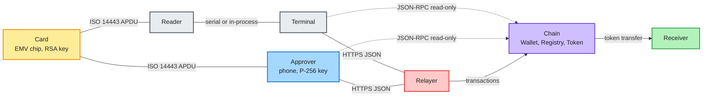

The Card signs any 4-byte challenge without PIN or consent and has no screen or clock. The Approver displays, asks for a biometric, and signs the full `H`; it may also read cards. Terminal and Reader attest the card and have it sign the Payment Intent. The Relayer submits and pays gas. Wallet and Registry enforce every rule.

### 3.2 The three layers

Layers are listed in §1. Layer 1 does not depend on Layer 2. A different account design (for example an ERC-7579 validator module) MAY use Layer 1 alone.

### 3.3 Trust assumptions per role

| Role | Trusted for | Can never |
|---|---|---|
| Payment network CA | Certifying issuer keys | Move funds; sign for the card |
| Issuing bank | Generating and certifying the card key (it MAY have kept a copy) | Move funds alone (§5.13, §10.4) |
| Card | Keeping its key secret; signing exactly what it receives | Show what it signs; bind more than 4 bytes; refuse a reader |
| Approver | Hardware key, per-use biometric, recomputing and displaying `H` faithfully | Move funds alone above the soft tier |
| Terminal / Reader | Showing the amount; data hygiene; honest status | Redirect a payment; complete a normal payment without the Approver |
| Relayer | Liveness and gas | Forge or alter Intents; move or hold funds |
| Wallet contract | Enforcing Layer 2; immutable root of authority | (n/a) |
| Tap2ETH authors | Nothing at run time (no privileged, upgrade, or server key) | Move funds, freeze wallets, change rules |

### 3.4 Core security invariants

A conforming system MUST maintain:

1. **No single factor moves value above the soft tier.** Every payment above `softLimit` needs `t ≥ 2` signatures including at least one Approver signature over the full `H`.
2. **No 4-byte-only authority.** Every approval without an Approver signature uses Strong Card Proofs (`k ≥ K_STRONG`, 96 bits per card).
3. **No harvested-signature reuse.** A wallet never accepts a card signature over a challenge value it already accepted for that card (§5.5).
4. **Recovery is slow and cancellable.** Replacing a signer takes effect only after `recoveryDelay`; any single active Signer can cancel before then.
5. **No card data leaves the reading device except the Card Key and SDADs.** PAN, track data, certificates, and cryptograms are never logged, transmitted, or put on-chain.
6. **Users can always act without the Relayer.** Every wallet function is callable by any account.

---

## 4. Layer 1: card attestation and card signatures

### 4.1 Card profiles

| Profile id | Name | Command | Terminal data the card hashes | Use in Draft 1 |
|---|---|---|---|---|
| `0x01` | **IA-DDA** | INTERNAL AUTHENTICATE (`00 88 00 00`) | Exactly the 4 data bytes | REQUIRED for every conforming party |
| `0x02` | Visa fDDA | Returned with GPO | `9F37 ‖ 9F02 ‖ 5F2A ‖ 9F69` | Registered extension point (§12.3); not used for signers |
| `0x03` | CDA | GENERATE AC with CDA | Includes cryptogram and transaction data | Not used |

IA-DDA applies to cards answering INTERNAL AUTHENTICATE with a format-05 SDAD. The default DDOL (`9F49`) is `9F37 04`, so the card commits to 4 reader-chosen bytes; its own dynamic data is a random number. fDDA-only cards cannot enroll. CDA comes only with a cryptogram, so Readers MUST NOT send GENERATE AC.

### 4.2 Physical and transport layer

- Readers MUST support ISO/IEC 14443-4 (ISO-DEP) Type A, and SHOULD support Type B.
- Readers MUST implement ISO-DEP chaining in both directions, R(NAK) retransmission, and S(WTX), and MUST honour the card's FWT and frame size from the ATS.
- Readers MUST allow at least 1500 ms (including WTX) for the INTERNAL AUTHENTICATE response.
- Readers SHOULD poll at nominal field strength and MAY raise it after the card is selected.
- On a transport error the Reader MUST restart from SELECT PPSE and MUST NOT assume card state survived. It MAY retry with the same Challenges; each retry yields fresh, valid SDADs.

### 4.3 APDU sequence (IA-DDA profile)

A conforming Reader MUST send these commands, in this order, and no others (apart from ISO-DEP control blocks).

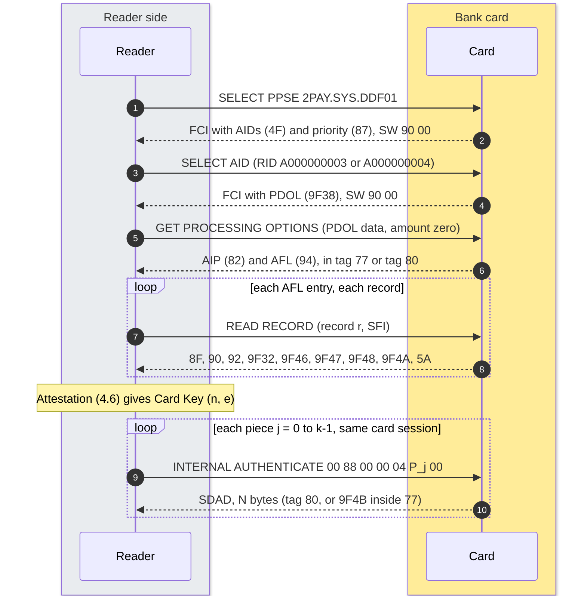

| # | Command | Bytes | Reader action on response |
|---|---|---|---|
| 1 | SELECT PPSE | `00 A4 04 00 0E 32 50 41 59 2E 53 59 53 2E 44 44 46 30 31 00` | SW MUST be `90 00`. |
| 2 | Choose application | (none) | From the FCI, collect every AID (`4F`) whose RID (first 5 bytes) is `A000000003` (Visa) or `A000000004` (Mastercard). If `87` is present choose the lowest priority number, else the first in FCI order. No supported RID → abort `NOT_SUPPORTED`. |
| 3 | SELECT AID | `00 A4 04 00 Lc <AID> 00` | SW MUST be `90 00`. Read PDOL (`9F38`) if present. |
| 4 | GET PROCESSING OPTIONS | `80 A8 00 00 Lc 83 Lp <PDOL data> 00`, or `80 A8 00 00 02 83 00 00` without PDOL | SW MUST be `90 00`. Format 1 (`80`): AIP = value bytes 0–1, AFL = rest. Format 2 (`77`): AIP = `82`, AFL = `94`. |
| 5 | READ RECORD | `00 B2 r ((SFI << 3) \| 4) 00` | For each 4-byte AFL entry `(b0, first, last, odaCount)`, `SFI = b0 >> 3`, records `first..last`. Skip records whose SW is not `90 00`. |
| 6 | Attestation | (none) | §4.6, by the Reader or its host, before any signing. |
| 7 | INTERNAL AUTHENTICATE | `00 88 00 00 04 <P_j> 00` | Once per Piece, order `j = 0 … k−1`, one card session. SW MUST be `90 00`. The data field MUST be exactly the 4 Piece bytes, whatever DDOL the card declares. |
| 8 | SDAD extraction | (none) | Response starting with `80`: SDAD = its value (length one byte or `81 LL`). Otherwise template `77`: SDAD = value of `9F4B`. `len(SDAD)` MUST equal `N`. |

**PDOL values.** Tags not listed are zero-filled. Values are truncated or left-padded with zeros to the requested length; format-n values are right-aligned.

| Tag | Value | Note |
|---|---|---|
| `9F66` TTQ | `27 80 00 00` | |
| `9F02` Amount, authorised | `00 00 00 00 00 00` | Zero. No authorisation is ever sent. |
| `9F03` Amount, other | `00 00 00 00 00 00` | |
| `9F1A` Terminal country | ISO 3166-1 numeric (e.g. `03 56`) | |
| `5F2A` Currency | ISO 4217 numeric (e.g. `03 56`) | |
| `9A` Date | `YY MM DD` BCD | MUST be the real current date |
| `9C` Transaction type | `00` | |
| `9F37` Unpredictable number | 4 CSPRNG bytes | Not the signing challenge |
| `9F35` Terminal type | `22` | |
| `9F33` Terminal capabilities | `E0 F0 C8` | |
| `9F40` Additional capabilities | `60 00 F0 A0 01` | |

If GPO fails with a zero amount on a given card, the Reader MAY use a nominal amount; no cryptogram ever reaches an issuer.

**Forbidden.** Readers MUST NOT send VERIFY (no PIN is ever requested or presented), GENERATE AC, GET DATA for the PIN try counter, or any issuer script. Readers MUST discard any cryptogram (`9F26`) returned during GPO. Readers SHOULD check AIP byte 0 bit `0x20` (DDA supported); if clear, they MAY still try INTERNAL AUTHENTICATE and MUST report `NO_DDA` if it fails.

### 4.4 Tags used

Tags read: `4F` AID, `87` priority, `9F38` PDOL, `82` AIP, `94` AFL, `8F` CAPK index, `90`/`92`/`9F32` issuer certificate, remainder, exponent, `9F46`/`9F48`/`9F47` ICC certificate, remainder, exponent, `9F4A` SDA tag list, `5A` PAN (cross-check only, never leaves the reading process), `5F24` expiry (local warning only), `9F4B` SDAD.

TLV parsing MUST support multi-byte tags (first byte `& 0x1F == 0x1F`, continuing while `& 0x80`), long-form lengths (`81`, `82`), recursion into constructed tags (`& 0x20`), skipping `00` and `FF` padding, and bounds checks on every length. Tag searches use the first depth-first match over the concatenation of all record bodies.

### 4.5 CA public keys

- Each verifier MUST hold a CAPK table keyed by `(RID, index)` with modulus, exponent, and expiry.
- The table MUST contain only **live production** keys. Test and certification keys MUST NOT be trusted. Two keys under one `(RID, index)` make the table malformed; it MUST be corrected, and a verifier MUST NOT resolve the conflict by load order.
- An expired CAPK MUST NOT be used.
- Verifiers SHOULD obtain CAPKs from the networks' published lists and SHOULD verify the published SHA-1 checksums.

### 4.6 Certificate-chain validation algorithm

Input: records from §4.3, AIP, AID, CAPK table. Output: Card Key `(n, e)` or failure. The algorithm **fails closed**: any failed check aborts, with no weaker fallback.

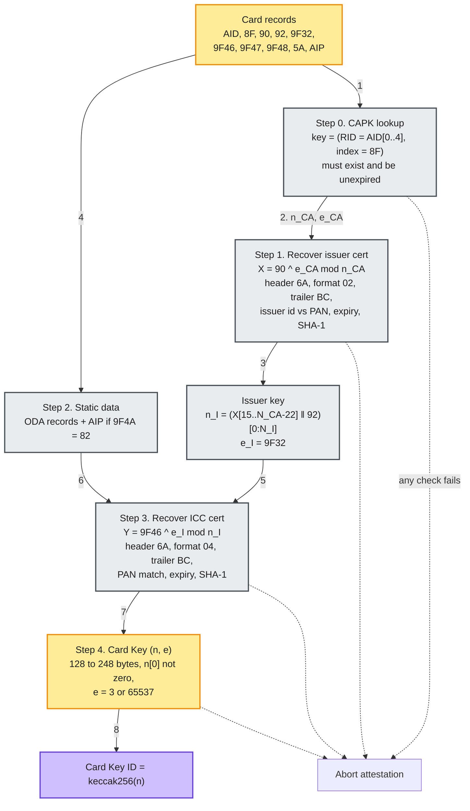

**Step 0: CAPK.** `RID = AID[0..4]`, `idx = 8F`. Look up `(RID, idx)` → `(n_CA, e_CA)`, `N_CA = len(n_CA)`. Fail if missing or expired.

**Step 1: Issuer certificate.** Require `len(90) == N_CA`. `X = (int(90))^e_CA mod n_CA` as exactly `N_CA` bytes.

| Offset | Field | Check |
|---|---|---|
| `X[0]` | Header | MUST be `6A` |
| `X[1]` | Format | MUST be `02` |
| `X[2..5]` | Issuer identifier (leftmost PAN digits, `F`-padded) | MUST match leading digits of `5A` |
| `X[6..7]` | Expiry `MMYY` | MUST NOT be before the current month |
| `X[8..10]` | Serial | (no check) |
| `X[11]` | Hash algorithm | MUST be `01` (SHA-1) |
| `X[12]` | PK algorithm | MUST be `01` (RSA) |
| `X[13]` | `N_I` | MUST satisfy `N_I ≤ N_CA` |
| `X[14]` | Issuer exponent length | MUST equal `len(9F32)` |
| `X[15 .. N_CA−22]` | Leftmost `N_CA − 36` bytes of issuer modulus | |
| `X[N_CA−21 .. N_CA−2]` | SHA-1 | See below |
| `X[N_CA−1]` | Trailer | MUST be `BC` |

If `N_I > N_CA − 36`, `92` MUST be present with `len(92) == N_I − (N_CA − 36)`. Require
`SHA-1( X[1 .. N_CA−22] ‖ 92 (or empty) ‖ 9F32 ) == X[N_CA−21 .. N_CA−2]`.
Issuer key: `n_I = (X[15 .. N_CA−22] ‖ 92)[0 : N_I]`, `e_I = int(9F32)`.

**Step 2: Static data.** For each AFL entry, records `first .. first + odaCount − 1`: if `SFI ≤ 10`, append the value of the record's tag `70` (MUST be present); if `SFI ≥ 11`, append the whole record including tag and length. Then if `9F4A` is present and equals `82`, append the 2-byte AIP. `9F4A` with any other value → fail.

**Step 3: ICC certificate.** Require `len(9F46) == N_I`. `Y = (int(9F46))^e_I mod n_I` as exactly `N_I` bytes.

| Offset | Field | Check |
|---|---|---|
| `Y[0]` | Header | MUST be `6A` |
| `Y[1]` | Format | MUST be `04` |
| `Y[2..11]` | Application PAN (`F`-padded) | MUST equal `5A` (`F`-padded) |
| `Y[12..13]` | Expiry `MMYY` | MUST NOT be before the current month |
| `Y[14..16]` | Serial | (no check) |
| `Y[17]` | Hash algorithm | MUST be `01` |
| `Y[18]` | PK algorithm | MUST be `01` |
| `Y[19]` | `N_IC` | MUST satisfy `N_IC ≤ N_I` |
| `Y[20]` | ICC exponent length | MUST equal `len(9F47)` |
| `Y[21 .. N_I−22]` | Leftmost `N_I − 42` bytes of ICC modulus | |
| `Y[N_I−21 .. N_I−2]` | SHA-1 | See below |
| `Y[N_I−1]` | Trailer | MUST be `BC` |

If `N_IC > N_I − 42`, `9F48` MUST be present with `len(9F48) == N_IC − (N_I − 42)`. Require
`SHA-1( Y[1 .. N_I−22] ‖ 9F48 (or empty) ‖ 9F47 ‖ staticData ) == Y[N_I−21 .. N_I−2]`.

**Step 4: Card Key.** `n = (Y[21 .. N_I−22] ‖ 9F48)[0 : N_IC]`, `e = 9F47` (minimal big-endian). Require `n[0] ≠ 0`, `MIN_MODULUS_BYTES ≤ N_IC ≤ MAX_MODULUS_BYTES`, `e ∈ ALLOWED_EXPONENTS`.

**Where attestation happens.** It reveals the PAN, so it runs only on the reading device. The Approver MUST attest every card it enrolls (creation, adding a card, proposing a replacement). A Terminal SHOULD attest on every tap before signing. Wallet and Relayer never see certificates, so the Wallet proves possession of an EMV-format RSA key and relies on the enrolling Approver for bank origin (ZK attestation: §12.2).

### 4.7 Card Key encoding and Card Key ID

- `cardModulus` = `n`, exactly `N` bytes, most significant byte non-zero.
- `cardExponent` = `0x03` or `0x010001`.
- **Card Key ID** = `keccak256(cardModulus)`.
- Signer key hash (duplicate detection, `SignerAdded`) = `keccak256(abi.encode(cardModulus, cardExponent))`.

### 4.8 Challenge derivation

- Single-piece Challenge `C = H[0..3]` (Solidity `bytes4(H)`).
- On the wire: 8 lowercase hex characters, no prefix. `H = 0x1a2b3c4d…` → `"1a2b3c4d"`.
- The Reader sends `C[0]` as the first data byte of INTERNAL AUTHENTICATE, then `C[1]`, `C[2]`, `C[3]`. These bytes take the place of `9F37` in the card's default DDOL.

### 4.9 Multi-piece Card Proofs

A k-piece proof (`1 ≤ k ≤ K_MAX`) binds `4k` bytes of `H`. Piece `j` (`0 ≤ j < k`):

```
P_j = H[4j .. 4j+3]          (Solidity: bytes4(H << (32 * j)))
```

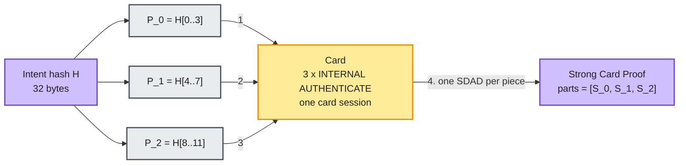

- The card signs each Piece with a separate INTERNAL AUTHENTICATE in one card session, in order `j = 0 … k−1`. The proof is valid iff every `S_j` verifies against `P_j` under the same Card Key (§4.10).
- Test vector: `H = 0x0102030405060708090a0b0c0d0e0f101112131415161718191a1b1c1d1e1f20` → pieces `0x01020304`, `0x05060708`, `0x090a0b0c`.
- A Strong Card Proof uses `k = K_STRONG = 3` (96 bits). A wallet MUST reject a Card Proof without exactly the required number of pieces, and MUST reject a proof in which two pieces have the same value (clients re-issue the Intent with a different expiry).

### 4.10 SDAD verification algorithm (IA-DDA)

Input: Card Key `(n, e)`, `N = len(n)`, Challenge `C` (4 bytes), signature `S`. Output: valid or invalid.

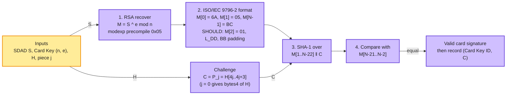

1. Require `len(S) == N` and `MIN_MODULUS_BYTES ≤ N ≤ MAX_MODULUS_BYTES`. Verifiers SHOULD require `int(S) < int(n)`.
2. `M = S^e mod n` as exactly `N` bytes. On the EVM, call modexp at `0x05` (EIP-198) with input
   `abi.encodePacked(uint256(N), uint256(len(e)), uint256(N), S, e, n)`
   (three 32-byte length words for base, exponent, modulus, then `S`, `e`, `n`). The call MUST succeed and return exactly `N` bytes.
3. Recovered block (ISO/IEC 9796-2 scheme 1, EMV Book 2 format `05`):

   ```
   M = 6A | 05 | HashAlg | L_DD | ICC Dynamic Data (L_DD bytes) | BB … BB | SHA-1 (20 bytes) | BC
   ```

   Verifiers MUST check `M[0] == 6A`, `M[1] == 05`, `M[N−1] == BC`. Verifiers SHOULD also check `M[2] == 01`, `L_DD = M[3] ≤ N − 25`, and that every byte of `M[4 + L_DD .. N−22]` is `BB` (these never reject a genuine card signature).
4. `D = SHA-1( M[1 .. N−22] ‖ C )`: `N − 22 + 4` bytes, from the format byte through the padding, then the 4 Challenge bytes.
5. Valid iff `D == M[N−21 .. N−2]`.

There is no SHA-1 precompile; Wallets compute SHA-1 in EVM code (for `N = 128`, 110 bytes, two 64-byte blocks). A verifier MUST NOT accept a format-05 SDAD whose hash covers terminal dynamic data other than exactly the 4 Challenge bytes.

### 4.11 Card Proof encoding in signature containers

Inside a Wallet `Sig` (§5.4) the `data` of a card entry is:

- **k = 1:** the raw SDAD, exactly `N` bytes.
- **k ≥ 2:** `abi.encode(bytes[] parts)`, `parts[j]` = SDAD over `P_j`, each `N` bytes.

`len(data) == N` means a single piece; any other length MUST decode as `bytes[]`. These cannot collide: two or more `N`-byte parts encode to at least 320 bytes, more than `MAX_MODULUS_BYTES`. Approver recovery (§5.13) uses `StrongSig { uint256 id; bytes[] parts; }` with the same `parts`.

### 4.12 Card data hygiene

For every Reader, Terminal, and Approver:

1. MUST NOT leave the reading process, be persisted, be logged, or be sent to a Relayer, the chain, or any network: PAN (`5A`), track-2 equivalent (`57`), cardholder name (`5F20`), expiry (`5F24`), certificates and remainders (`90`, `92`, `9F46`, `9F48`), raw records, AIP/AFL, cryptograms (`9F26`), ATC (`9F36`).
2. Only the Card Key (`cardModulus`, `cardExponent`), SDADs, and the RID (to show the network) may leave the reading process.
3. A device MAY display the last four PAN digits locally.
4. All card data MUST be discarded at the end of the card session; buffers SHOULD be overwritten.
5. No component may request, accept, store, or verify the card PIN. VERIFY MUST NOT be sent.
6. Production Reader diagnostics MUST NOT include raw APDU responses.

### 4.13 Key-size floor

Card Keys with a modulus under 128 bytes MUST be rejected at attestation and at on-chain enrollment (`BadKey`). 1024-bit keys are treated as legacy-grade (§10.3), one reason a card is never the sole signer for value.

---

## 5. Layer 2: account rules

### 5.1 Wallet state

Storage layout is not normative; observable behaviour is.

| Field | Type | Meaning |
|---|---|---|
| `signers[id]` | `(Kind kind, bool active, bytes a, bytes b)` | Card: `a = modulus`, `b = exponent`. Approver: `a = abi.encode(x)`, `b = abi.encode(y)` (32 bytes each, raw affine, no `04` prefix). |
| `signerCount` | `uint256` | Ids issued. Sequential, never reused. |
| `activeCount`, `phoneCount` | `uint256` | Active Signers; active Approvers. |
| `threshold` | `uint256` | `MIN_THRESHOLD ≤ threshold ≤ activeCount`. |
| `perTxLimit`, `dailyLimit` | `uint256` | Settlement Token base units. |
| `spentToday`, `spentDay` | `uint256` | Daily accounting. |
| `softLimit`, `softCardOnly` | `uint256`, `bool` | Soft tier; `softLimit = 0` is off. |
| `nonce` | `uint256` | Shared by payments and every action. |
| `frozen` | `bool` | Blocks payments. |
| `recoveryDelay` | `uint256` | Seconds; fixed at creation. |
| `recovery` | `(oldId, modulus, exponent, readyAt)` | Pending card replacement; `readyAt = 0` means none. |
| `phoneRecovery` | `(x, y, readyAt)` | Pending Approver replacement; `readyAt = 0` means none. |
| `usedChallenge` | set of `(Card Key ID, bytes4)` | Challenge consumption (§5.5). |
| `factory` | `address` | Creating Registry. |

`Kind` is ABI `uint8`: `Card = 0`, `Phone = 1` (Approver).

### 5.2 Signer set

- At most `MAX_SIGNERS = 8` active Signers at the end of every transaction.
- At least one active Approver at all times (`phoneCount ≥ 1`).
- A Signer whose key hash `keccak256(abi.encode(a, b))` matches an active Signer MUST be refused (`DuplicateKey`).
- Card keys MUST satisfy §4.13: `MIN_MODULUS_BYTES ≤ len(a) ≤ MAX_MODULUS_BYTES`, `a[0] ≠ 0`, `b ∈ ALLOWED_EXPONENTS` (`BadKey`).
- Approver keys MUST have `len(a) == len(b) == 32` (`BadKey`); curve validity is checked by every P-256 verification.
- Every card added MUST be linked in the Registry under its Card Key ID, and every card removed MUST be unlinked. A Card Key ID belongs to at most one Wallet per Registry.

### 5.3 Approver signature format

Approvers sign with a **WebAuthn assertion envelope** (`PhoneSig`, §5.16), never raw ECDSA over `H`. `challengeIndex` and `typeIndex` are the byte offsets of `"challenge":"` and `"type":"webauthn.get"` in `clientDataJSON`; `authenticatorData` is `rpIdHash(32) | flags(1) | signCount(4) | …`.

**Producing (Approver).**

1. `authenticatorData`: as returned by a platform passkey; for a native hardware key, `sha256(UTF-8 "tap2eth.app") ‖ 0x05 ‖ 0x00000000` (37 bytes; flags `0x05` = UP + UV; sign count 0). A native Approver MUST set UV only when the key enforces user verification on every use (§5.3.1).
2. `clientDataJSON` for a native key is exactly
   `{"type":"webauthn.get","challenge":"<base64url(H)>","origin":"android:app:tap2eth"}`
   with no whitespace. `base64url(H)` is 43 characters; `typeIndex = 1`, `challengeIndex = 23`.
3. Sign `digest = sha256(authenticatorData ‖ sha256(clientDataJSON))` with ECDSA P-256 ("SHA256withECDSA" over `authenticatorData ‖ sha256(clientDataJSON)` produces exactly this).
4. Convert DER to `(r, s)`, 32 bytes each. **Normalise to low-s:** if `s > n/2`, `s = n − s`, where `n = 0xffffffff00000000ffffffffffffffffbce6faada7179e84f3b9cac2fc632551` and `n/2 = 0x7fffffff800000007fffffffffffffffde737d56d38bcf4279dce5617e3192a8`.

**Verifying (Wallet)**, given `H`, `ps`, and `(x, y)`:

1. `clientDataJSON[challengeIndex ..]` MUST begin with `"challenge":"` ‖ `base64url(H)` ‖ `"`.
2. `clientDataJSON[typeIndex ..]` MUST begin with `"type":"webauthn.get"`.
3. `len(authenticatorData) ≥ 37` and `authenticatorData[32]` MUST have `0x01` (UP) and `0x04` (UV) set.
4. `digest = sha256(authenticatorData ‖ sha256(clientDataJSON))`.
5. Require `0 < r < n`, `0 < s ≤ n/2`, and valid P-256 verification of `(digest, r, s)` under `(x, y)`. The Wallet SHOULD use P256VERIFY at `0x100` (RIP-7212 / EIP-7951): input 160 bytes `digest ‖ r ‖ s ‖ x ‖ y`, output 32-byte `1` on success, empty on failure. Without the precompile the Wallet MUST use EVM code, and MUST NOT treat an empty return as success.

Wallets MUST NOT require a particular `rpIdHash`, `origin`, or sign count. Relying-party binding is provided by the authenticator (a passkey only by its relying party, a native key only by its app).

#### 5.3.1 Approver key requirements

- The private key MUST be generated and held in hardware-backed storage (TEE or secure element); StrongBox or equivalent SHOULD be requested.
- Every signature MUST require a fresh strong biometric. Device-credential fallback SHOULD NOT be offered.
- The key SHOULD NOT be invalidated on biometric enrollment changes (recovery would then depend on cards, §5.13).
- Platform key attestation to the user's other devices MAY be provided; not required.

### 5.4 Approval algorithm

```solidity
struct Sig { uint256 id; bytes data; }   // card: §4.11; approver: abi.encode(PhoneSig)
```

`Approve(H, sigs, required, needApprover)` over `Sig[]` (§5.16; card data per §4.11, Approver data `abi.encode(PhoneSig)`):

1. `len(sigs) < required` → revert `NotEnoughSignatures`.
2. Ids MUST be strictly increasing, else `SignaturesNotSorted` (also rejects duplicates).
3. Each referenced Signer MUST be active, else `UnknownSigner`.
4. Every supplied signature MUST verify (extras beyond `required` are verified too), else `BadSignature`.
   - Card: decode the Card Proof (§4.11) into `k` pieces; verify each against `P_j(H)` (§4.10).
   - Approver: decode `PhoneSig`; verify over full `H` (§5.3).
5. If no Approver signature is present, every Card Proof MUST have `k = K_STRONG`, else `WeakCardProof`.
6. If `needApprover` and no Approver signature is present → `PhoneRequired`.
7. Record every accepted card Piece (§5.5); a repeat reverts `ChallengeReused`.

| Function | `required` | Approver needed | Card-only possible |
|---|---|---|---|
| `pay`, normal | `threshold` | yes | no |
| `pay`, soft tier, `softCardOnly = false` | 1 | yes | no |
| `pay`, soft tier, `softCardOnly = true` | 1 | no | yes, Strong Card Proof |
| `freeze` | 1 | no | yes, Strong Card Proof |
| `unfreeze`, `setLimits`, `setSoftLimit`, `setThreshold`, `addSigner`, `removeSigner` | `threshold` | yes | no |
| `proposeRecovery` (lost card) | 1 | yes | no |
| `cancelRecovery`, `cancelPhoneRecovery` | 1 | no | yes, Strong Card Proof |
| `proposePhoneRecoveryStrong` | ≥ `RECOVERY_CARDS` distinct cards, each Strong | n/a | cards plus the new Approver's proof |

### 5.5 Challenge consumption

Card signatures are public in calldata; without consumption a published SDAD over `C` would be valid for any later Intent whose Piece equals `C` (§10.1, §10.2).

- A Wallet MUST record each accepted `(Card Key ID, Piece)` and MUST revert `ChallengeReused` on a repeat. This applies to every card signature accepted: `initialize`, `Approve`, new-key proofs (`addSigner`, `proposeRecovery`), and Approver recovery.
- Records are never deleted, including on card removal.
- A Registry SHOULD keep the record keyed by Card Key ID across all its Wallets.
- Before asking a card to sign, a Terminal or Approver SHOULD check `challengeUsed(cardKeyId, piece)` for each Piece and on a hit re-issue the Intent with expiry + 1 s.

### 5.6 Intent hash preimages

All Intent Hashes are `keccak256(abi.encode(…))` with standard head/tail encoding, starting with an ABI `string` domain tag. Domain separation comes from the tag, `block.chainid`, the Wallet address, and for actions the action name. `V2` in the tags names the Draft 1 hash format; an incompatible hash format MUST use new tags.

#### 5.6.1 Create Intent

```
H_create = keccak256(abi.encode(
    "TAP2ETH_V2_CREATE",          // string
    block.chainid,                // uint256
    wallet,                       // address: predicted Wallet address (§5.14)
    keccak256(cardModulus),       // bytes32 (= Card Key ID)
    keccak256(cardExponent),      // bytes32
    phoneX,                       // bytes32
    phoneY,                       // bytes32
    perTxLimit,                   // uint256
    dailyLimit,                   // uint256
    recoveryDelay                 // uint256
))
```

Layout: 10 head words; word 0 = string offset `0x140`; words 1–9 the static fields. Tail: length `0x11` (17), then `"TAP2ETH_V2_CREATE"` zero-padded to 32 bytes. Total 384 bytes. A new Wallet has fixed `threshold = 2`, `softLimit = 0`, `softCardOnly = false`, `frozen = false`, `nonce = 0` (not in the preimage).

#### 5.6.2 Payment Intent

```
H_pay = keccak256(abi.encode(
    "TAP2ETH_V2_PAY",             // string
    block.chainid,                // uint256
    wallet,                       // address: address(this)
    token,                        // address
    receiver,                     // address (named `merchant` in code)
    amount,                       // uint256, token base units
    nonce,                        // uint256, current wallet nonce
    expiry                        // uint256, unix seconds
))
```

Layout: 8 head words; word 0 = offset `0x100`; words 1–7 `chainid, wallet, token, receiver, amount, nonce, expiry`. Tail: length `0x0e` (14), `"TAP2ETH_V2_PAY"` padded. Total 320 bytes. Covers merchant payments and sends.

#### 5.6.3 Action Intent

```
H_action = keccak256(abi.encode(
    "TAP2ETH_V2_ACTION",          // string
    action,                       // string, action name
    block.chainid,                // uint256
    wallet,                       // address: address(this)
    params,                       // bytes, action parameters
    nonce,                        // uint256, current wallet nonce
    expiry                        // uint256
))
```

Layout: 7 head words: tag offset (`0xe0`), `action` offset (`0x120`), `chainid`, `wallet`, `params` offset (`0x120 + 32 + 32·⌈len(action)/32⌉`), `nonce`, `expiry`. Tails in order: tag (length 17, padded), `action` (length, padded), `params` (length, padded). The tag precedes the action name; `chainid` follows it.

| Action name | `params` |
|---|---|
| `"freeze"`, `"unfreeze"` | empty bytes |
| `"limits"` | `abi.encode(uint256 perTx, uint256 daily)` |
| `"softLimit"` | `abi.encode(uint256 soft, bool cardOnly)` |
| `"threshold"` | `abi.encode(uint256 m)` |
| `"addSigner"` | `abi.encode(uint8 kind, bytes32 keccak256(a), bytes32 keccak256(b))`; for an Approver `keccak256(a) = keccak256(x)` |
| `"removeSigner"` | `abi.encode(uint256 id)` |
| `"proposeRecovery"` | `abi.encode(uint256 oldId, bytes32 keccak256(newModulus), bytes32 keccak256(newExponent))` |
| `"cancelRecovery"`, `"cancelPhoneRecovery"` | empty bytes |
| `"proposePhoneRecoveryStrong"` | `abi.encode(bytes32 newX, bytes32 newY)` |

`"proposePhoneRecovery"` (single-piece Approver recovery) is reserved and MUST NOT be accepted (§5.13).

### 5.7 Nonce and expiry

- One sequential `nonce` covers payments and all actions. Every successful state-changing call increments it exactly once, including permissionless `executeRecovery` and `executePhoneRecovery`. Any accepted transaction therefore invalidates every other outstanding Intent; clients MUST be prepared to re-issue.
- `pay` and actions compute `H` with the **current storage** nonce.
- Every entry point taking an expiry MUST check it first: `block.timestamp > expiry` → `Expired` (valid when equal).
- Approvers and Terminals MUST NOT sign Intents with `expiry > now + MAX_SIGN_AHEAD`.
- `Paid` and `Frozen` carry the consumed nonce.

### 5.8 Payments and limits

`pay(token, receiver, amount, expiry, sigs)` MUST, in order:

1. Expiry (`Expired`).
2. Frozen (`IsFrozen`).
3. `H_pay` with current nonce; `soft = softLimit > 0 && amount ≤ softLimit`; `Approve(H, sigs, soft ? 1 : threshold, !(soft && softCardOnly))`.
4. Day roll: `today = floor(block.timestamp / 86400)`; if `today ≠ spentDay`, `spentDay = today`, `spentToday = 0`.
5. `amount > perTxLimit` or `spentToday + amount > dailyLimit` → `OverLimit`.
6. `spentToday += amount`; `nonce += 1`.
7. Safe ERC-20 transfer of `amount` to `receiver`.
8. Emit `Paid(token, receiver, amount, usedNonce)`.

`pay` is permissionless. One daily counter covers all tokens, so a deployment MUST use a single Settlement Token (or tokens of identical decimals and value), and Approvers MUST display amounts in its units. Buckets are fixed UTC days. Soft-tier payments count toward the daily limit.

### 5.9 Soft tier (optional)

- `setSoftLimit(soft, cardOnly, expiry, sigs)`: normal approval; MUST revert `OverLimit` if `soft > perTxLimit` (before approval). `soft = 0` turns it off. Off by default.
- `setLimits` MUST clamp `softLimit` down to the new `perTxLimit`.
- Approvers MUST warn, before signing `"softLimit"` with `cardOnly = true`, that anyone who can tap the card can spend up to the soft limit per payment and the daily limit per day. Approvers SHOULD recommend a soft limit well below the local no-PIN contactless limit.

### 5.10 Freeze and unfreeze

- `freeze(expiry, sigs)`: `Approve(H_action("freeze", ""), sigs, 1, false)`. Any single Signer (Approver or Strong Card Proof). Never moves funds.
- `unfreeze(expiry, sigs)`: `Approve(H_action("unfreeze", ""), sigs, threshold, true)`.
- Both increment the nonce and emit `Frozen(bool, usedNonce)`; neither checks current state.
- `frozen` blocks `pay` only; management, limits, and recovery remain available.

### 5.11 Signer and threshold management

- `setThreshold(m, expiry, sigs)`: MUST revert `BadThreshold` unless `MIN_THRESHOLD ≤ m ≤ activeCount` (before approval). Approval uses the old threshold.
- `setLimits(perTx, daily, expiry, sigs)`: normal approval; immediate; clamps `softLimit`.
- `addSigner(kind, a, b, expiry, sigs, proof)`:
  1. Expiry; `activeCount < MAX_SIGNERS` (`TooManySigners`).
  2. `H = H_action("addSigner", abi.encode(kind, keccak256(a), keccak256(b)))`; normal approval.
  3. **Proof of possession by the new key** over the same `H`: a card signs `bytes4(H)` (single piece suffices, an Approver is present); an Approver signs `H` (`proof = abi.encode(PhoneSig)`).
  4. `nonce += 1`; add Signer; for a card, `Registry.link(keccak256(a))` (reverts if linked elsewhere).
  5. Emit `SignerAdded(id, kind, keccak256(abi.encode(a, b)))`.
- `removeSigner(id, expiry, sigs)`: Signer MUST be active; normal approval; then `BelowThreshold` if `activeCount − 1 < threshold`, `LastPhone` if last Approver. A card is unlinked. Emit `SignerRemoved(id)`.

Invariants after every transaction: `phoneCount ≥ 1`; `MIN_THRESHOLD ≤ threshold ≤ activeCount`; `activeCount ≤ MAX_SIGNERS`.

### 5.12 Card replacement (lost, stolen, or reissued card)

- `proposeRecovery(oldId, newModulus, newExponent, expiry, sigs, newCardSig)` checks in order: expiry; none pending (`RecoveryPending`); `oldId` active (`UnknownSigner`) and a card (`NotCard`); new key not a Signer (`DuplicateKey`); new key valid (`BadKey`); `Approve(H, sigs, 1, true)` over `H = H_action("proposeRecovery", abi.encode(oldId, keccak256(newModulus), keccak256(newExponent)))`; new card's proof over `bytes4(H)`. Then `nonce += 1`, store with `readyAt = block.timestamp + recoveryDelay`, emit `RecoveryProposed(oldId, readyAt)`.
- The new card MUST have passed attestation on the proposing Approver (§4.6).
- `executeRecovery()`: anyone, once `block.timestamp ≥ readyAt`. Clears pending, increments nonce, removes and unlinks the old card, adds and links the new card, emits `RecoveryExecuted(oldId, newId)`. If the old card was removed or the new card linked elsewhere meanwhile, it reverts; only cancellation clears it.
- `cancelRecovery(expiry, sigs)`: any single Signer (`required = 1`; a card uses a Strong Card Proof). Emits `RecoveryCancelled()`.
- Card replacement bypasses the threshold by design; the delay and cancellation by any other Signer are the defence.

### 5.13 Approver recovery (lost or wiped phone)

Replaces every Approver using cards only; each card MUST provide a Strong Card Proof.

- `proposePhoneRecoveryStrong(newX, newY, expiry, StrongSig[] cardSigs, newPhoneProof)`:
  1. Expiry; none pending (`RecoveryPending`); new key not a Signer (`DuplicateKey`).
  2. `H = H_action("proposePhoneRecoveryStrong", abi.encode(newX, newY))` (= `strongRecoveryHash(newX, newY, expiry)`).
  3. `len(cardSigs) ≥ RECOVERY_CARDS` (`NotEnoughCards`); ids strictly increasing (`SignaturesNotSorted`); each active (`UnknownSigner`) and a card (`NotCard`); each `parts` has exactly `K_STRONG` entries (`WrongPartCount`); each part `j` verifies against `P_j(H)` (`BadSignature`); every Piece recorded (§5.5).
  4. `newPhoneProof = abi.encode(PhoneSig)` MUST verify over full `H`.
  5. `nonce += 1`; store `(newX, newY, readyAt = block.timestamp + recoveryDelay)`; emit `PhoneRecoveryProposed(keccak256(abi.encode(newX, newY)), readyAt)`.
- `proposePhoneRecovery` (single-piece) MUST revert `UseStrongRecovery`.
- `executePhoneRecovery()`: anyone, once ready. Clears pending, increments nonce, adds the new Approver, removes every previously active Approver, clamps `threshold` to `activeCount`, emits `SignerAdded(newId, Phone, keccak256(abi.encode(abi.encode(x), abi.encode(y))))` then `PhoneRecoveryExecuted(newId)`.
- `cancelPhoneRecovery(expiry, sigs)`: any single Signer (old Approver, or card with Strong Card Proof). Emits `PhoneRecoveryCancelled()`.
- A Wallet with fewer than two cards cannot do Approver recovery; Approvers SHOULD urge enrolling a second card.
- Card replacement and Approver recovery use independent slots and may be pending together.

The `keyHash` in `PhoneRecoveryProposed` is `keccak256(x ‖ y)` (64 bytes); `SignerAdded.keyHash` is `keccak256(abi.encode(abi.encode(x), abi.encode(y)))`. Indexers MUST NOT compare them directly.

### 5.14 Wallet creation, Registry, and deterministic address

**Registry.** Deploys Wallets as EIP-1167 clones with CREATE2 and maps Card Key IDs to Wallets. In the single-contract pattern the master is both Registry and implementation; Registry functions MUST only work on the master (`"registry only on the master"`), and the master MUST NOT be usable as a Wallet (constructor marks it initialised; no Signers).

**Deterministic address**, with `salt = keccak256(cardModulus)` of the first card:

```
initCode = 0x3d602d80600a3d3981f3363d3d373d3d3d363d73 ‖ implementation (20 bytes) ‖ 0x5af43d82803e903d91602b57fd5bf3
wallet   = keccak256(0xff ‖ registry ‖ salt ‖ keccak256(initCode))[12:32]
```

In the single-contract pattern `implementation = registry = master`. The address is fixed for the Wallet's life, even if the first card is replaced; later lookups use `walletOf(cardKeyId)`.

**Creation.** `createWallet(InitParams p, bytes cardSig, PhoneSig phoneSig)`:

1. Require `walletOf[keccak256(p.cardModulus)] == 0` (`"card already registered"`).
2. Clone; set `isWallet[wallet] = true`, `walletOf[key] = wallet`.
3. `wallet.initialize(p, cardSig, phoneSig)`: runs once (`AlreadyInitialized`); sets `factory = msg.sender`; computes `H_create` with `wallet = address(this)`; verifies the card's single-piece proof over `bytes4(H_create)` and the Approver's `PhoneSig` over `H_create` (**proof of possession of both keys**); records the Piece; adds card as id 0 and Approver as id 1; sets `threshold = 2`, limits, `recoveryDelay`.
4. Emit `WalletCreated(cardKeyHash, wallet)`.

`createWallet` is permissionless; front-running with the same signatures yields the same Wallet.

**Links.** `link(cardKeyHash)` requires a Registry Wallet caller and an unlinked card (`"not a wallet"`, `"card already registered"`). `unlink(cardKeyHash)` requires the owning Wallet (`"not the wallet"`).

### 5.15 ERC-1271 (optional)

A Wallet MAY implement `isValidSignature(bytes32 hash, bytes signature)`. If so it MUST treat `signature` as `abi.encode(Sig[])`, MUST compute `H = H_action("erc1271", abi.encode(hash))` with the current nonce and an expiry carried as `abi.encode(Sig[], uint256 expiry)`, MUST require a normal approval, and MUST NOT accept card-only signatures.

### 5.16 Solidity interface

Normative external ABI. On-chain names keep `phone` (Approver) and `merchant` (Receiver).

```solidity
// SPDX-License-Identifier: CC0-1.0
pragma solidity ^0.8.24;

/// @notice Wallet creation parameters, hashed identically by Registry and Wallet.
struct InitParams {
    bytes   cardModulus;   // first card: RSA modulus, exactly N bytes
    bytes   cardExponent;  // first card: 0x03 or 0x010001
    bytes32 phoneX;        // first Approver: P-256 affine x
    bytes32 phoneY;        // first Approver: P-256 affine y
    uint256 perTxLimit;    // Settlement Token base units
    uint256 dailyLimit;    // Settlement Token base units
    uint256 recoveryDelay; // seconds
}

/// @notice Approver (WebAuthn-format) assertion.
struct PhoneSig {
    bytes   authenticatorData;
    string  clientDataJSON;
    uint256 challengeIndex;
    uint256 typeIndex;
    bytes32 r;
    bytes32 s;
}

interface ITap2EthWallet {
    enum Kind { Card, Phone } // ABI: uint8, Card = 0, Phone (Approver) = 1

    /// card: data = SDAD (k = 1) or abi.encode(bytes[] parts) (k >= 2); approver: data = abi.encode(PhoneSig)
    struct Sig { uint256 id; bytes data; }
    /// one card's multi-piece proof: parts[j] signs piece j of the hash
    struct StrongSig { uint256 id; bytes[] parts; }

    // ---- events
    event Paid(address indexed token, address indexed merchant, uint256 amount, uint256 nonce);
    event Frozen(bool frozen, uint256 nonce);
    event LimitsChanged(uint256 perTxLimit, uint256 dailyLimit);
    event SoftLimitChanged(uint256 softLimit, bool cardOnly);
    event ThresholdChanged(uint256 threshold);
    event SignerAdded(uint256 indexed id, Kind kind, bytes32 keyHash);
    event SignerRemoved(uint256 indexed id);
    event RecoveryProposed(uint256 indexed oldId, uint256 readyAt);
    event RecoveryCancelled();
    event RecoveryExecuted(uint256 indexed oldId, uint256 indexed newId);
    event PhoneRecoveryProposed(bytes32 keyHash, uint256 readyAt);
    event PhoneRecoveryCancelled();
    event PhoneRecoveryExecuted(uint256 indexed newId);

    // ---- errors
    error Expired();            error IsFrozen();          error OverLimit();
    error BadSignature();       error NotEnoughSignatures(); error SignaturesNotSorted();
    error UnknownSigner();      error PhoneRequired();     error BadKey();
    error DuplicateKey();       error TooManySigners();    error BelowThreshold();
    error LastPhone();          error BadThreshold();      error NoRecovery();
    error RecoveryPending();    error RecoveryNotReady();  error AlreadyInitialized();
    error NotCard();            error NotEnoughCards();    error UseStrongRecovery();
    error WrongPartCount();     error WeakCardProof();     error ChallengeReused();

    // ---- constants and state
    function MAX_SIGNERS() external view returns (uint256);      // 8
    function RECOVERY_CARDS() external view returns (uint256);   // 2
    function RECOVERY_PARTS() external view returns (uint256);   // K_STRONG = 3
    function factory() external view returns (address);
    function signerCount() external view returns (uint256);
    function activeCount() external view returns (uint256);
    function phoneCount() external view returns (uint256);
    function threshold() external view returns (uint256);
    function softLimit() external view returns (uint256);
    function softCardOnly() external view returns (bool);
    function perTxLimit() external view returns (uint256);
    function dailyLimit() external view returns (uint256);
    function spentToday() external view returns (uint256);
    function spentDay() external view returns (uint256);
    function nonce() external view returns (uint256);
    function frozen() external view returns (bool);
    function recoveryDelay() external view returns (uint256);
    function recovery() external view
        returns (uint256 oldId, bytes memory modulus, bytes memory exponent, uint256 readyAt);
    function phoneRecovery() external view returns (bytes32 x, bytes32 y, uint256 readyAt);
    function getSigner(uint256 id) external view
        returns (Kind kind, bool active, bytes memory a, bytes memory b);
    function challengeUsed(bytes32 cardKeyId, bytes4 piece) external view returns (bool);

    // ---- hashes
    function paymentHash(address token, address merchant, uint256 amount, uint256 nonce_, uint256 expiry)
        external view returns (bytes32);
    function actionHash(string calldata action, bytes calldata params, uint256 expiry)
        external view returns (bytes32);                         // uses the current nonce
    function strongRecoveryHash(bytes32 newX, bytes32 newY, uint256 expiry) external view returns (bytes32);
    function recoveryParts(bytes32 h) external pure returns (bytes4[3] memory);

    // ---- lifecycle
    function initialize(InitParams calldata p, bytes calldata cardSig, PhoneSig calldata phoneSig) external;

    // ---- payments
    function pay(address token, address merchant, uint256 amount, uint256 expiry, Sig[] calldata sigs) external;

    // ---- management
    function freeze(uint256 expiry, Sig[] calldata sigs) external;
    function unfreeze(uint256 expiry, Sig[] calldata sigs) external;
    function setLimits(uint256 perTx, uint256 daily, uint256 expiry, Sig[] calldata sigs) external;
    function setSoftLimit(uint256 soft, bool cardOnly, uint256 expiry, Sig[] calldata sigs) external;
    function setThreshold(uint256 m, uint256 expiry, Sig[] calldata sigs) external;
    function addSigner(Kind kind, bytes calldata a, bytes calldata b, uint256 expiry,
                       Sig[] calldata sigs, bytes calldata proof) external;
    function removeSigner(uint256 id, uint256 expiry, Sig[] calldata sigs) external;

    // ---- card replacement
    function proposeRecovery(uint256 oldId, bytes calldata newModulus, bytes calldata newExponent,
                             uint256 expiry, Sig[] calldata sigs, bytes calldata newCardSig) external;
    function executeRecovery() external;
    function cancelRecovery(uint256 expiry, Sig[] calldata sigs) external;

    // ---- approver recovery
    function proposePhoneRecovery(bytes32, bytes32, uint256, Sig[] calldata, bytes calldata) external; // MUST revert UseStrongRecovery
    function proposePhoneRecoveryStrong(bytes32 newX, bytes32 newY, uint256 expiry,
                                        StrongSig[] calldata cardSigs, bytes calldata newPhoneProof) external;
    function executePhoneRecovery() external;
    function cancelPhoneRecovery(uint256 expiry, Sig[] calldata sigs) external;
}

interface ITap2EthRegistry {
    event WalletCreated(bytes32 indexed cardKeyHash, address wallet);

    function walletOf(bytes32 cardKeyHash) external view returns (address);
    function isWallet(address wallet) external view returns (bool);
    function predict(bytes32 cardKeyHash) external view returns (address);
    function createHash(InitParams calldata p) external view returns (bytes32);
    function createWallet(InitParams calldata p, bytes calldata cardSig, PhoneSig calldata phoneSig)
        external returns (address wallet);
    function link(bytes32 cardKeyHash) external;   // only Registry wallets
    function unlink(bytes32 cardKeyHash) external; // only the owning wallet
}
```

Registry reverts are the strings `"card already registered"`, `"not a wallet"`, `"not the wallet"`, `"registry only on the master"`.

---

## 6. Layer 3: sessions and messages

### 6.1 Transports

| Link | Binding | Rules |
|---|---|---|
| Terminal ↔ Relayer, Approver ↔ Relayer | HTTPS + JSON (§6.4) | Cleartext HTTP MUST NOT be used outside a local development network. Clients SHOULD pin or otherwise authenticate the Relayer's TLS identity. |
| Terminal → Chain, Approver → Chain | Read-only JSON-RPC | Each MUST check `eth_chainId` against Chain Info and MUST recompute Intent Hashes from chain state rather than trust the Relayer. |
| Reader ↔ Terminal host | Serial line (§6.7) or in-process driver with equivalent semantics | |
| Approver notification | Polling the Wallet View (§6.5); push MAY be added | A push message MUST carry only a Session id; the Approver MUST fetch and verify the Session before showing it. |

### 6.2 Payment-session state machine

One Session per Payment Intent (merchant payment or send).

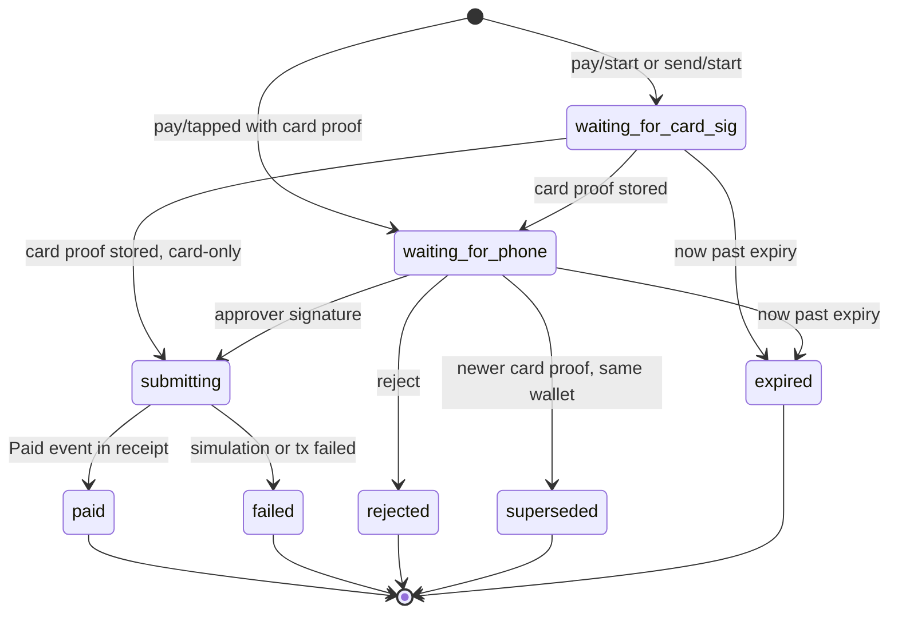

1. Status strings are exactly `waiting_for_card_sig`, `waiting_for_phone`, `submitting`, `paid`, `failed`, `rejected`, `superseded`, `expired`. The last five are final and never change.
2. Session ids MUST be unguessable (≥ 122 random bits, e.g. UUIDv4). An id is a capability to read and reject the Session.
3. **Supersede.** When a card proof is stored for a Session of Wallet `W`, every other Session of `W` in `waiting_for_phone` MUST move to `superseded` (all share one nonce).
4. **Card-only.** A merchant payment (never a send) within the soft tier with `softCardOnly` true. Its card proof MUST be a Strong Card Proof; the Relayer submits immediately without an Approver.
5. **Expiry.** The Relayer MUST move a non-final Session to `expired` when `now > expiry` (`now = max(latest block timestamp, wall clock)`) and MUST NOT submit it afterwards.
6. **Decline.** An Approver decline moves `waiting_for_phone` to `rejected`; rejecting in other states has no effect. A Terminal that cancels a bill MUST reject its Session.
7. **Atomic submission.** Entry into `submitting` MUST be atomic: of two concurrent Approver signatures exactly one proceeds; the other gets HTTP 409.
8. A Relayer MUST garbage-collect final Sessions after a retention period and MUST NOT retain card proofs after a Session is final, except within the on-chain transaction.

### 6.3 Display requirements (anti-blind-signing)

**The Approver MUST, before requesting the biometric:**

1. Recompute `H` from the fields it displays and chain context (chainId, Wallet, token, nonce from chain, Registry and implementation for creation), and refuse if it differs from the Relayer's `hash`.
2. Verify each card Challenge it requests equals the matching Piece of the recomputed `H`.
3. For a **payment or send**, display: amount in Settlement Token units with symbol; Receiver name (if known) **and** address (at least first 6 and last 4 hex characters, full address one tap away); network name and chain id; expiry countdown. A first-time Receiver SHOULD be flagged.
4. For an **action**, display the action in plain words and every new value (limits, soft limit and card-only flag, threshold, Signer added or removed, replacement delay).
5. For **wallet creation**, display network, per-transaction limit, daily limit, recovery delay, predicted Wallet address. It SHOULD refuse a delay below `MIN_RECOVERY_DELAY`.
6. Refuse if expiry has passed or exceeds `now + MAX_SIGN_AHEAD`; disable the approve control at expiry.
7. Use a biometric prompt summarising the same amount and Receiver.

**The Terminal MUST:**

1. Display amount and merchant name before the tap.
2. Compute `H_pay` from chain state (Wallet from `walletOf`, current nonce, configured token and Receiver, amount, own expiry), or recompute and compare a Relayer-computed one before sending any Challenge to the card.
3. Display "Approve on your phone" while waiting, and "Paid" only after confirming through its own RPC a receipt for `txHash` containing `Paid(token, receiver, amount, nonce)` from the Wallet with the expected values; otherwise "Declined" with the reason.
4. Treat `superseded`, `expired`, `rejected`, `failed` as final and stop polling.
5. Protect its merchant control interface (start and cancel charges) with authentication or restrict it to the local device.

### 6.4 HTTP relayer binding: common rules

- UTF-8 JSON, `Content-Type: application/json`, request body ≤ 64 KiB.
- Byte strings are `0x`-prefixed hex; Relayers MUST emit lowercase and SHOULD accept either case and unprefixed `cardModulus`, `cardExponent`, and card signatures. Challenges are 8 hex characters without prefix.
- Display amounts are decimal token units (`"12.50"`); amounts inside `intent` are decimal base units (`"12500000"`); large integers (nonce, limits) are decimal strings.
- Errors: `{"error": "<message>", "code": "<code>"}` with 400 (bad request or revert; `code` is the revert name, e.g. `Expired`, `IsFrozen`, `OverLimit`, `BadSignature`, `PhoneRequired`, `ChallengeReused`), 404 (unknown wallet, card, Session), 409 (stale nonce, wrong state, conflict), 429 (rate limited), 503 (gas budget or gas-price cap).
- No endpoint authentication; authority is in signatures. Relayers MUST rate-limit every write endpoint per client and per Wallet (§7.1).
- Every response asking a party to sign MUST contain enough fields to recompute `H` (§6.3).
- Relayers MAY accept aliases `"soft"` for `"softLimit"` and `"addCard"` for `"addSigner"` with `kind = 0`.

### 6.5 Message schemas

The field lists below are normative (JSON Schema draft 2020-12 semantics). "Req" fields are required; "Opt" fields are optional. `A + B` means all fields of both.

**Primitive types**

| Type | Encoding |
|---|---|
| `Hex` | `^0x([0-9a-fA-F]{2})*$` |
| `Bytes32` | `^0x[0-9a-fA-F]{64}$` |
| `Address` | `^0x[0-9a-fA-F]{40}$` |
| `UintStr` | `^[0-9]+$` |
| `DecAmount` | `^[0-9]+(\.[0-9]+)?$` |
| `UnixTime` | integer ≥ 0 |
| `Challenge` | `^[0-9a-f]{8}$` |
| `Challenges` | array of 1–8 `Challenge` |
| `CardSig` | `Hex` (k = 1, one SDAD) or array of 2–8 `Hex` (SDADs in piece order) |

**Shared objects**

| Object | Req | Opt |
|---|---|---|
| `CardEntry` | `cardModulus` Hex, `cardSig` CardSig | |
| `PhoneSig` | `authenticatorData` Hex, `clientDataJSON` string, `challengeIndex` int ≥ 0, `typeIndex` int ≥ 0, `r` Bytes32, `s` Bytes32 | |
| `PaymentIntent` | `chainId` int, `wallet`, `token`, `receiver` Address, `amount` UintStr, `nonce` UintStr, `expiry` UnixTime | |
| `ActionIntent` | `chainId` int, `wallet` Address, `action` string, `params` Hex (ABI, §5.6.3), `nonce` UintStr, `expiry` UnixTime | `decoded` object (for display) |
| `SigningRequest` | `id` string, `hash` Bytes32, `challenges` Challenges | `challenge` (= `challenges[0]`) |
| `Error` | `error` string | `code` string |
| `ChainInfo` | `v` (const 1), `chainId` int, `registry`, `implementation`, `token` Address, `decimals` int, `symbol`, `network` string, `ttl` int | `receiver` Address (bound to the requesting Terminal), `receiverName`, `explorer` |
| `Session` | `id`, `kind` (`payment` or `send`), `status` (8 values of §6.2), `wallet`, `intent` PaymentIntent, `hash`, `amount` DecAmount, `symbol`, `decimals`, `cardOnly` bool | `receiverName`, `txHash` Bytes32, `gasUsed` UintStr, `error` |
| `TxRes` | `status` (`done`, `frozen`, `active`, `waiting`, `cancelled`), `txHash` | `readyAt`, `now` UnixTime |

**Requests and responses**

| Message | Fields |
|---|---|
| `SignupStartReq` | Req: `phoneX`, `phoneY` Bytes32, `cardModulus`, `cardExponent` Hex |
| `SignupStartRes` | One of: `SigningRequest` + Req `wallet`, `chainId`, `params {perTxLimit, dailyLimit, recoveryDelay}` (UintStr, all req) — or `{existing: true, wallet}` |
| `SignupFinishReq` | Req: `cardSig` Hex, `phoneSig` PhoneSig |
| `SignupFinishRes` | Req: `wallet`, `txHash` |
| `PayStartReq` | Req: `cardModulus`, `amount` DecAmount |
| `SendStartReq` | Req: `cardModulus`, `amount` DecAmount, `to` Address |
| `PayStartRes` | `SigningRequest` + Req `wallet`, `cardId` int, `cardOnly` bool, `intent` PaymentIntent |
| `PayTappedReq` | Req: `cardModulus`, `cardId` int ≥ 0, `intent` PaymentIntent, `hash`, `cardSig` CardSig |
| `CardSigReq` | Req: `cardSig` CardSig |
| `PhoneSigReq` | Req: `phoneSig` PhoneSig |
| `WalletReq` | Req: `wallet` |
| `ActionStartReq` | Req: `wallet`, `action` (`limits`, `softLimit`, `threshold`, `addSigner`, `removeSigner`, `proposeRecovery`), `params` object: limits `{perTx, daily}`; softLimit `{amount, cardOnly}`; threshold `{m}`; addSigner `{kind: card or approver, cardModulus, cardExponent` or `phoneX, phoneY, name?}`; removeSigner `{id}`; proposeRecovery `{oldId, cardModulus, cardExponent}` |
| `ActionStartRes` | `SigningRequest` + Req `intent` ActionIntent |
| `ActionFinishReq` | Opt: `cards` CardEntry[], `phoneSig`, `newKeyProof` (Hex or PhoneSig: the new key's proof over the same hash, for addSigner and proposeRecovery) |
| `RecoverStartReq` | Req: `cardModulus`, `phoneX`, `phoneY` |
| `RecoverStartRes` | One of: `SigningRequest` + Req `wallet`, `intent` ActionIntent, `delay` int — or `{existing: true, wallet}` — or `{pending: true, wallet, readyAt, now}` |
| `RecoverSubmitReq` | Req: `cards` (≥ 2 items, each `{cardModulus, parts}` with exactly 3 Hex parts), `phoneSig` |
| `RecoverFinishReq` | Req: `wallet`, `kind` (`approver` or `card`) |
| `RecoverStatusRes` | Req: `pending` bool, `readyAt`, `now`, `active` bool, `mine` bool |
| `CancelStartReq` | Req: `wallet`, `kind` (`approver` or `card`) |
| `SingleSignerReq` | Exactly one of `phoneSig` or `card` (CardEntry with a strong proof). Used by freeze and cancels. |
| `WalletView` | Req: `wallet`, `chainId`, `network`, `token`, `symbol`, `decimals`, `balance`, `perTxLimit`, `dailyLimit`, `spentToday` (DecAmount), `frozen`, `softLimit` (DecAmount), `softCardOnly`, `threshold` int, `nonce` UintStr, `signers` (items: req `id`, `kind` card or approver, `active`; opt `name` ≤ 24 chars), `recovery {pending, oldId, readyAt}`, `phoneRecovery {pending, readyAt}`, `pending` (Session[]: unexpired merchant-payment Sessions in `waiting_for_phone`), `stale` bool, `updatedAt`. Opt: `history` array |

### 6.6 Endpoints

| Endpoint | Request → Response | Notes |
|---|---|---|
| `GET /api/terminal/config` | → `ChainInfo` | Terminal identifies itself (client certificate or API key) to get its bound `receiver`. |
| `POST /api/signup/start` | `SignupStartReq` → `SignupStartRes` | `existing` only if this Approver is already a Signer of the card's Wallet; 409 if linked to a Wallet without it. |
| `POST /api/signup/{id}` | `SignupFinishReq` → `SignupFinishRes` | Single use; submits `createWallet`. |
| `POST /api/pay/start` | `PayStartReq` → `PayStartRes` | Relayer-computed intent; Terminal recomputes before tapping. |
| `POST /api/pay/tapped` | `PayTappedReq` → `Session` | Relayer recomputes `H` with its token, the Terminal's bound Receiver, current nonce: mismatch 400; stale nonce 409; expiry outside `(now, now + MAX_SIGN_AHEAD]` 400. |
| `POST /api/send/start` | `SendStartReq` → `PayStartRes` | `to` MUST NOT be zero, the token, or the Wallet. Never card-only. |
| `POST /api/pay/{id}/card` | `CardSigReq` → `Session` | Only in `waiting_for_card_sig`, else 409. Triggers supersede. |
| `POST /api/pay/{id}/phone` | `PhoneSigReq` → `Session` | Only in `waiting_for_phone`, else 409. |
| `POST /api/pay/{id}/reject` | `{}` → `Session` | Idempotent. |
| `GET /api/pay/{id}` | → `Session` | Status. |
| `POST /api/action/start` | `ActionStartReq` → `ActionStartRes` | |
| `POST /api/action/{id}` | `ActionFinishReq` → `TxRes` (`done`) | Relayer sorts signatures by signer id. |
| `POST /api/freeze/start` | `WalletReq` + opt `kind` → `SigningRequest` + `intent` | `kind = "card"` returns `K_STRONG` challenges. |
| `POST /api/freeze/{id}` | `SingleSignerReq` → `TxRes` (`frozen`) | |
| `POST /api/unfreeze/start` | `WalletReq` → `ActionStartRes` | |
| `POST /api/unfreeze/{id}` | `ActionFinishReq` → `TxRes` (`active`) | |
| `POST /api/recover/start` | `RecoverStartReq` → `RecoverStartRes` | `K_STRONG` challenges. 400 if fewer than 2 cards; 409 if another replacement pending. |
| `POST /api/recover/{id}` | `RecoverSubmitReq` → `TxRes` (`waiting`) | Submits `proposePhoneRecoveryStrong`. Card ids MUST be distinct. |
| `POST /api/recover/finish` | `RecoverFinishReq` → `TxRes` (`done`) | `executePhoneRecovery` or `executeRecovery`. |
| `GET /api/recover/status/{wallet}?x=&y=` | → `RecoverStatusRes` | |
| `POST /api/recovery-cancel/start` | `CancelStartReq` → `SigningRequest` + `intent` | `kind` names the replacement (`approver` → `cancelPhoneRecovery`, `card` → `cancelRecovery`). Always returns `K_STRONG` challenges, since a card canceller MUST present `K_STRONG` pieces. |
| `POST /api/recovery-cancel/{id}` | `SingleSignerReq` → `TxRes` (`cancelled`) | |
| `GET /api/wallet/{address}` | → `WalletView` | `?fresh=1` bypasses caches. |

### 6.7 Reader ↔ Terminal serial binding

Applies when the Reader is a separate device. Lines are ASCII, ≤ 2048 bytes, terminated by `\n` (a preceding `\r` is ignored). Hex is either case, no prefix. The Reader runs the APDU sequence (§4.3) and attestation (§4.6) itself; the link carries no card data other than the Card Key and SDADs.

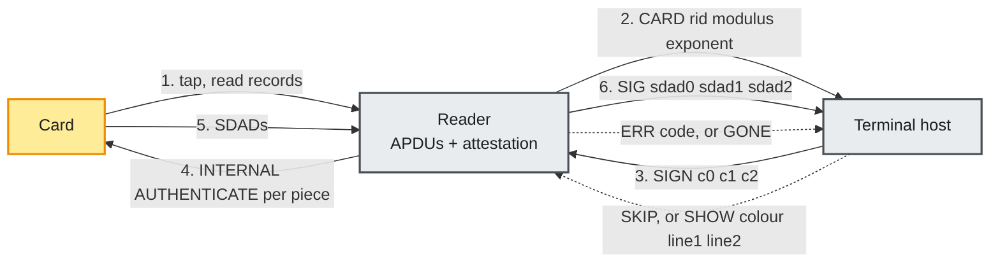

| Direction | Line | Meaning |
|---|---|---|
| Host → Reader | `SIGN <c0>[ <c1> … <c(k−1)>]` | Sign Pieces in order (8 hex chars each, `1 ≤ k ≤ 8`) in the current card session. Valid only after `CARD`. |
| Host → Reader | `SKIP` | End the card session without signing. |
| Host → Reader | `SHOW <G\|R\|Y\|B\|W>\|<line1>\|<line2>` | Optional display: colour, two lines of ≤ 26 printable ASCII characters. |
| Reader → Host | `CARD <rid> <modulus> <exponent>` | Card read and attested. `rid` is 10 hex chars. |
| Reader → Host | `SIG <sdad0>[ <sdad1> …]` | One SDAD per Piece, same order, `2N` hex chars each. |
| Reader → Host | `ERR <code>[ <text>]` | Codes: `NOT_PAYMENT_CARD`, `NOT_SUPPORTED`, `GPO_FAILED`, `NO_CAPK`, `ATTEST_FAILED`, `WEAK_KEY`, `NO_DDA`, `SIGN_FAILED`, `CARD_LOST`, `NO_CHALLENGE`, `BAD_COMMAND`. `text` MUST NOT contain card data. |
| Reader → Host | `GONE` | Card left the field. |

Timing: after `CARD`, the Reader waits up to 8 s for `SIGN` or `SKIP`, then emits `ERR NO_CHALLENGE`. The host waits up to `4 s + 2 s × k` for `SIG`. The Reader MUST NOT emit raw APDU data, PAN, or certificates on this link. (The diagnostic `CHAL` / `RAW` lines of the reference proof-of-concept firmware forward raw records and are not this binding.) An in-process Reader follows the same steps and data-hygiene rules.

### 6.8 End-to-end flows

Participants: **Card**, **Reader**, **Terminal**, **Approver**, **Relayer**, **Chain** (Wallet, Registry, token).

#### 6.8.1 Signup

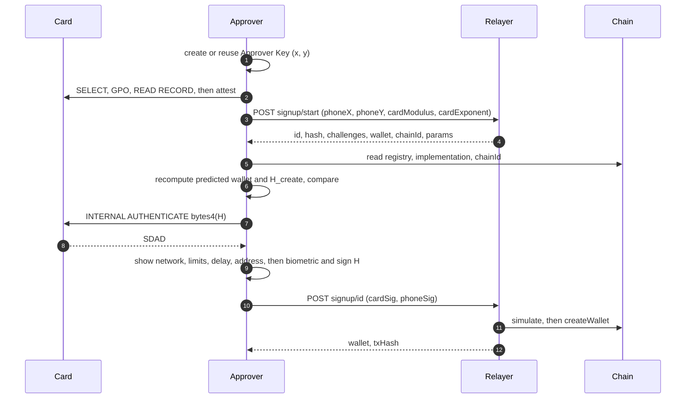

The card stays in the field while the Approver contacts the Relayer, so signup is one tap.

#### 6.8.2 Merchant payment (card + Approver)

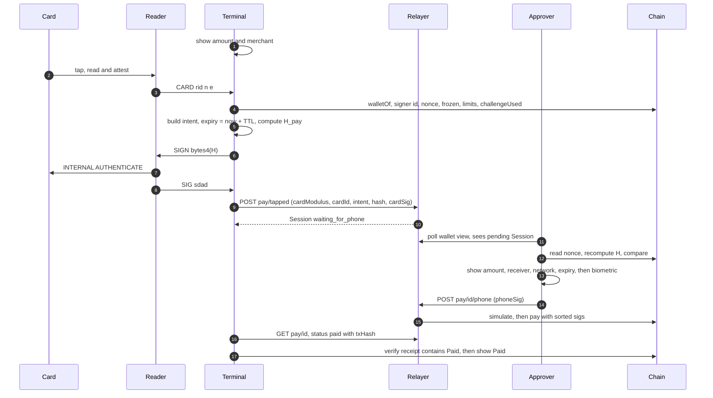

If the Terminal cannot read chain state, it calls `POST /api/pay/start`, recomputes `H` from the returned intent and its own amount and Receiver, has the card sign, and sends `POST /api/pay/{id}/card`.

#### 6.8.3 Card-only payment (soft tier with `softCardOnly`)

Same as §6.8.2 up to the intent, with these differences: the Terminal confirms from chain that `amount ≤ softLimit` and `softCardOnly` is set; computes Pieces `P0 P1 P2`; sends `SIGN P0 P1 P2` and receives `SIG s0 s1 s2`; posts `pay/tapped` with `cardSig: [s0, s1, s2]`. The Relayer submits `pay` with one Strong Card Proof immediately (no Approver step), and the Terminal verifies the receipt before showing "Paid".

#### 6.8.4 Approver-led flows: send, freeze, unfreeze, add card, card replacement, cancel

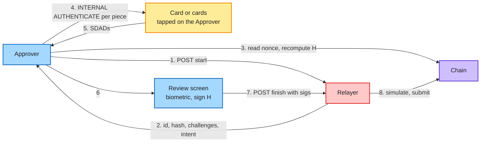

| Flow | Start (step 1) | Card pieces | Approver | Finish → wallet call |
|---|---|---|---|---|
| Send | `send/start {cardModulus, amount, to}` (Approver checks EIP-55, its own wallet, `receiver` = typed address) | 1 | yes | `pay/{id}/card`, `pay/{id}/phone` → `pay` |
| Freeze | `freeze/start {wallet}` | 0 | yes | `freeze/{id} {phoneSig}` → `freeze` |
| Freeze by card (any Reader-role device) | `freeze/start {wallet, kind: card}` | 3 | no | `freeze/{id} {card}` → `freeze` |
| Unfreeze | `unfreeze/start {wallet}` | 1 per card up to `threshold` | yes | `unfreeze/{id}` → `unfreeze` |
| Add card | `action/start {action: addSigner, params: {kind: card, …}}` | new card 1 (`newKeyProof`) + a different enrolled card 1 | yes | `action/{id}` → `addSigner` |
| Card replacement | `action/start {action: proposeRecovery, …}` | new card 1 (`newKeyProof`) | yes | `action/{id}` → `proposeRecovery`; later `recover/finish {kind: card}` |
| Cancel replacement | `recovery-cancel/start {wallet, kind}` | 3, or none with an Approver | either | `recovery-cancel/{id}` → `cancelRecovery` / `cancelPhoneRecovery` |

With `threshold > 2` the Approver collects more signatures first. Card names stay off-chain.

#### 6.8.5 Approver recovery and cancel

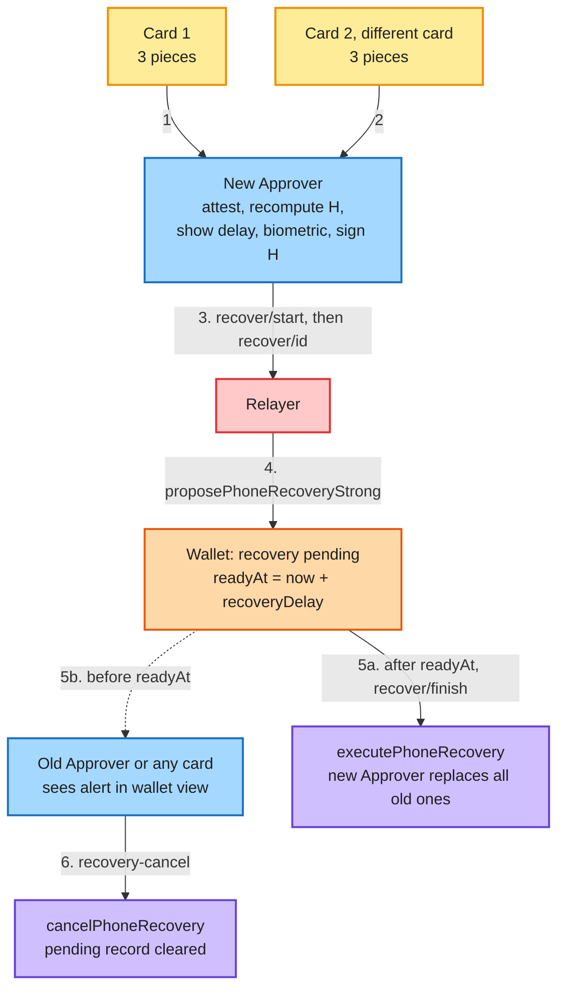

Approvers MUST show a prominent alert, with a one-step cancel, whenever the Wallet View reports a pending replacement of any kind.

---

## 7. Submission and gas

### 7.1 Relayer requirements

A conforming Relayer:

1. MUST simulate every transaction (`eth_call`, latest block) and MUST NOT submit one whose simulation fails.
2. MUST only target the Registry or a Wallet with `isWallet(target) == true` (or, in §7.3–7.4, the EntryPoint or frame mechanism carrying such calls). It MUST NOT send token transfers on its own behalf from user funds and MUST NOT hold user funds.
3. MUST rate-limit every write endpoint per client network address (honouring trusted proxy headers), per Wallet, and per Card Key ID.
4. MUST enforce a per-period gas budget and a maximum gas price, returning 503 when exceeded. It SHOULD reserve estimated cost before submitting.
5. MUST compute `H` independently for every accepted request and MUST reject a Terminal intent whose Receiver is not the one bound to that Terminal.
6. MUST NOT request, accept, or store certificates, PAN, or any §4.12 data.
7. MUST provide every field needed to recompute `H` (§6.3).
8. MUST NOT be required for safety: users MAY submit any call themselves and MAY use any Relayer; recovery execution is permissionless.
9. SHOULD keep the Wallet View fresh with short-lived caches and mark stale data `stale: true`.

### 7.2 Binding A: direct call

The Relayer or user calls the Wallet or Registry from an EOA and pays native gas. Signatures are function arguments. Supports every operation.

### 7.3 Binding B: ERC-4337 UserOperation with paymaster

A Wallet supporting ERC-4337 implements `validateUserOp`:

1. `userOp.callData` MUST be a self-call to an entry point of §5.16; anything else MUST fail validation.
2. `userOp.signature` MUST be empty; signatures travel in `callData`. The account MUST NOT verify a signature over `userOpHash`.
3. Validation recomputes `H` from `callData` and the current nonce and runs §5.4 without timestamp-dependent checks, returning `validUntil = min(expiry, 2⁴⁸ − 1)`, `validAfter = 0`.
4. Execution repeats the expiry check, applies frozen, limits, and day roll, and records consumed challenges. It MAY skip re-verification if validation recorded in transient storage that this exact `H` was approved.
5. The paymaster MUST sponsor only UserOperations whose sender is a Registry Wallet and whose call data selects a Tap2ETH entry point, and MUST bind the gas fields in its signature or policy. Per-Wallet quotas are RECOMMENDED.

ERC-7562 caps validation gas (single-piece card verification ≈ 150,000 gas; Approver ≈ 10,000–65,000). Approver recovery and card-only actions with Strong Card Proofs MUST be submitted through Binding A or a deferred-verification pattern as in Binding C.

### 7.4 Binding C: EIP-8141 frame transactions with a quota paymaster

VERIFY frames are limited to about 100,000 gas and forbid precompiles and clock reads, so RSA and P-256 verification are deferred to execution, and a quota paymaster bounds the cost of invalid proofs.

| # | Mode | Target | Purpose |
|---|---|---|---|
| 0 | VERIFY (scope EXECUTION) | Wallet | Cheap checks (below). |
| 1 | DEFAULT | Paymaster `consume()` | Charges max cost to the Wallet's daily quota and the paymaster's global daily budget. |
| 2 | VERIFY (scope PAYMENT) | Paymaster | Approves payment only if frame 1 targeted this paymaster's `consume()` and succeeded. |
| 3 | SENDER | Wallet `pay(...)` | Full approval (card + Approver), day roll, limits, transfer, quota roll. |

The Wallet's VERIFY frame MUST check:

1. Exactly one SENDER frame, last, targeting this Wallet with value 0 and selector `pay`.
2. Wallet not frozen.
3. `amount ≤ perTxLimit` (daily limit is checked in execution).
4. Exactly one envelope signature, secp256k1, from a Terminal key enrolled in the Wallet.

An invalid proof moves no funds but consumes quota; a compromised Terminal key is bounded by the per-Wallet quota and stopped by a freeze. Writing the paymaster's shared budget in validation requires a staked paymaster. Quotas roll forward in execution; an exhausted Wallet is re-enrolled by the paymaster operator.

---

## 8. Chain requirements

A chain hosting Tap2ETH Wallets MUST provide:

1. **EVM equivalence** for Solidity 0.8 opcodes (Cancun or later), CREATE2, `block.chainid`.
2. **Modexp at `0x05`** (EIP-198, with EIP-2565 or EIP-7883 pricing). Chains whose provers restrict large modexp calls are unsuitable.
3. **SHA-256 at `0x02`.**
4. **P-256 verification:** P256VERIFY at `0x100` (EIP-7951 / RIP-7212) RECOMMENDED; otherwise EVM-code verification.
5. **A Settlement Token:** ERC-20 stablecoin with `transfer`, `balanceOf`, `decimals`, `Transfer`. Fee-on-transfer and rebasing tokens MUST NOT be used.

Each chain has its own Registry. Every Intent Hash includes `block.chainid` and the Wallet address, so signatures never transfer between chains or Registries. A Registry at the same address on several chains yields the same Wallet address per card, with independent Wallets.

---

## 9. Privacy considerations

1. **The Card Key is a public, stable identifier.** Anyone who has read the card can compute the Wallet address and see its balance and history. No card-to-Wallet unlinkability.
2. **No PAN on-chain**, nor its hash (brute-forceable from BIN and Luhn), expiry, name, or certificates (§4.12).
3. **SDADs** recover only to the card's random number and padding; no PAN.
4. **The Relayer sees metadata** (IP, Wallet, amounts, merchants, timing). Users can run their own Relayer or submit directly.
5. **The Wallet View is public** to anyone with the address. Relayers SHOULD NOT expose card names or history beyond what is on-chain, and SHOULD NOT expose pending Session ids to clients that cannot prove control of an Approver; a Relayer MAY require an Approver signature over a fresh nonce to read pending Sessions.
6. **Approver keys** are random, identity-free, and not reused across wallets by conforming Approvers.
7. Stronger privacy is an extension point (§12.2).

---

## 10. Security considerations

Rationale is in the white paper; this table lists each threat and its normative mitigation.

| § | Threat | Mitigation |
|---|---|---|
| 10.1 | **4-byte grinding.** One SDAD over `C` lets an attacker find `bytes4(H) = C` in about 2³² hashes; 3 pieces need about 2⁹⁶, or `(2³²/S)³` with `S` harvested SDADs. | Approver signs all 32 bytes on normal approvals; 3 pieces without an Approver; consumption (§5.5); `H` always recomputed. |
| 10.2 | **Replay of public SDADs.** | Consumption makes each on-chain SDAD single-use; nonce in `H` stops transaction replay. |
| 10.3 | **1024-bit card keys.** | Floor of §4.13; card never sole signer above the soft tier. Users SHOULD rotate to a longer key when reissued; deployments SHOULD keep soft limits small. |
| 10.4 | **Bank-generated keys.** | Bank acts at most as one card. Users SHOULD enroll recovery cards from different issuers. |
| 10.5 | **Skimming and relay.** | Approver on normal approvals; soft tier off by default. Approvers SHOULD notify every card-only payment. |
| 10.6 | **Malicious Terminal.** | Cannot finish a normal payment. Card-only payments SHOULD only be enabled by users who accept the risk (§12.4). Terminal software MUST follow §4.12; merchants MUST NOT run Terminal software that logs card data. |
| 10.7 | **Malicious Relayer.** | Cannot forge or alter Intents; Approvers recompute `H` and Challenges; Terminals verify receipts. |
| 10.8 | **Coercion.** | Deployments needing coercion resistance SHOULD adopt §12.5. Not claimed without it. |
| 10.9 | **Lost, expired, or reissued card** (the chip keeps signing). | Freeze, `removeSigner`, or `proposeRecovery`. Approvers SHOULD warn when an enrolled card's certificate nears expiry. |
| 10.10 | **Lost phone.** | Biometric plus card needed. Approvers MUST warn that one card plus one Approver cannot recover a lost Approver, and SHOULD encourage a second card at signup. |
| 10.11 | **Cancel stalemates.** | Deliberate. The owner SHOULD freeze and remove the compromised Signer by normal approval. |
| 10.12 | **Registration squatting.** | No funds at risk; proof of possession at creation. |
| 10.13 | **Non-bank RSA keys.** | Approvers MUST attest every enrolled card; degenerate keys rejected. |
| 10.14 | **ATC side effects** of GPO. | Readers MUST NOT send GENERATE AC and SHOULD do one GPO per tap; users SHOULD prefer a card they also use for purchases. |
| 10.15 | **PIN-harvesting apps.** | Approvers SHOULD tell users: "Tap2ETH never asks for your card PIN." |
| 10.16 | **SHA-1 and ISO/IEC 9796-2.** | Verifiers MUST apply the §4.10 format checks and SHOULD apply the strict ones. |
| 10.17 | **WebAuthn `rpIdHash` and `origin` unchecked.** | Native Approvers MUST NOT set UV unless the key requires user verification for every use. |
| 10.18 | **Shared-nonce denial of service.** | Clients MUST re-issue Intents on a stale-nonce error. |
| 10.19 | **Card data on the Terminal.** | Builders MUST apply §4.12 in full; track-equivalent data MUST NOT be stored, even encrypted. |

---

## 11. Conformance

An implementation conforms to a role if it meets every MUST that applies to the role.

### 11.1 Wallet (and Registry)

- [ ] ABI of §5.16, including events, errors, Registry reverts.
- [ ] `H_create`, `H_pay`, `H_action` byte-exact (§5.6).
- [ ] SDAD verification (§4.10), Card Proof encodings (§4.11), `PhoneSig` (§5.3: low-s, UP and UV, substrings).
- [ ] Approval algorithm (§5.4) with Approver requirement, strong-proof rule, challenge consumption (§5.5).
- [ ] Key validation: modulus 128–248 bytes, non-zero leading byte, exponent 3 or 65537; Approver coordinates 32 bytes.
- [ ] Expiry first, shared nonce, `pay` check order, UTC-day buckets, limits.
- [ ] Freeze by any single Signer; unfreeze and management by threshold with an Approver.
- [ ] Card replacement and Approver recovery with `recoveryDelay`, permissionless execution, cancel by any single Signer; single-piece Approver recovery reverts `UseStrongRecovery`.
- [ ] Invariants: `phoneCount ≥ 1`, `2 ≤ threshold ≤ activeCount`, `activeCount ≤ 8`.
- [ ] Registry: deterministic EIP-1167 CREATE2 clones salted with the Card Key ID; one Wallet per Card Key ID; proof of possession at creation; master unusable as a Wallet.
- [ ] No privileged roles, no upgrade mechanism.

### 11.2 Terminal

- [ ] Displays amount and merchant before the tap; recomputes `H_pay` from chain state; never sends a Challenge not derived from a recomputed `H`.
- [ ] Serial binding (§6.7) or equivalent in-process Reader; attests cards (SHOULD).
- [ ] Requests 3 Pieces for card-only payments.
- [ ] Shows "Paid" only after verifying a receipt with the expected `Paid` event.
- [ ] Rejects its Session when the merchant cancels; treats final states as final.
- [ ] §4.12 data hygiene; never asks for a PIN; protects its merchant control interface.

### 11.3 Reader

- [ ] ISO-DEP with chaining, NAK, WTX; ≥ 1500 ms for INTERNAL AUTHENTICATE.
- [ ] Exactly the §4.3 APDU sequence; real current date; zero amount; CSPRNG `9F37`.
- [ ] INTERNAL AUTHENTICATE with exactly 4 data bytes per Piece, in order, in one card session.
- [ ] Attestation per §4.6 with a live-only, unexpired CAPK table; fails closed.
- [ ] Never sends VERIFY or GENERATE AC; discards cryptograms; emits no card data other than Card Key and SDADs.

### 11.4 Approver

- [ ] Hardware-backed P-256 key with per-use strong biometric; WebAuthn envelope; low-s.
- [ ] Recomputes every `H` it signs and every Challenge it asks a card to sign (§6.3).
- [ ] Displays amount, Receiver name and address, token, network and chain id, expiry; action details; signup parameters.
- [ ] Refuses expired Intents and Intents beyond `MAX_SIGN_AHEAD`.
- [ ] Attests every card it enrolls; refuses the same card twice where two cards are required.
- [ ] Requests 3 Pieces per card for Approver recovery and card-only freeze and cancels.
- [ ] Alerts on pending replacements with a one-step cancel.
- [ ] Never asks for a card PIN; applies §4.12.

### 11.5 Relayer

- [ ] Endpoints of §6.6, messages of §6.5, state machine of §6.2 (unguessable ids, supersede, expiry, atomic submission).
- [ ] Simulates before submitting; targets only the Registry and Registry Wallets; never custodies funds.
- [ ] Rate limits, gas budget, gas-price cap (§7.1).
- [ ] Recomputes `H` independently; binds each Terminal to its Receiver.
- [ ] Returns all fields needed for recomputation; never accepts card certificate data.

---

## 12. Versioning and extension points

| § | Topic | Rule |
|---|---|---|
| 12.1 | Versioning | This is **Draft 1**; Chain Info reports `"v": 1`. Hash formats are versioned by domain tags (`TAP2ETH_V2_*`); any preimage change MUST introduce new tags. Wallets are immutable; changing version means a new Wallet and Registry. Card Profile ids and action names are registries; new entries MUST NOT reuse identifiers. |
| 12.2 | Zero-knowledge attestation | A Wallet or Registry MAY accept a ZK proof that a Card Key was certified under a live CAPK, optionally with a salted commitment `keccak256(n ‖ e ‖ salt)`; the proof system then also verifies the SDAD. |
| 12.3 | More card profiles | Visa fDDA (`0x02`): preimage `M[1 .. N−22] ‖ 9F37 (4) ‖ 9F02 (6) ‖ 5F2A (2) ‖ 9F69`, dynamic number is the ATC. Other networks MAY be added once documented. A profile binding more than 4 bytes MUST be detected per card at enrollment and recorded in the Signer. |
| 12.4 | Card-only allowlist | A Wallet MAY restrict card-only payments to Receivers on a list managed by normal approvals. |
| 12.5 | Delayed loosening | A Wallet MAY make tightening immediate and loosening (higher limits, lower threshold, soft tier on) wait a cancellable delay. |
| 12.6 | Names | Wallets MAY have ENS names; `walletOf` stays canonical. Approvers MAY parse EIP-681 requests into `(token, receiver, amount)`. |
| 12.7 | Signer kinds | New `Kind` values MAY be added by a new hash-format generation. A kind binding fewer than 32 bytes MUST follow the strong-proof and consumption rules. |

---

## 13. Reference implementation

Open source in the `ethglobal-mumbai` repository by team-somehow: contracts in `contracts/contracts/` (`v2/Tap2EthV2.sol` and `v2/Tap2Eth.sol` Wallet and Registry, `v3/Tap2EthV3.sol` strong Approver recovery, `frames/` EIP-8141 wallet and quota paymaster, `SHA1.sol`); Relayer `relayer/server.v2.js` and `relayer/frames.mjs`; Terminal `terminal/` (`terminal.py`, `chain.py`, `reader_i2c.py`); Android Approver `mobile/` (`lib/emv.js`, `lib/phone.js`, `modules/keystore-signer/`); Reader firmware `reader/firmware/` and `reader/tools/verify_dda.py`. Reference deployments: Whitechain Sepolia (chain id 1874) and Arc testnet. Where the reference implementation and this document differ, this document is normative.

---

## 14. References

**Normative.** RFC 2119, RFC 8174, RFC 4648; EMV Book 2 and Book 3 (v4.4), EMV Contactless Books A, B, C-2, C-3; ISO/IEC 7816-4, 14443-3/-4, 9796-2; FIPS 180-4, FIPS 186-5; W3C WebAuthn Level 3; EIP-198, EIP-2565, EIP-7883, EIP-7951, RIP-7212, EIP-1014, EIP-1167, EIP-20, EIP-55, EIP-681; Solidity ABI Specification; JSON Schema 2020-12.

**Informative.** ERC-4337, ERC-7562, EIP-8141, ERC-1271, ERC-7579, ERC-7913; NIST SP 800-131A, NIST IR 8547; PCI DSS v4.0; Bond et al. (S&P 2014); Basin, Sasse, Toro-Pozo (S&P 2021, USENIX Security 2021); Radu et al. (S&P 2022); Coron, Naccache, Tibouchi, Weinmann (CRYPTO 2009); Emms et al. (CCS 2014); Nemec et al., ROCA (CCS 2017); ensdomains `solsha1`; OpenZeppelin Contracts 5.x.
