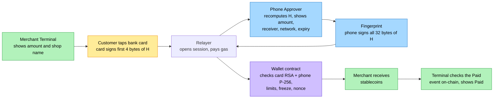
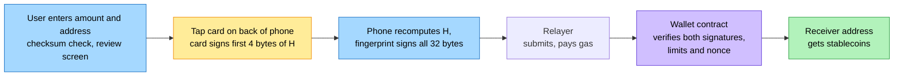
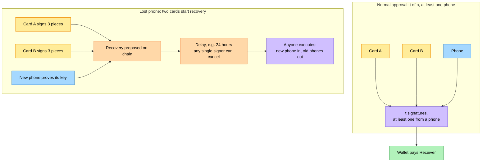

# Tap2ETH: A Hardware Wallet With No Supply Chain to Trust

**The bank card already in your pocket, as one key of a self-custodial wallet.**

| | |
|---|---|
| Authors | team-somehow |
| Date | November 2026 |
| Built at | ETHGlobal Mumbai 2026 |
| Companion specification | [`PROTOCOL.md`](./PROTOCOL.md) (Tap2ETH Protocol Specification, Draft 1) |

---

## Abstract

Self-custody today usually means buying a dedicated device and writing down a recovery phrase. Both are weak points. In October 2026, tampered hardware wallets resold through a single reseller led to estimated losses of around $86–93 million, and the implanted devices still passed the vendor's own authenticity check [1][2][3]. Recovery phrases are phished, guessed and socially engineered out of their owners [6][7]. Signers approve transactions they cannot read [8].

Tap2ETH starts from a different observation. A contactless Visa or Mastercard bank card (debit or credit) already contains a certified secure chip with an RSA private key that cannot be read out. Through a standard EMV command, the chip signs a challenge chosen by the reader. Its public key is certified by the issuing bank, and the bank's key is certified by the payment network. Anyone, including a smart contract, can check those signatures.

We worked out how to make an ordinary, unmodified bank card sign a challenge we choose, and we verified the result end to end: network CA key, then bank key, then card key, then signature. We then turned the trick into a protocol. In Tap2ETH, the card is one signer of a smart-contract wallet. The second signer is a biometric-gated P-256 key on the user's phone, the **Approver**. The wallet contract verifies both signatures on-chain, requires the Approver on every normal approval, and enforces thresholds, spending limits, a freeze switch, and time-locked recovery. A **Relayer** sponsors gas, so users and merchants never touch a gas token. Merchant **Terminals** let a customer tap a card and approve on their phone.

The card is used only as a key. No card payment is processed and the bank account is never charged. Money sits in the wallet as stablecoins. The protocol is open: the specification is public domain, and anyone can build compatible Terminals, wallets and verifiers with no vendor to trust.

---

## 1. Introduction: the problem with self-custody

A self-custodial wallet should mean one thing: only you can move your money. In practice, users have to trust a long list of people and processes to get there. This paper looks at four ways that trust breaks, then shows a design that removes most of the list.

### 1.1 The supply chain you have to trust

A hardware wallet is a small computer that holds your keys. To trust it, you must trust the factory that made it, the firmware it runs, every reseller and courier that handled the box, and the vendor's customer database.

In October 2026, that chain broke in public. Ledger devices that had been tampered with were resold through a reseller called CryptoBilis. On-chain estimates put the losses at around $86–93 million, taken from around 300 wallets [1][2]. The implant captured the recovery phrase. The devices still passed Ledger's Genuine Check, the vendor's own test that a device is authentic [3]. In the same period, Trezor warned of a suspected Safe 5 device from the same reseller with a hidden cellular implant [4].

The lesson is not that one vendor failed. It is that "buy a trusted device" pushes the trust problem into a supply chain that the buyer cannot inspect. A genuine-looking box, a genuine-looking check, and a stolen key can all exist at once.

### 1.2 The customer list is a target list

Buying a hardware wallet also puts your name on a list of people who own crypto. In January 2026, a breach at Ledger's e-commerce partner Global-e exposed customer names, postal addresses and phone numbers, and the leaked data was followed by phishing letters [5]. A self-custody product that requires a purchase creates a database of targets, whether or not the device itself is secure.

### 1.3 Seed phrases

Most wallets back up keys as a 12- or 24-word recovery phrase. Whoever reads those words owns the wallet. In January 2026, an attacker who impersonated Trezor support persuaded a holder to reveal their recovery phrase; around $282 million was stolen [6]. Phrases can also be weak at birth: in 2026, Coinspect described a flaw in seed generation, called "Ill Bloom", linked to estimated losses of at least $5.69 million [7]. A secret that a human must copy, store and never reveal is a secret that humans will eventually reveal.

### 1.4 Blind signing

A signature is only as good as the user's understanding of what is signed. In February 2025, attackers took around $1.5 billion from the exchange Bybit. The signers approved a malicious transaction that a compromised Safe web interface displayed as a routine transfer [8][9]. Their hardware devices signed correctly. They simply signed the wrong thing, because the screen that explained the transaction was the part the attacker controlled.

### 1.5 One stolen device empties the wallet

Many people now keep crypto on a single phone. When the phone goes, so does the money. In London, an investor lost around $14,000 after thieves took his unlocked iPhone [10]. In Brooklyn, a man lost more than $50,000, including Bitcoin, after losing his phone [11]. A wallet with a single factor has a single point of failure.

### 1.6 What we want

From these failures we take five requirements:

1. **No new supply chain.** Do not ask the user to buy a device.
2. **No seed phrase.** Nothing a person can be talked into reading out.
3. **No blind signing.** The device that approves must show, and cryptographically commit to, exactly what is approved.
4. **No single factor.** Losing one thing, or having one thing stolen, must not lose the money.
5. **No vendor.** No company, including us, should be able to move funds, freeze wallets, or be required for recovery.

Tap2ETH meets these with two things most people already carry: a bank card and a phone.

---

## 2. The insight: a certified secure chip in every wallet

A modern bank card is a smart card. Its chip runs the EMV payment application defined by EMVCo, the standards body of the card networks [13][14][15]. To prevent card cloning, EMV includes **offline data authentication**: a way for a terminal to check that a card is genuine without contacting the bank.

The strongest form is **Dynamic Data Authentication** (DDA). It works like this:

1. The card holds an RSA private key. The key was loaded into the chip when the bank personalised the card. It is designed never to leave the chip.
2. The terminal sends the card a random challenge with the INTERNAL AUTHENTICATE command.
3. The card signs the challenge with its private key and returns the signature, called the SDAD (Signed Dynamic Application Data).
4. The card also carries certificates. The card's public key is signed by the issuing bank. The bank's public key is signed by the payment network's certification authority (CA). The network's CA public keys are published.

So a verifier with the network's public CA keys can walk the chain and confirm that a signature came from a key that a real bank put into a real card. No network connection, bank account, or bank cooperation is needed.

This is exactly the property we want from a hardware wallet key:

| Property a hardware wallet needs | What a bank card already has |
|---|---|
| Key generated and stored in tamper-resistant hardware | EMV chip, certified secure element |
| Key cannot be exported | Private key never leaves the chip by design |
| Signs a challenge chosen by the verifier | INTERNAL AUTHENTICATE with a reader-chosen challenge |
| Anyone can check the signature | RSA public key, published CA keys, standard formats [13][16] |
| Anyone can check the hardware is genuine | Certificate chain from network CA to bank to card |
| Distributed to users already | Over a billion debit cards in India alone [12] |

There is one important difference. Payment cryptograms (the codes a card produces to authorise a purchase) use symmetric keys shared with the bank, so only the bank can check them. Offline data authentication signatures are different: they use public-key cryptography, so anyone can verify them. Tap2ETH uses only the public-key signatures. It never asks the card for a payment cryptogram, never sends a payment to the bank, and never charges the card.

The card brings no new supply chain. It reaches the user through the banking system they already use, and Tap2ETH never asks them to trust that card on its own (Section 5.4).

---

## 3. Cracking open the card

EMV is a documented standard. Nothing about the card needs to be modified, broken or bypassed. What was missing was a working recipe: which commands to send, which fields to fill, how to get the card to sign a value we choose, and how to check the result without a bank. This section describes how we worked that out.

### 3.1 Day one: one card, one reader, one signature

We started with an M5StickS3 microcontroller, an M5Stack RFID 2 reader, and a real Indian-issued Mastercard. The work had four steps.

**Talk to the payment application.** The reader selects the card's payment directory (`2PAY.SYS.DDF01`), then selects the Mastercard application (AID `A0000000041010`). It answers GET PROCESSING OPTIONS, the command that starts a transaction, with a zero amount and standard terminal values. No PIN is involved, and no transaction is sent to any bank.

**Read the certificates.** The card's records hold the issuer certificate, the card certificate, the exponents, and the index of the network CA key that signed it all. The reader collects them.

**Ask the card to sign our value.** We sent INTERNAL AUTHENTICATE with a 4-byte value we chose, `81D0D5FF`. The card returned a signature. The card's Dynamic Data Object List declares a 4-byte "unpredictable number", so the card commits to exactly the 4 bytes the reader sends.

**Verify everything.** Offline, we recovered the chain:

- Mastercard CA key 06 (1984-bit RSA, exponent 3) opened the issuer certificate, revealing a 1408-bit bank key.
- The bank key opened the card certificate, revealing a 1024-bit card key with exponent 3.
- The card key opened the signature. The recovered block had the expected ISO/IEC 9796-2 format [16], and its embedded SHA-1 hash matched our challenge.

Every link checked out: **network CA to bank to card to signature over our challenge.** The card number never left the reader's memory.

### 3.2 What the card taught us

Getting there took practical lessons that are now written into the protocol:

- **Field strength matters.** The chip draws more power while it computes a signature. With the reader's field left at polling strength, the card could brown out in the middle of a command. Raising field strength after the card is selected made reads reliable.
- **Signing is slow.** INTERNAL AUTHENTICATE can take more than a second, with the card asking for extra time through ISO-DEP waiting-time extensions [17]. Readers must allow at least 1500 ms.
- **Only send exactly 4 bytes.** A card may declare a longer data list, but verifiers hash exactly the 4 challenge bytes. The protocol fixes the INTERNAL AUTHENTICATE data at 4 bytes.
- **Stay away from payment cryptograms.** Another EMV mode, Combined Data Authentication (CDA), produces a signature only alongside a payment cryptogram, and it timed out on our reader. Publishing a cryptogram would be wrong anyway. Tap2ETH never sends GENERATE AC, the command that produces one.
- **Never touch the PIN.** The card signs without a PIN. Tap2ETH components never ask for one, which also protects users from malware that tricks people into tapping their card and typing their PIN [31][32]. Research has also shown that sending PIN commands over the contactless interface can leak information [48].
- **Trust only signed data, and fail closed.** Academic work on EMV has repeatedly found attacks that work by changing card data that is not signed, or by pushing a terminal onto a weaker fallback path [29][30]. Tap2ETH verifies only signed data, pins each wallet to the card key it enrolled, and never falls back to a weaker check.

### 3.3 From a bench test to a wallet

We then built the same reading and verification on three more devices:

- an **Android phone**, which reads the card through its NFC controller, checks the certificate chain against a table of network CA keys, and asks the card to sign;
- a **Raspberry Pi merchant terminal**, with a low-cost contactless reader on its I2C bus and its own ISO-DEP stack;
- a **smart contract**, which verifies the card's signature on-chain.

The on-chain check uses the EVM's modular exponentiation precompile (EIP-198 [19]) to perform the RSA operation and a Solidity SHA-1 implementation [25] to check the hash. The EVM has no SHA-1 precompile, but this approach has precedent: ENS's DNSSEC oracle runs RSA plus SHA-1 on-chain in production [26]. On Whitechain Sepolia, a card signature check measured 151,139 gas as a standalone transaction (Section 9).

At that point we had a hardware key that people already carry in their pockets, a way to make it sign, and a way for a contract to check it. The rest of this paper is about turning that into something safe to put money behind.

---

## 4. The Tap2ETH protocol

### 4.1 The three layers

Tap2ETH is specified in three layers. Each can be used on its own.

| Layer | What it defines | Who uses it |
|---|---|---|
| **1. Card attestation and card signatures** | How to read a card, check its certificate chain, derive a challenge from a 32-byte hash, and verify the card's signature. Includes multi-piece proofs and card-data hygiene. | Any wallet or verifier that wants a bank card as a signer, including non-Tap2ETH accounts such as a modular-account validator |
| **2. Account rules** | The signer set, approval algorithm, limits, freeze, signer management, recovery, wallet creation, and byte-exact hash formats | Tap2ETH Wallets and their Registry |
| **3. Sessions and messages** | The payment-session state machine, the HTTP Relayer binding, the Reader-to-Terminal serial binding, end-to-end sequences, and what every device must display before anyone signs | Terminals, Readers, Approvers, Relayers |

### 4.2 Roles

| Role | What it is | What it does |
|---|---|---|
| **Card** | An unmodified EMV contactless bank card | Signs any 4-byte challenge presented to it. Has no screen, no clock, and no PIN check in this protocol. |
| **Approver** | The user's phone, holding an **Approver Key**: a P-256 key in hardware-backed storage that needs a fresh biometric for every signature | Shows what is being approved, recomputes the hash itself, and signs all 32 bytes of it. Can also read cards. |
| **Terminal** and **Reader** | A merchant point-of-sale device and its card reader | Shows the amount, reads and checks the card, has it sign the payment challenge, and confirms the result on-chain. |
| **Relayer** | An off-chain service | Holds sessions, forwards requests to Approvers, and submits transactions while paying gas. Never holds funds. |
| **Wallet** and **Registry** | Smart contracts | The Wallet holds funds and enforces every rule. The Registry creates Wallets at deterministic addresses and maps each card to at most one Wallet. |
| **Receiver** | Any address that is paid | A merchant, or anyone the user sends to. |

Funds are held in a **Settlement Token**, an ERC-20 stablecoin chosen per deployment.

### 4.3 Intents, hashes and challenges

Every approval is over an **Intent**: a structured request such as "pay 12.50 USDC from wallet W to receiver R, with nonce 7, before time T, on chain 1874". The Intent is ABI-encoded with a domain tag and hashed with keccak-256 into a 32-byte **Intent Hash**, `H`. The hash includes the chain id, the wallet address and the wallet's nonce, so a signature can never be replayed on another chain, another wallet, or a second time.

The two signers bind `H` differently:

- The **Approver** signs all 32 bytes of `H`, inside a WebAuthn assertion envelope [18] that carries the "user verified" flag.
- The **Card** can only sign 4 bytes. Its **Challenge** is the first 4 bytes of `H`. Where more binding is needed, the card signs several 4-byte **Pieces** of `H` in one tap, one INTERNAL AUTHENTICATE per Piece. A three-piece **Strong Card Proof** binds 12 bytes (96 bits).

This asymmetry drives the whole security design (Section 5).

### 4.4 Paying a merchant with card and phone

The customer taps a bank card at the merchant's Terminal, then approves on their phone. The Terminal computes the Payment Intent from chain state, so it never needs to trust anyone else's hash. The Approver independently recomputes the same hash from what it shows the user.

The Terminal shows "Paid" only after it has seen, through its own connection to the chain, a receipt containing the expected `Paid` event. A Relayer that lies about status cannot fool it.

### 4.5 Sending on-chain with card and phone

The same Wallet can pay any address. The user types or scans an address in the Approver app, reviews it, taps their card on the back of the phone, and confirms with a fingerprint. A send always needs the phone; it never uses the card-only shortcut.

### 4.6 Several cards, thresholds, and a lost phone

A Wallet can hold up to eight signers, cards and Approvers, with a threshold `t` between 2 and the number of signers. Every normal approval needs `t` signatures and at least one of them must be an Approver. If the phone is lost, two of the wallet's cards, each giving a Strong Card Proof, can start replacing it. The replacement waits out a recovery delay (24 hours is recommended), during which any single signer can cancel it.

A lost card is replaced the same way in reverse: the phone plus the new card propose the swap, and it takes effect after the same cancellable delay. The Wallet address never changes.

### 4.7 Creating a wallet

Signup is one tap. The phone creates or reuses its Approver Key, reads the card, checks the card's certificate chain, and asks the Relayer to prepare a Create Intent. The Create Intent binds the chain, the predicted Wallet address, the card key, the phone key, the limits and the recovery delay. The phone shows those parameters, the card signs, the user gives a fingerprint, and the Registry deploys the Wallet as a minimal proxy clone [22]. The Wallet's initialisation verifies both signatures, which proves that the creator held both the card and the phone.

The Wallet address is derived from the card's public key. Anyone can compute it before the Wallet exists, and it stays the same for the Wallet's life.

---

## 5. Security model

### 5.1 Two independent factors

Tap2ETH separates two questions that a single hardware wallet answers with one device:

- **Possession: is the real card here?** The card answers this. Its signature proves that someone had the physical card within a few centimetres of a reader.
- **Intent: does the owner approve exactly this?** The Approver answers this. It shows the amount, the receiver's name and address, the token, the network and the expiry. It recomputes the Intent Hash from those displayed fields and refuses to sign if the Relayer's hash differs. Only then does it ask for a biometric and sign all 32 bytes.

The two factors live on different hardware, come through different supply chains, and fail in different ways. An attacker has to beat both.

### 5.2 Why the card alone is never enough

A card is a good key but a poor approver:

- it has no screen, so it cannot show what it signs;
- it signs for any reader in range, without a PIN or consent;
- it binds only 4 bytes per signature;
- its key was generated by the bank.

So the protocol makes six invariants that every conforming system must keep (see PROTOCOL.md §3.4):

1. **No single factor moves value above the soft tier.** Every payment above an optional small `softLimit` needs at least two signatures, one of them an Approver over all 32 bytes.
2. **No 4-byte-only authority.** Any approval without an Approver uses Strong Card Proofs: three Pieces per card, 96 bits.
3. **No harvested-signature reuse.** A Wallet records every `(card, challenge)` pair it has accepted and refuses to accept one again.
4. **Recovery is slow and cancellable.** Replacing a lost signer waits a delay, and any single signer can cancel.
5. **No card data leaves the reading device** except the card's public key and its signatures.
6. **Users can always act without the Relayer.** Every wallet function can be called by anyone holding valid signatures.

### 5.3 No blind signing

The Bybit theft worked because the signers trusted a screen that the attacker controlled [8][9]. Tap2ETH puts the screen on the device that holds the key and makes the hash a function of the screen:

- The Approver reads the nonce and chain context from the chain itself, rebuilds `H` from the fields it is about to display, and compares. A Relayer that tries to slip in a different receiver or amount produces a different hash, and the Approver refuses.
- The Approver checks that every Challenge it asks a card to sign is the matching Piece of the recomputed `H`. A Relayer therefore cannot use 4-byte collisions to make the card and the phone sign different Intents.
- The Terminal computes the payment hash from chain state too, and never sends the card a Challenge it did not derive itself.
- Wallet creation shows the network, limits, recovery delay and predicted address before signing.

The biometric prompt text summarises the same amount and receiver, but the protocol treats the on-screen review as the binding step, because prompt text is not cryptographically tied to the signed bytes.

### 5.4 "So now I trust the bank instead of Ledger?"

This is the right question, and the answer is no.

The bank (or its card personalisation bureau) generated the card's key pair in its own hardware and loaded it into the chip [38]. It may have kept a copy, and nobody can prove it did not. Tap2ETH therefore assumes that it might have. The card is treated as a possession factor that the bank co-controls, never as the owner of the wallet.

What follows from that assumption:

- **The bank alone cannot move funds.** Every value-moving approval needs the Approver Key, which exists only in the user's phone and never leaves it.
- **The bank can at most act as one card.** It could spend within the soft tier if the user enabled card-only payments, freeze the wallet, or cancel a pending replacement. None of these moves funds to the bank.
- **Two cards from the same bank are still not enough** to take over quietly. Approver recovery with two cards waits out a public delay, and the user's phone can cancel it. Users are advised to enrol recovery cards from different banks.
- **A thief cannot move funds alone** with only the card or only the phone.
- **The Tap2ETH team cannot move funds at all.** The protocol has no admin key, no upgrade key, and no server whose cooperation is required.

Compare this with a compromised hardware wallet. An implant that captures a recovery phrase gives the attacker everything [1][3]. A compromised card in Tap2ETH gives the attacker one factor out of two, inside limits the user controls.

### 5.5 Limits, freeze and recovery

- **Per-transaction and daily limits** are enforced by the Wallet in token units, with fixed UTC-day buckets. Changing them needs a normal approval.
- **The soft tier** is off by default. A user can allow small payments with a single signature. Soft limits should sit well below the local no-PIN limit for contactless card payments, which in India has been ₹5,000 per transaction since 2021 [51]. By default that signature must come from the phone. The user can also allow card-only payments up to the soft limit, after a clear warning that anyone who can tap the card can spend up to that amount per payment and up to the daily limit per day. Card-only payments use Strong Card Proofs.
- **Freeze** needs any single signer: the phone, or a card with a Strong Card Proof. Freezing never moves funds, so it is cheap to allow. A user whose phone was stolen can freeze with their card at any device that can read cards, including a merchant Terminal. **Unfreeze** needs a full normal approval.
- **Recovery** has two independent slots, one for replacing a card and one for replacing the Approver. Both wait `recoveryDelay`, both can be cancelled by any single signer, and both can be executed by anyone once ready.

### 5.6 Threats and mitigations

| Threat | What the attacker has | Mitigation |
|---|---|---|
| Supply-chain implant in a device | A compromised card or phone | No recovery phrase exists to capture. Card and Approver come through separate supply chains, and neither alone can move value above the soft tier. Nothing is bought for Tap2ETH, so there is no new vendor channel to tamper with. |
| Customer-data leak | A list of buyers | There is no purchase and no vendor customer database. |
| Seed-phrase phishing or weak seed generation | Social engineering | No seed phrase exists. Keys are generated by the card's bank and the phone's secure hardware. |
| Blind signing through a compromised interface | Control of a web page or the Relayer | Approver recomputes `H` from displayed fields and checks card Challenges against it. Terminal computes its own hash. |
| Stolen card | The card | Cannot pass a normal approval. Card-only spending, if enabled, is capped by the soft and daily limits. User freezes and removes or replaces the card. |
| Skimming or relay of a card in a pocket | Brief radio access; skimmers have read cards at around 25 cm [27]; relays forward a card to a distant reader [28] | Same as a stolen card. Binding cannot stop an attacker's own reader, so the protocol limits what card-only access can do instead. |
| Stolen phone | The phone, without the owner's biometric | Every signature needs the owner's strong biometric. Normal approvals also need a card. |
| Stolen phone and card together, with the biometric defeated | Both factors | Bounded by limits. The user's second card can freeze and cancel changes, and recovery waits a delay. |
| Malicious merchant Terminal | Control of the reader | Cannot redirect funds: the receiver is in `H` and shown on the phone. Can trigger card-only payments only within the soft tier. Spam can only supersede sessions (denial of service). |
| Malicious Relayer | Control of sessions | Cannot forge or alter signatures. Can censor or delay; users can submit directly or use another Relayer. Terminals verify receipts on-chain. |
| 4-byte challenge grinding | One card signature, GPU time | About 2³² keccak evaluations finds a matching hash, seconds on a GPU (estimate based on a measured 1.25×10⁹ keccak per second on one consumer GPU [33]). Mitigated by the Approver's 32-byte signature on every normal approval, 3-piece proofs elsewhere, and challenge consumption. |
| Reuse of card signatures published on-chain | Calldata from earlier transactions | Each `(card, challenge)` pair is accepted once per card, ever. |
| Bank keeps a copy of the card key | The card's private key | Acts as one card at most (Section 5.4). |
| Factoring a 1024-bit card key | Large compute | Yields the card's signing power and nothing more. Keys under 1024 bits are rejected. |
| PIN-harvesting "tap your card" malware [31][32] | A victim's tap and PIN | Tap2ETH never asks for a PIN, and tells users so during onboarding. |
| Card-registration squatting | A brief tap of someone else's card | Creates a Wallet the attacker controls with no victim funds in it. Denial of service for that card on that Registry, not theft. |
| Coercion ("wrench attack") | The owner, under threat | Limits cap a quick grab of a stolen card, not a coerced owner. Delayed loosening (Section 11.8) gives limits meaning against coercion. |

---

## 6. Privacy

Tap2ETH protects card data strictly, but it does not hide who owns a wallet from someone who has read their card. We state both plainly.

**What never leaves the reading device.** The card number (PAN), its expiry, the cardholder name, track data, certificates, raw records, cryptograms and the transaction counter are read into memory, used for the certificate check, and discarded. They are never logged, stored, sent to a Relayer, or put on-chain. The only card data that leaves the device is the card's RSA public key and its signatures. The signatures recover to a random number chosen by the card and padding, with no card number. These rules match the spirit of PCI DSS, which forbids storing chip track-equivalent data after authorisation [52].

**Why no card-number hash on-chain.** A hash of a card number does not protect it. The first six to eight digits identify the bank and are public, and the last digit is a checksum, so the remaining search space is small enough to brute-force.

**What is linkable.** The card's public key is stored on-chain, and the Wallet address is derived from it. Anyone who has ever read the card (any reader within range, any merchant terminal) can compute the Wallet address and see its balance and history. Tap2ETH does not offer unlinkability between a physical card and its wallet.

**What the Relayer sees.** IP addresses, wallet addresses, amounts, merchants, and timing. Users who object can run their own Relayer or submit transactions directly.

**Approver keys** are random P-256 keys, unrelated to any identity, and are not reused across wallets.

**The path to stronger privacy.** The specification defines an extension point for a zero-knowledge proof that a key was certified by a live network CA, combined with a salted commitment to the card key, so that neither the certificates nor the raw key would appear on-chain (PROTOCOL.md §12.2). Prior work on zero-knowledge proofs over EMV signatures shows this is practical to prove [39].

---

## 7. Payments without crypto steps

The people at a shop counter should not need to know what gas is. Tap2ETH is designed so that neither the customer nor the merchant handles a gas token, a seed phrase, or a chain setting.

### 7.1 What the customer does

Tap the card, check the amount and shop on the phone, touch the fingerprint sensor. Signup is the same: tap the card on the phone, check the settings, touch the sensor.

### 7.2 What the merchant gets

A stablecoin transfer to the merchant's address, settled on-chain, and a Terminal that only says "Paid" after it has seen the on-chain receipt. There is no card authorisation, so there are no card-scheme fees, chargebacks or settlement delays involved. There is also no bank-account charge for the customer: the card is a key, and the money moves out of the customer's smart wallet.

### 7.3 Who pays for gas

Every wallet call carries its own signatures as arguments, so any account can submit it and pay the gas. The **Relayer** does this for users. Typically the Relayer is run by the merchant, a payment processor serving many merchants, or a wallet provider. It keeps a native-token balance for gas and treats sponsorship as a cost of acceptance. On chains whose gas is paid in a stablecoin, such as Arc testnet, the operator funds gas in the same currency it receives.

The cost per payment is small. A card plus phone payment measured 320,193 gas on Whitechain Sepolia (Section 9). We estimate a full card payment at around $0.004–0.01 on Base, assuming ETH at $3,000 (estimate, not a measurement).

The protocol defines three submission bindings (PROTOCOL.md §7):

- **Direct call.** The Relayer calls the Wallet from its own account. This supports every operation.
- **ERC-4337** [23]. The Wallet validates the Tap2ETH signatures carried in the call data, and a paymaster sponsors the UserOperation.
- **EIP-8141 frame transactions** [24]. A quota paymaster gives each enrolled wallet a daily gas quota and caps the total budget. Signature checks run in the execution frame, because the frame validation rules forbid the precompiles that RSA and P-256 checks need. An invalid proof moves no funds and only consumes that wallet's quota.

### 7.4 How the Relayer is protected

Sponsoring gas invites abuse. A conforming Relayer:

1. simulates every transaction first and never submits one that fails, so a bad signature costs nothing;
2. only calls the Registry and Registry Wallets, and never sends token transfers on its own behalf;
3. rate-limits every write endpoint per client, per Wallet and per card;
4. enforces a gas budget per period and a gas-price cap, refusing requests when either is reached;
5. recomputes every hash itself, and binds each Terminal to its own Receiver, so a Terminal cannot redirect payments.

The Relayer is never required for safety. If it disappears, users can submit any call themselves, and recovery execution is open to anyone.

Each deployment uses one stablecoin as its Settlement Token, and limits are counted in its units, so a daily limit of 50 means 50 of that stablecoin. The Approver always shows amounts in that token, with its symbol.

---

## 8. Multi-card accounts and recovery

### 8.1 Shared treasuries

A Wallet can hold up to eight signers. That makes Tap2ETH useful for small groups that share money and want shared control: a family budget, a small shop's float, a club treasury, a project team. Some examples:

- **Two partners, one shop.** Two cards and two phones, threshold 2. Either partner can approve with their own card and phone. Neither partner's card alone can spend.
- **A family pot.** Three cards and two phones, threshold 3. Large payments need three people's devices, one of them a phone.

Tap2ETH is a shared-control account, not a bill-splitting app. It decides who must approve a payment from a shared pool. It does not divide a payment among several people's separate funds.

### 8.2 Why cards alone never approve

Even with many cards, at least one Approver must sign every normal approval. A thief with a purse of cards, or a skimmer next to a stack of cards, would otherwise be able to approve anything, and each card binds only 4 bytes. The phone's 32-byte, biometric-gated signature is what turns possession into consent.

### 8.3 Adding and removing signers

Adding a signer needs a normal approval from existing signers and a proof of possession from the new key over the same hash. A new card must also pass the certificate-chain check on the Approver that enrols it. Removing a signer needs a normal approval and may never drop below the threshold or remove the last Approver.

### 8.4 Recovering a lost phone

Phones get lost, wiped and replaced. With two or more cards enrolled, recovery works without the old phone:

1. On the new phone, the user taps card one. The new phone reads it, checks it, and prepares a recovery Intent that names the new Approver Key.
2. Card one signs three Pieces of the Intent Hash. The user taps a different card, which also signs three Pieces.
3. The new phone signs the Intent with the user's biometric, proving it holds the new key.
4. The Wallet records the proposal and starts the recovery delay.
5. If the old phone still works, it shows a prominent alert with a one-step cancel. Any card can cancel too.
6. After the delay, anyone can execute the recovery. The new Approver is added and every old Approver is removed.

Why three Pieces? Card signatures are public once they reach the chain. With one Piece per card, a thief holding one stolen card could search for a recovery request whose first 4 bytes match an old public signature of the other card, about 2³² tries, and so "use" a card they do not have. Three Pieces per card raise that to 96 bits per card. The Wallet also refuses any challenge a card has signed before, which removes the pool of old signatures entirely.

A wallet with one card and one phone cannot recover from losing the phone. The Approver app warns about this at signup and encourages a second card.

---

## 9. On-chain cost and feasibility

### 9.1 Measured costs

All figures below are gas used by transactions on **Whitechain Sepolia (chain id 1874)**, measured with the reference contracts. They include the 21,000-gas base cost of each transaction.

| Operation | Gas |
|---|---|
| Card signature check alone (RSA via modexp + SHA-1) | 151,139 |
| Phone signature check alone (WebAuthn P-256) | 62,716 |
| Create a wallet (clone plus both proofs of possession) | 765,960 |
| Add a second card | 555,553 |
| `pay`, card + phone | 320,193 |
| `pay`, second card + phone | 243,947 |
| `pay`, two cards + phone (3 of 3) | 379,953 |
| `pay`, single card signature | 199,028 |
| Change limits (card + phone) | 228,084 |
| Freeze with the phone | 104,422 |
| Unfreeze (card + phone) | 215,810 |
| Start a phone replacement (two cards) | 404,897 |
| Finish a phone replacement | 203,115 |
| Deploy the Registry | 5,060,414 |

Creating a wallet as a minimal proxy clone costs about 30% of deploying a full wallet contract per user, which measured 2,566,689 gas.

### 9.2 Where the gas goes

- **RSA.** With 1024-bit keys and exponent 3, the modexp precompile is cheap: 512 gas under EIP-7883 pricing [20].
- **SHA-1.** This is the expensive part. A Solidity SHA-1 costs about 38,000 gas per 64-byte block [25], and a 1024-bit signature check hashes 110 bytes, which is two blocks.
- **P-256.** The P256VERIFY precompile costs 6,900 gas under EIP-7951 on Ethereum L1 and 3,450 gas under RIP-7212 on rollups [21]. The WebAuthn envelope adds a few SHA-256 calls and string checks.

### 9.3 Costs of the stronger rules

The measured operations above use single-piece card proofs. From them we can estimate the extra cost of rules the protocol adds:

- **Each extra Piece** costs one more card signature check. Subtracting the transaction base cost from the measured standalone check suggests roughly 130,000 gas per Piece (estimate). A Strong Card Proof adds two such checks per card.
- **Challenge consumption** writes one new storage slot per accepted Piece, about 22,100 gas each under current EVM pricing.

So a card-only payment with a Strong Card Proof lands around 500,000 gas, and starting a two-card Approver recovery around 1.1 million gas (estimates). These are rare operations, and both stay well below block gas limits. A normal card plus phone payment keeps the single-piece cost plus one storage write, around 340,000 gas (estimate).

### 9.4 Which chains fit

A chain needs the modexp and SHA-256 precompiles, CREATE2, and ideally the P256VERIFY precompile (PROTOCOL.md §8). Chains whose provers restrict large modexp calls are a poor fit. Reference deployments exist on Whitechain Sepolia and on Arc testnet, where gas is paid in USDC.

---

## 10. Comparison with prior art

| Approach | Example | Hardware the user needs | Issuer or KYC | Recovery phrase | Who can verify signatures | Supply chain to trust |
|---|---|---|---|---|---|---|
| Hardware wallet | Ledger, Trezor | A new purpose-built device | No | Yes | Anyone (on-chain keys) | Factory, firmware, resellers, couriers, vendor database [1][3][5] |
| NFC crypto card | Arx HaLo, Burner [40][41]; Tangem [42] | A new NFC chip card | No for the wallet; Tangem Pay adds a new Visa card with KYC [42] | No for HaLo (key generated in the chip at manufacture) | Anyone (on-chain ECDSA) | The card vendor's chip and distribution |
| Issuer crypto card | Gnosis Pay [43], MetaMask Card [44], ether.fi Cash [45] | A new Visa or Mastercard issued through a card program | Yes | Depends on the wallet | The card issuer, which pulls funds under an allowance or delay module | Issuer, program manager, and the wallet's own modules; Gnosis Pay's delay module was exploited in June 2026 [54] |
| ZK proof of card possession | zkEMV [39] | Existing bank card, Android phone | No | Not applicable | Anyone, through a ZK proof | None new; it proves possession and sybil resistance, but is not a wallet |
| Bank identity check by tap | Visa Tap to Confirm (announced May 2026) [46] | Existing bank card, phone | Issuer-run | Not applicable | Only the issuer, through symmetric cryptograms | The issuer and network |
| Bank one-time codes | EMV-CAP readers [47] | Existing card, bank reader, PIN | Issuer-run | Not applicable | Only the bank | The bank |
| **Tap2ETH** | This paper | **The bank card and phone the user already has** | **No** | **No** | **Anyone, on-chain, using public-key card signatures** | **None new. Two independent existing chains (bank card, phone), and neither alone can move value.** |

Three distinctions matter most:

- **Against hardware wallets and NFC crypto cards:** Tap2ETH needs no new hardware. Over a billion debit cards circulate in India alone [12].
- **Against issuer crypto cards:** those issue a new card and the issuer moves the money. In Tap2ETH the existing card is only a key, the user's own contract moves the money, and no issuer, program manager or KYC is involved.
- **Against Visa Tap to Confirm and EMV-CAP:** those use cryptograms that only the bank can check. Tap2ETH uses the card's public-key signatures, which anyone, including a smart contract, can check.

As far as our search of public projects found, no earlier project uses an unmodified, already-issued bank card's offline-authentication signature as a smart-wallet signer with on-chain limits, multi-card thresholds and a merchant terminal. That rests on web searches; hackathon galleries could not be searched exhaustively.

---

## 11. Limitations and open problems

We list what Tap2ETH does not solve, or solves only in part.

### 11.1 The bank generated the key

The card's key was made by the bank's systems, not by the user. Section 5.4 explains why this caps the bank's power at "one card". It does not remove the bank from the picture. A user who wants no bank-generated key in their signer set at all can add other signer kinds through the specification's extension points (PROTOCOL.md §12.7).

### 11.2 Four bytes per signature

A card signs only the 4 bytes the reader sends. The protocol answers this in three ways: an Approver signs the full 32 bytes on every normal approval; approvals without an Approver use three-piece Strong Card Proofs; and challenge consumption stops any public signature from being reused. Three Pieces need three INTERNAL AUTHENTICATE commands, which makes the tap longer: on our low-cost I2C reader, reading a card and getting one signature takes about 1.5 seconds. Whether some cards hash INTERNAL AUTHENTICATE data longer than their declared data list is an open question; if they do, a future card profile could bind more per signature.

### 11.3 1024-bit RSA

Many cards use 1024-bit RSA keys, about 80-bit security. NIST has not allowed 1024-bit RSA for new signatures since 2013 [35], and plans to deprecate RSA altogether after 2030 [36]. The public factoring record has moved quickly: RSA-260 (862 bits) was reported factored in September 2026, and RSA-896 later that month, according to recent reports [34]. The card key is revealed on every tap, so an attacker can work on it offline for as long as they want. Factoring a card key gives the attacker the card's signing power, which is exactly what physically holding the card gives, and no more. This is a core reason the card is never the sole signer. ROCA-style weak-key generation [37] does not apply in the same way, because EMV keys are generated off-chip by the bank's systems rather than by the chip. Keys under 1024 bits are rejected, and users should prefer cards with longer keys as they are reissued.

### 11.4 SHA-1 and ISO/IEC 9796-2

The card's signature format uses SHA-1. Forging a card signature would need an RSA forgery or a SHA-1 second preimage under the card's key, not a collision, because the card chooses most of what it hashes. Known attacks on this signature family exploit freedom in the signed content [53]. Verifiers apply strict format checks.

### 11.5 Linkability

The card's public key is on-chain, and the wallet address is derived from it. Anyone who has read the card can find the wallet. Section 6 describes the zero-knowledge path that would remove this; it adds proving cost and complexity.

### 11.6 Attestation happens on the device, not on-chain

The certificate chain contains the card number, so the protocol checks it only on the device that read the card (the phone or Terminal). The Wallet itself verifies possession of an EMV-format RSA key, not that a bank issued it. A user could enrol a software RSA key into their own wallet. That harms only that wallet. Attacks on someone else's wallet with a fake key still need that wallet's Approver and a cancellable delay. A zero-knowledge attestation would make "genuine bank card" an on-chain fact.

### 11.7 Phones and platforms

iPhones do not let apps talk to payment cards over NFC. The Approver app therefore needs Android to read cards itself. An iPhone can still act as an Approver whenever a Terminal or another device does the card reading. Card reading on Android also requires users to hold the card steady for a few seconds.

### 11.8 Coercion

An attacker who threatens the owner can obtain any approval the owner can give, including higher limits, which take effect immediately. Limits therefore cap a quick grab of a stolen card or a skimmer, not a coerced owner. The specification defines delayed loosening as an extension: tightening a limit is immediate, while loosening waits a cancellable delay (PROTOCOL.md §12.5). We do not claim coercion resistance without it.

### 11.9 Card behaviour and lifecycle

- **Transaction counter.** Some cards advance their transaction counter during GET PROCESSING OPTIONS. Banks check this counter on online purchases. Heavy use as a key could in principle drift the counter far from what the bank expects. Readers minimise commands per tap, and users should prefer a card they also use for normal purchases.
- **Blocked or expired cards keep signing.** A bank's block reaches the chip only during an online transaction, which Tap2ETH never performs, and the chip has no clock. Freeze, signer removal and card replacement in the Wallet are the revocation mechanism.
- **Card coverage.** The protocol covers Visa and Mastercard cards that answer INTERNAL AUTHENTICATE. Cards that support only Visa's fast DDA variant, and other networks such as RuPay, need additional card profiles.

### 11.10 Card terms and network rules

We found no public card-network rule that addresses a cardholder using their own chip's offline-authentication key as a signing key. Sanctioned non-payment uses of the chip exist, such as bank one-time-code readers [47], but banks or networks run them. Using the card this way is off-label. Tap2ETH never processes a card payment, never stores card data, and never asks for a PIN, but anyone deploying it commercially should review the card terms and network rules that apply to them. We use "bank card" and "EMV" descriptively and make no claim of endorsement by any network or bank.

### 11.11 Regulation

Rules for crypto vary by country. In India, where Tap2ETH was built, income from transferring virtual digital assets is taxed at 30% with a 1% tax deducted at source, now under the Income-tax Act 2025 [49]. Virtual-asset service providers must register with the Financial Intelligence Unit, and in July 2026 the Reserve Bank of India told a parliamentary committee that crypto should not get legal recognition at present [50]. Merchants accepting stablecoins, and Relayer operators sponsoring gas, should take local advice. This paper is not legal advice.

### 11.12 Liveness versus safety

Any single signer can cancel a pending replacement. A thief holding one card can therefore keep cancelling the owner's recovery, and the owner can keep cancelling the thief's. We chose this on purpose: when in doubt, nothing changes. The owner should freeze the wallet and remove the compromised signer through a normal approval when they can.

---

## 12. An open protocol

### 12.1 Why open

The point of Tap2ETH is that there is nobody to trust. That only holds if nobody owns it. A closed product would bring back the vendor, its servers, its customer database, and its ability to change the rules.

So:

- **The specification is public domain** (CC0 1.0). Anyone may implement it, extend it, or fork it.
- **The reference implementation is open source.** The Solidity contracts carry MIT licence identifiers, and the SHA-1 library is BSD-2-Clause.
- **The protocol has no privileged keys.** Wallets are immutable, with no admin, no upgrade path, and no fee switch. The Registry has no owner.
- **No server is required for safety.** Any party can run a Relayer, and users can always submit their own transactions.
- **CA keys are public data.** Every verifier checks cards against the payment networks' published CA keys.

### 12.2 What a third party needs to build

Each role is specified independently in the Tap2ETH Protocol Specification [55], with a conformance checklist (PROTOCOL.md §11).

| You want to build | Read in PROTOCOL.md | Core obligations |
|---|---|---|
| **A card verifier for any smart account** (for example, an ERC-7579 validator module) | §4 (Layer 1) | APDU sequence, certificate-chain validation, challenge derivation, multi-piece proofs, SDAD verification, data hygiene, 1024-bit floor |
| **A Tap2ETH-compatible Wallet and Registry** | §5 (Layer 2), §5.16 interface, §11.1 | Byte-exact hash preimages, approval algorithm with the Approver rule, Strong Card Proofs, challenge consumption, limits, freeze, recovery, deterministic clones |
| **A merchant Terminal or Reader** | §4.2–4.3, §6.3, §6.7, §6.8.2–6.8.3, §11.2–11.3 | Display amount before the tap, compute the hash from chain state, request three Pieces for card-only payments, confirm the on-chain receipt, never ask for a PIN |
| **An Approver app** | §5.3, §6.3, §6.8, §11.4 | Hardware-backed P-256 key with per-use biometric, WebAuthn envelope with low-s, recompute every hash and Challenge, display rules, attest every enrolled card |
| **A Relayer** | §6.2, §6.4–6.6, §7, §11.5 | Session state machine, HTTP endpoints and schemas, simulation, rate limits, gas budget, Terminal-to-Receiver binding, no custody |

Because every Intent Hash is byte-exact and every message has a schema, a Terminal from one team, an Approver from another, a Relayer from a third, and a Wallet from a fourth can work together.

### 12.3 Extension points

The specification reserves room to grow without breaking existing wallets (PROTOCOL.md §12): zero-knowledge attestation, more card profiles, a card-only receiver allowlist, delayed loosening of limits, and new signer kinds.

### 12.4 Reference implementation

An open-source reference implementation lives in the `ethglobal-mumbai` repository by team-somehow. It contains the contracts (multi-signer Wallet and Registry, strong Approver recovery, an EIP-8141 frame wallet with a quota paymaster), a Relayer, a Raspberry Pi Terminal with an I2C reader driver, an Android Approver app, reader firmware, and an offline DDA verifier. Reference deployments exist on Whitechain Sepolia (chain id 1874) and Arc testnet. Where the code and the specification differ, the specification is normative.

---

## 13. Conclusion

Hardware wallets asked users to trust a new device and everyone who touched it, and to guard a phrase that anyone could steal by reading it. The events of 2025 and 2026 showed what that costs [1][6][8].

Tap2ETH takes a different route. The bank card in your pocket already holds a certified secure key that never leaves its chip, and anyone can verify its signatures. We worked out how to make an ordinary card sign a challenge we choose, verified it from the network's CA key all the way to the signature, and checked it inside a smart contract. Then we surrounded it with the rules that a card on its own cannot provide: a phone that shows and signs exactly what is approved, thresholds, limits, a freeze switch, and slow, cancellable recovery.

The result is a self-custodial wallet with no device to buy, no seed phrase to leak, no screen you cannot trust, and no single thing to lose. Neither the bank, nor a thief, nor the Tap2ETH team can move the money alone.

We have published the protocol so that anyone can build on it: terminals, wallets, verifiers and relayers, with no vendor in the middle.

---

## References

1. CoinDesk, "Ledger investigates potential wallet tampering after reports of $86 million in crypto stolen", 9 October 2026. https://www.coindesk.com/business/2026/10/09/ledger-investigates-potential-wallet-tampering-after-reports-of-usd86-million-in-crypto-stolen
2. Forbes, "Ledger's spy chip attack: what we know so far", 23 October 2026. https://www.forbes.com/sites/digital-assets/2026/10/23/ledgers-spy-chip-attack-what-we-know-so-far/
3. Tech Times, "Ledger hardware wallet supply chain attack: Genuine Check passes implanted devices", 13 October 2026. https://www.techtimes.com/articles/328907/20261013/ledger-hardware-wallet-supply-chain-attack-genuine-check-passes-implanted-devices.htm
4. Aviatrix Threat Research Center, "Trezor warns of suspected crypto-theft implant in hardware wallet (2026 supply chain)". https://aviatrix.ai/threat-research-center/trezor-warns-suspected-crypto-theft-implant-hardware-wallet-2026-supply-chain/
5. Ryder, "Ledger January 2026 data breach: what was leaked and what to do". https://ryder.id/blogs/post/ledger-january-2026-data-breach-what-was-leaked-and-what-to-do
6. Halborn, "Explained: the $282 million social engineering crypto heist". https://www.halborn.com/blog/post/explained-the-282-million-social-engineering-crypto-heist
7. DeFi Planet, "Coinspect warns weak seed phrase flaw may have exposed crypto wallets", July 2026. https://defi-planet.com/2026/07/coinspect-warns-weak-seed-phrase-flaw-may-have-exposed-crypto-wallets/
8. a16z crypto, "Bybit hack lessons". https://a16zcrypto.com/posts/article/bybit-hack-lessons
9. The Block, "Largest crypto exchange hack: what Ethereum security experts know about Lazarus and Bybit". https://www.theblock.co/post/342791/largest-crypto-exchange-hack-what-ethereum-security-experts-know-lazarus-bybit
10. Analytics Insight, "London crypto veteran loses $14,000 after thieves steal unlocked iPhone". https://www.analyticsinsight.net/news/london-crypto-veteran-loses-usd-14000-after-thieves-steal-unlocked-iphone
11. News 12 New York, "Lost phone leads to more than $50K stolen, including Bitcoin". https://newyork.news12.com/lost-phone-leads-to-more-than-50k-stolen-including-bitcoin
12. Reserve Bank of India, payment system statistics publication (103.43 crore debit cards outstanding at December 2025). https://www.rbi.org.in/Scripts/PublicationsView.aspx?id=23813
13. EMVCo, "EMV Integrated Circuit Card Specifications for Payment Systems, Book 2: Security and Key Management", v4.4. https://www.emvco.com/specifications/
14. EMVCo, "EMV Integrated Circuit Card Specifications for Payment Systems, Book 3: Application Specification", v4.4. https://www.emvco.com/specifications/
15. EMVCo, "EMV Contactless Specifications for Payment Systems", Books A, B, C-2, C-3. https://www.emvco.com/specifications/
16. ISO/IEC 9796-2, "Digital signature schemes giving message recovery, Part 2: Integer factorization based mechanisms". https://www.iso.org/standard/54788.html
17. ISO/IEC 14443-3 and 14443-4, "Cards and security devices for personal identification: Contactless proximity objects". https://www.iso.org/standard/73598.html
18. W3C, "Web Authentication: An API for accessing Public Key Credentials, Level 3". https://www.w3.org/TR/webauthn-3/
19. EIP-198, "Big integer modular exponentiation". https://eips.ethereum.org/EIPS/eip-198
20. EIP-7883, "ModExp Gas Cost Increase". https://eips.ethereum.org/EIPS/eip-7883
21. EIP-7951, "Precompile for secp256r1 Curve Support", https://eips.ethereum.org/EIPS/eip-7951 ; RIP-7212, https://github.com/ethereum/RIPs/blob/master/RIPS/rip-7212.md
22. EIP-1167, "Minimal Proxy Contract", https://eips.ethereum.org/EIPS/eip-1167 ; EIP-1014, "Skinny CREATE2", https://eips.ethereum.org/EIPS/eip-1014
23. ERC-4337, "Account Abstraction Using Alt Mempool". https://eips.ethereum.org/EIPS/eip-4337
24. EIP-8141, "Frame Transaction". https://eips.ethereum.org/EIPS/eip-8141
25. ENS, `solsha1`: SHA-1 in Solidity (about 38,000 gas per 512-bit block). https://github.com/ensdomains/solsha1
26. ENS, DNSSEC oracle `RSASHA1Algorithm.sol`. https://github.com/ensdomains/ens-contracts/blob/staging/contracts/dnssec-oracle/algorithms/RSASHA1Algorithm.sol
27. Kirschenbaum, I., Wool, A., "How to Build a Low-Cost, Extended-Range RFID Skimmer", USENIX Security 2006. https://www.usenix.org/legacy/events/sec06/tech/kirschenbaum.html
28. Radu, A.-I., Chothia, T., Newton, C. J. P., Boureanu, I., Chen, L., "Practical EMV Relay Protection", IEEE S&P 2022. https://research.birmingham.ac.uk/en/publications/practical-emv-relay-protection
29. Bond, M., et al., "Chip and Skim: cloning EMV cards with the pre-play attack", IEEE S&P 2014. https://arxiv.org/abs/1209.2531
30. Basin, D., Sasse, R., Toro-Pozo, J., "The EMV Standard: Break, Fix, Verify", IEEE S&P 2021, https://arxiv.org/abs/2006.08249 ; "Card Brand Mixup Attack", USENIX Security 2021, https://www.usenix.org/conference/usenixsecurity21/presentation/basin
31. Kaspersky, "NFCGate relay attacks", 2026. https://www.kaspersky.com/blog/nfc-gate-relay-attacks-2026/55116
32. Malwarebytes, "Android malware turns phones into malicious tap-to-pay machines", April 2025. https://www.malwarebytes.com/blog/news/2025/04/android-malware-turns-phones-into-malicious-tap-to-pay-machines
33. akshatmittal, `create2-salt-miner` (1,250 million keccak attempts per second on an RTX 3070). https://github.com/akshatmittal/create2-salt-miner
34. Wikipedia, "RSA numbers", https://en.wikipedia.org/wiki/RSA_numbers ; J. D. Cook, "New RSA number factored", 3 September 2026, https://www.johndcook.com/blog/2026/09/03/new-rsa-number-factored/ ; Crypto Briefing, "RSA-896 factored with AI assistance", https://cryptobriefing.com/rsa-896-factored-ai-assistance-public-record/
35. NIST SP 800-131A, "Transitioning the Use of Cryptographic Algorithms and Key Lengths". https://csrc.nist.gov/pubs/sp/800/131/a/r2/final
36. NIST IR 8547, "Transition to Post-Quantum Cryptography Standards". https://csrc.nist.gov/pubs/ir/8547/ipd
37. Nemec, M., et al., "The Return of Coppersmith's Attack: Practical Factorization of Widely Used RSA Moduli" (ROCA), ACM CCS 2017. https://en.wikipedia.org/wiki/ROCA_vulnerability
38. EMVCo, "EMV Card Personalization Specification". https://pinpasjc.win.tue.nl/docs/EMV-CPS-1.0Final16June03.pdf
39. itzmeanjan, `zkEMV`: zero-knowledge proofs of EMV card possession. https://github.com/itzmeanjan/zkEMV
40. Arx Research, HaLo documentation. https://arx-docs.vercel.app/HaLo/overview
41. Arx Research, Burner documentation. https://arx-docs.vercel.app/Burner/overview
42. Cointelegraph, "Tangem wallet Visa card payments, KYC and self-custody". https://cointelegraph.com/news/tangem-wallet-visa-card-payments-kyc-self-custody
43. Gnosis Pay, "How Gnosis Pay accounts work". https://gnosis-pay.gitbook.io/gnosis-pay/overview/how-gnosis-pay-accounts-work
44. The Block, "MetaMask Card with Baanx and Mastercard". https://www.theblock.co/post/311139/metamask-card-baanx-mastercard
45. ether.fi, "Managing your card and vault limits". https://help.ether.fi/en/articles/330661-managing-your-card-and-vault-limits
46. Visa, "Your Card, Your Security: Tap, a safer way to verify identity" (Visa, Keyno and Fidelity Bank Bahamas), May 2026. https://investor.visa.com/news/news-details/2026/Your-Card-Your-Security--Tap-A-Safer-Way-to-Verify-Identity--Visa-Keyno-and-Fidelity-Bank-Bahamas-Lead-the-Transformation/default.aspx
47. Drimer, S., Murdoch, S. J., Anderson, R., "Optimised to Fail: Card Readers for Online Banking", Financial Cryptography 2009. https://www.cl.cam.ac.uk/~sjm217/papers/fc09optimised.pdf
48. Emms, M., et al., "Harvesting High Value Foreign Currency Transactions from EMV Contactless Credit Cards without the PIN", ACM CCS 2014.
49. TDSMAN, "TDS on virtual digital assets: section 393(1) (formerly 194S)", May 2026. https://blog.tdsman.com/2026/05/tds-on-virtual-digital-assets-section-3931-194s/
50. Kalkine, "RBI tells parliamentary panel it opposes legalising virtual digital assets", July 2026. https://www.kalkine.co.in/article/blockchain-crypto/rbi-tells-parliamentary-panel-it-opposes-legalising-virtual-digital-assets
51. Business Standard, "RBI hikes contactless card transaction limit to Rs 5,000", December 2020. https://business-standard.com/article/economy-policy/rbi-hikes-contactless-card-transaction-limit-to-rs-5000-to-boost-e-payments-120120401582_1.html
52. PCI Security Standards Council, "Payment Card Industry Data Security Standard", v4.0. https://www.pcisecuritystandards.org/
53. Coron, J.-S., Naccache, D., Tibouchi, M., Weinmann, R.-P., "Practical Cryptanalysis of ISO/IEC 9796-2 and EMV Signatures", CRYPTO 2009.
54. The Defiant, "Gnosis Pay hit by Delay module exploit as Gnosis pledges to cover user losses", June 2026. https://thedefiant.io/news/hacks/gnosis-pay-hit-by-delay-module-exploit-as-gnosis-pledges-to-cover-user-losses
55. team-somehow, "Tap2ETH Protocol Specification", Draft 1. [`PROTOCOL.md`](./PROTOCOL.md)
