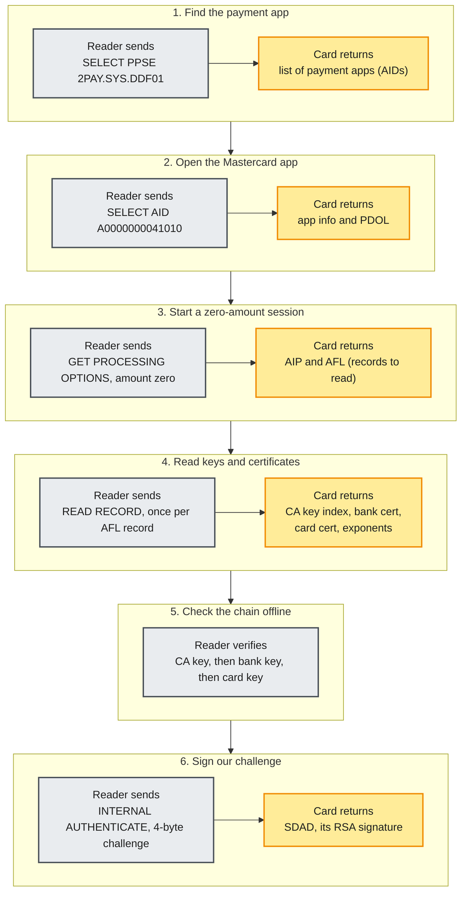
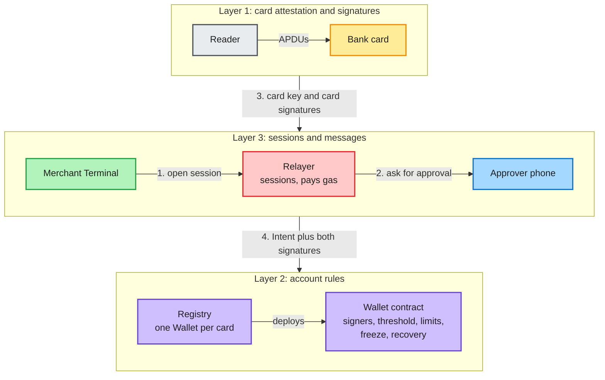
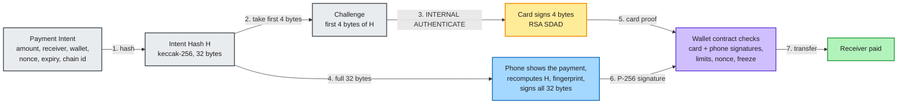
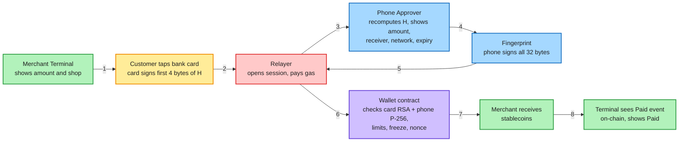
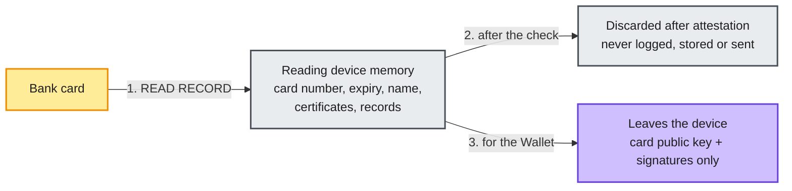
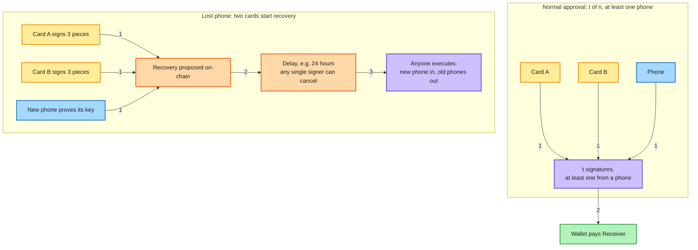

# Tap2ETH: A Hardware Wallet With No Supply Chain to Trust

**The bank card already in your pocket, as one key of a self-custodial wallet.**

| | |
|---|---|
| Authors | team-somehow |
| Date | November 2026 |
| Built at | ETHGlobal Mumbai 2026 |
| Companion specification | [`PROTOCOL.md`](./PROTOCOL.md) (Tap2ETH Protocol Specification, Draft 1) |

---

## Abstract

Self-custody today means buying a device and guarding a recovery phrase, and both keep failing. Tap2ETH starts from one observation: every contactless Visa or Mastercard bank card already holds a certified chip with an RSA key that cannot be read out, and it will sign a reader-chosen challenge that anyone, including a smart contract, can verify.

In Tap2ETH that card is one signer of a smart-contract wallet. The second is a biometric-gated key on the user's phone, the **Approver**. The wallet checks both and enforces limits, freeze and slow, cancellable recovery; a **Relayer** pays gas. The card is used only as a key: no card payment is processed and the bank account is never charged. Money sits in the wallet as stablecoins.

---

## 1. The problem with self-custody

**The supply chain.** In October 2026, tampered Ledger devices resold through one reseller led to estimated losses of $86–93 million [1][2]. The implant captured the recovery phrase, yet the devices passed Ledger's own Genuine Check [3]; Trezor warned of a similar implant [4]. The purchase also creates a target list: a January 2026 breach at Ledger's e-commerce partner leaked customer addresses [5].

**Seed phrases.** Whoever reads the words owns the wallet. A fake Trezor support agent talked one holder out of around $282 million [6], and a 2026 seed-generation flaw was linked to at least $5.69 million in losses [7].

**Blind signing.** Bybit lost around $1.5 billion in 2025 when signers approved a malicious transaction that a compromised interface showed as routine [8][9].

**One stolen device.** Single-phone wallets were drained after phone thefts in London and Brooklyn [10][11].

Our requirements:

1. **No new supply chain.** Do not ask the user to buy a device.
2. **No seed phrase.** Nothing a person can be talked into reading out.
3. **No blind signing.** The approving device shows, and commits to, exactly what is approved.
4. **No single factor.** Losing one thing must not lose the money.
5. **No vendor.** Nobody, including us, can move funds or be required for recovery.

---

## 2. The insight: a certified secure chip in every bank card

A bank card's chip runs the EMV payment application [12][13]. To stop cloning, EMV includes **Dynamic Data Authentication** (DDA): the card holds an RSA private key loaded by the bank, a terminal sends a challenge with INTERNAL AUTHENTICATE, and the card returns a signature, the **SDAD**. The card's public key is certified by the bank, and the bank's by the payment network, whose CA keys are published.

| A hardware wallet key needs | A bank card already has |
|---|---|
| Key in tamper-resistant hardware, never exported | Certified EMV chip; private key never leaves it |
| Signs a verifier-chosen challenge | INTERNAL AUTHENTICATE with a reader-chosen challenge |
| Anyone can check the signature | RSA public key, ISO/IEC 9796-2 format [14] |
| Proof the hardware is genuine | Certificate chain: network CA to bank to card |
| Already in users' hands | Over a billion debit cards in India alone [15] |

Payment cryptograms use symmetric keys only the bank can check; DDA signatures are public-key, so anyone can. Tap2ETH uses only DDA signatures and never asks for a payment cryptogram.

---

## 3. Cracking open the card

EMV is documented; nothing on the card is modified or bypassed. What was missing was a working recipe. We started with an M5StickS3, an M5Stack RFID 2 reader and a real Indian-issued Mastercard.

### 3.1 The reader-card conversation

The reader runs a short, fixed command sequence (APDUs over ISO-DEP [16]). Each step either finds the payment application, collects the certificates, or asks for a signature.

| Step | Command bytes | Card returns |
|---|---|---|
| 1. SELECT PPSE | `00 A4 04 00 0E "2PAY.SYS.DDF01" 00` | Directory of payment applications (tag `4F`); Visa `A000000003…` or Mastercard `A000000004…` |
| 2. SELECT AID | `00 A4 04 00 Lc <AID> 00` | Application info, including the PDOL (`9F38`) |
| 3. GET PROCESSING OPTIONS | `80 A8 00 00 Lc 83 Lp <PDOL data> 00` with amount `00…00` and real date | AIP and AFL (`82`, `94`) |
| 4. READ RECORD | `00 B2 r ((SFI<<3)\|4) 00` for each AFL record | CA key index `8F`, issuer certificate `90`, issuer exponent `9F32`, card certificate `9F46`, card exponent `9F47` |
| 5. Attestation | (no command) | Reader checks the chain offline |
| 6. INTERNAL AUTHENTICATE | `00 88 00 00 04 <4 challenge bytes> 00` | SDAD in tag `80`, or tag `9F4B` inside `77` |

Every response must end in `90 00` (success). The reader **never** sends VERIFY (PIN), GENERATE AC (payment cryptogram) or any issuer script, and discards any cryptogram the card volunteers. No PIN is involved and nothing goes to any bank.

On day one we sent the challenge `81D0D5FF` and got back a signature. The card's Dynamic Data Object List declares a 4-byte "unpredictable number" (`9F37`), so the card commits to exactly the 4 bytes the reader sends.

### 3.2 The chain of trust

Offline, we unwrapped each layer with the key from the layer above:

```mermaid
flowchart LR
    CA["Network CA public key<br/>published, chosen by index 8F<br/>Mastercard key 06, 1984-bit"]:::reader
    IC["Issuer certificate<br/>tag 90"]:::card
    IK["Bank public key<br/>1408-bit"]:::card
    CC["Card certificate<br/>tag 9F46"]:::card
    CK["Card public key<br/>1024-bit, exponent 3"]:::card
    SG["Card signature SDAD<br/>over our 4-byte challenge"]:::card
    OK["Verified: a real bank key<br/>in a real card signed our value"]:::chain
    CA -->|"1. opens"| IC
    IC -->|"2. reveals"| IK
    IK -->|"3. opens"| CC
    CC -->|"4. reveals"| CK
    CK -->|"5. opens"| SG
    SG -->|"6. SHA-1 hash matches challenge"| OK

    classDef card fill:#ffec99,stroke:#f08c00,stroke-width:2px,color:#1e1e1e
    classDef reader fill:#e9ecef,stroke:#495057,stroke-width:2px,color:#1e1e1e
    classDef chain fill:#d0bfff,stroke:#6741d9,stroke-width:2px,color:#1e1e1e
```

The recovered signature block had the expected ISO/IEC 9796-2 format [14], and its embedded SHA-1 hash matched our challenge. The card number never left the reader's memory.

### 3.3 What the card taught us

- **Field strength.** Signing draws extra power; raising the field after selection stopped brown-outs.
- **Slow signing.** INTERNAL AUTHENTICATE can exceed a second via ISO-DEP waiting-time extensions [16]; readers allow 1500 ms.
- **No PIN, no cryptogram.** This also protects users from "tap and type your PIN" malware [17].
- **Signed data only, no fallback.** Many EMV attacks tamper with unsigned data or force a weaker path [18].

The same flow runs on an Android phone, a Raspberry Pi merchant terminal and a smart contract. On-chain, RSA uses the modexp precompile [19] and the hash a Solidity SHA-1 [20], as ENS's DNSSEC oracle does in production [21].

---

## 4. The Tap2ETH protocol

### 4.1 Three layers

| Layer | Defines | Used by |
|---|---|---|
| 1. Card attestation and signatures | Reading a card, checking its chain, deriving a challenge from a 32-byte hash, verifying the SDAD | Any wallet or verifier wanting a bank card as a signer |
| 2. Account rules | Signer set, approval rule, limits, freeze, recovery, byte-exact hash formats | Tap2ETH Wallets and Registry |
| 3. Sessions and messages | Payment sessions, Relayer HTTP API, Reader-Terminal link, what each device must display | Terminals, Readers, Approvers, Relayers |

**Roles.** The **Card** signs any 4-byte challenge. The **Approver** is a phone whose P-256 key needs a fresh biometric per signature. The **Terminal** and **Reader** are merchant devices. The **Relayer** pays gas but never holds funds. The **Wallet** holds stablecoins and enforces every rule; the **Registry** creates Wallets. The **Receiver** gets paid.

### 4.2 Binding the challenge to the payment

Every approval is over an **Intent**, such as "pay 12.50 USDC from wallet W to receiver R, nonce 7, before time T, on chain 1874". Its keccak-256 hash is the 32-byte **Intent Hash** `H`. Because `H` includes the chain, the wallet and its nonce, no signature can be replayed elsewhere.

The phone signs all 32 bytes inside a WebAuthn envelope with the "user verified" flag [22]. The card can only sign 4 bytes, so where more binding is needed it signs several 4-byte **Pieces** of `H` in one tap. A three-piece **Strong Card Proof** binds 96 bits. This asymmetry drives the security design (Section 5).

### 4.3 Paying a merchant

The Terminal computes the Intent from chain state; the phone independently recomputes the same hash from what it shows.

The Terminal shows "Paid" only after its own chain connection sees the expected `Paid` event, so a dishonest Relayer cannot fool it.

### 4.4 Sending on-chain

The user enters an address in the Approver app, reviews it, taps the card on the back of the phone, and confirms with a fingerprint. A send always needs the phone.

```mermaid
flowchart LR
    U["User enters amount and address<br/>checksum check, review screen"]:::phone
    C["Tap card on back of phone<br/>card signs first 4 bytes of H"]:::card
    P["Phone recomputes H,<br/>fingerprint signs all 32 bytes"]:::phone
    L["Relayer<br/>submits, pays gas"]:::relayer
    W["Wallet contract<br/>verifies both signatures,<br/>limits and nonce"]:::chain
    R["Receiver address<br/>gets stablecoins"]:::receiver
    U -->|"1"| C
    C -->|"2"| P
    P -->|"3"| L
    L -->|"4"| W
    W -->|"5"| R

    classDef card fill:#ffec99,stroke:#f08c00,stroke-width:2px,color:#1e1e1e
    classDef phone fill:#a5d8ff,stroke:#1971c2,stroke-width:2px,color:#1e1e1e
    classDef chain fill:#d0bfff,stroke:#6741d9,stroke-width:2px,color:#1e1e1e
    classDef receiver fill:#b2f2bb,stroke:#2f9e44,stroke-width:2px,color:#1e1e1e
    classDef relayer fill:#ffc9c9,stroke:#e03131,stroke-width:2px,color:#1e1e1e
```

### 4.5 Creating a wallet

Signup is one tap. The phone reads and attests the card, shows the network, limits, recovery delay and predicted address, the card signs, the user gives a fingerprint, and the Registry deploys the Wallet as a minimal proxy clone [23]. The address is derived from the card's public key and never changes.

---

## 5. Security model

### 5.1 Two independent factors

- **Possession: is the real card here?** The card's signature proves someone had it within a few centimetres of a reader.
- **Intent: does the owner approve exactly this?** The Approver shows amount, receiver, token, network and expiry, recomputes `H` from those fields, refuses if the Relayer's hash differs, and only then asks for a biometric.

The two factors live on different hardware from different supply chains. An attacker must beat both.

### 5.2 Why the card alone is never enough

A card has no screen, signs for any reader in range, binds only 4 bytes, and its key was generated by the bank. So every conforming system keeps six invariants (PROTOCOL.md §3.4):

1. Every payment above an optional small `softLimit` needs two signatures, one from an Approver over all 32 bytes.
2. Any approval without an Approver uses Strong Card Proofs (96 bits per card).
3. A Wallet accepts each `(card, challenge)` pair once, ever.
4. Replacing a lost signer waits a delay that any single signer can cancel.
5. Only the card's public key and signatures leave the reading device.
6. Every wallet function can be called without the Relayer.

### 5.3 No blind signing

The screen sits on the device that holds the key, and the hash is a function of the screen. The Approver rebuilds `H` from what it displays and checks that every card challenge is the matching Piece of that `H`, so a Relayer cannot swap the receiver or use 4-byte collisions to make card and phone sign different things. The Terminal derives its own hash from chain state and never forwards a challenge it did not compute.

### 5.4 "So now I trust the bank instead of Ledger?"

No. The bank generated the card key [24] and might have kept a copy, so Tap2ETH assumes it did. The bank can then act as **one card** at most: soft-tier spending if enabled, freezing, or cancelling a pending change, none of which sends it funds. Every value-moving approval needs the phone's key. Recovery cards from different banks are advised. The Tap2ETH team has no admin or upgrade key at all. A captured phrase gives an attacker everything [1][3]; a compromised card gives one factor of two, inside the user's limits.

### 5.5 Limits, freeze and recovery

- **Limits** per transaction and per day; changing them needs a normal approval.
- **Soft tier**, off by default: small payments with one signature. Card-only payments are an explicit opt-in, use Strong Card Proofs, and should sit well below the no-PIN contactless limit (₹5,000 in India [25]).
- **Freeze** needs any single signer, even a card at a merchant Terminal. **Unfreeze** needs a full approval.
- **Recovery** waits `recoveryDelay`, is cancellable by any signer, and executable by anyone once ready.

### 5.6 Main threats

| Threat | Mitigation |
|---|---|
| Supply-chain implant | No phrase to capture; card and phone come through separate chains and neither alone moves value |
| Customer-data leak | Nothing is bought, so there is no vendor customer list |
| Seed phishing | No seed phrase exists |
| Compromised interface or Relayer | Approver recomputes `H` and checks every card challenge; Terminal confirms on-chain |
| Stolen card, skimming at ~25 cm [26], or relay [27] | Cannot pass a normal approval; card-only spending capped by soft and daily limits; freeze and replace |
| Stolen phone | Every signature needs the owner's biometric; normal approvals also need a card |
| 4-byte grinding (~2³² keccak, seconds on a GPU [28]) | Phone signs 32 bytes on every normal approval; 3-piece proofs elsewhere; challenges consumed |
| Malicious Terminal | Receiver is in `H` and shown on the phone; card-only spending only within the soft tier |
| Bank keeps the card key | Acts as one card at most |
| Coercion | Limits cap a quick grab, not a coerced owner (Section 11) |

---

## 6. Privacy

Card data is handled strictly, but a wallet is linkable to anyone who has read the card.

- **Never leaves the reader:** card number, expiry, name, certificates, cryptograms, transaction counter, in line with PCI DSS [29]. No card-number hash goes on-chain; it would be easy to brute-force.
- **Linkable:** the Wallet address derives from the on-chain card key, so anyone who has read the card can find the wallet. A zero-knowledge attestation extension (PROTOCOL.md §12.2), building on zkEMV [30], would hide it.
- **The Relayer sees** IPs, amounts and timing; users can run their own.

---

## 7. Payments without crypto steps

The customer taps, checks the phone and touches the fingerprint sensor. The merchant receives stablecoins on-chain. There is no card authorisation, so no scheme fees or chargebacks, and the customer's bank account is never touched: the money moves out of the smart wallet.

Every wallet call carries its own signatures, so anyone can submit it. The **Relayer** (a merchant, processor or wallet provider) pays gas as a cost of acceptance, by direct call, ERC-4337 with a paymaster [31], or EIP-8141 frame transactions with a per-wallet gas quota [32]. It simulates first, rate-limits, caps its gas budget, and binds each Terminal to its own Receiver. Without it, users submit calls themselves.

---

## 8. Multi-card accounts and recovery

A Wallet holds up to eight signers with a threshold `t` of at least 2. Every normal approval needs `t` signatures, at least one from a phone, which suits shared money such as a shop float or a family pot. Even a purse full of cards cannot approve alone: the phone's biometric signature turns possession into consent.

**Lost phone.** Two enrolled cards each sign three Pieces of a recovery Intent naming the new phone's key; after the delay anyone executes it, and the old phone can cancel meanwhile. Three Pieces stop a thief with one card from grinding (about 2³² tries) for a hash that matches an old public signature of the other card.

**Lost card.** The phone plus a new card propose the swap, with the same delay. The Wallet address never changes. With only one card a lost phone is unrecoverable, so the app urges a second card at signup. New signers must prove possession, and new cards must pass attestation.

---

## 9. On-chain cost

Measured on **Whitechain Sepolia (chain id 1874)** with the reference contracts, including the 21,000 base gas:

| Operation | Gas |
|---|---|
| Card signature check (RSA + SHA-1) | 151,139 |
| Phone signature check (WebAuthn P-256) | 62,716 |
| Create a wallet | 765,960 |
| `pay`, card + phone | 320,193 |
| `pay`, two cards + phone | 379,953 |
| Freeze with the phone | 104,422 |
| Start a phone replacement (two cards) | 404,897 |

Solidity SHA-1 dominates (about 38,000 gas per block [20]); RSA with exponent 3 is cheap. Each extra Piece adds roughly 130,000 gas (estimate). A card + phone payment is around $0.004–0.01 on Base at ETH $3,000 (estimate).

---

## 10. Comparison with prior art

| Approach | Example | New hardware | Issuer or KYC | Seed phrase | Who verifies |
|---|---|---|---|---|---|
| Hardware wallet | Ledger, Trezor | Yes, purpose-built device | No | Yes | Anyone |
| NFC crypto card | Arx HaLo [33], Tangem [34] | Yes, new chip card | No (Tangem Pay adds KYC) | No | Anyone |
| Issuer crypto card | Gnosis Pay [35], MetaMask Card [36] | Yes, newly issued card | Yes | Depends | The issuer pulls funds; Gnosis Pay's delay module was exploited in 2026 [37] |
| ZK card possession | zkEMV [30] | No | No | n/a | Anyone, but it is not a wallet |
| Bank tap identity | Visa Tap to Confirm [38], EMV-CAP [39] | No | Issuer-run | n/a | Only the bank (symmetric cryptograms) |
| **Tap2ETH** | This paper | **No, the card and phone you have** | **No** | **No** | **Anyone, on-chain, from public-key card signatures** |

As far as our search found, no earlier project uses an unmodified, already-issued bank card's offline-authentication signature as a smart-wallet signer with on-chain limits, multi-card thresholds and a merchant terminal.

---

## 11. Limitations

- **The bank generated the key.** Capped at "one card" (Section 5.4), not removed.
- **4 bytes per signature.** Covered by the phone's 32-byte signature and 3-piece proofs, which lengthen the tap (one signature takes about 1.5 s on our I2C reader).
- **1024-bit RSA.** About 80-bit security; factoring records keep advancing [40] and NIST disallows it for new signatures [41]. Factoring a card key yields only that card's power.
- **SHA-1.** Forgery needs a second preimage, not a collision; verifiers check format strictly.
- **Attestation is on the device.** The Wallet sees an EMV-format RSA key, not proof a bank issued it; a fake key harms only its own wallet.
- **iPhones** cannot read payment cards in apps; they can still approve when a Terminal reads the card.
- **Coercion.** Limits stop a quick grab, not a coerced owner, unless delayed loosening (PROTOCOL.md §12.5) is used.
- **Card lifecycle.** Blocked or expired cards keep signing, so freeze and replacement are the revocation path. Other networks such as RuPay need extra card profiles.
- **Card terms.** This use is off-label; commercial deployers should review card terms and local crypto regulation.
- **Liveness versus safety.** A thief and owner can cancel each other's recovery; when in doubt, nothing changes.

---

## 12. An open protocol

Tap2ETH only removes trust if nobody owns it.

- **The specification is public domain** (CC0 1.0) [42]; the reference implementation is open source.
- **No privileged keys.** Wallets are immutable, with no admin, upgrade path or fee switch. The Registry has no owner.
- **No server required for safety.** Anyone can run a Relayer.
- **CA keys are public data** that every verifier checks against.

| You want to build | Read in PROTOCOL.md |
|---|---|
| A card verifier for any smart account (e.g. an ERC-7579 module) | §4 (Layer 1) |
| A compatible Wallet and Registry | §5 (Layer 2) |
| A merchant Terminal or Reader | §4.2–4.3, §6 |
| An Approver app | §5.3, §6.3, §6.8 |
| A Relayer | §6, §7 |

Hashes are byte-exact and messages have schemas, so parts from different teams interoperate. The reference implementation (`ethglobal-mumbai` by team-somehow) is deployed on Whitechain Sepolia and Arc testnet.

---

## 13. Conclusion

Hardware wallets asked users to trust a new device and everyone who touched it, and to guard a phrase anyone could steal by reading it [1][6][8].

The bank card in your pocket already holds a certified key whose signatures anyone can verify. We made an ordinary card sign our challenge, verified it to the network CA key, and checked it in a smart contract. Around it we put what a card alone lacks: a phone that shows and signs exactly what is approved, limits, freeze and slow, cancellable recovery.

No device to buy, no seed phrase to leak, no screen you cannot trust, and no single thing to lose. Neither the bank, nor a thief, nor the Tap2ETH team can move the money alone.

---

## References

1. CoinDesk, "Ledger investigates potential wallet tampering after reports of $86 million in crypto stolen", 9 October 2026. https://www.coindesk.com/business/2026/10/09/ledger-investigates-potential-wallet-tampering-after-reports-of-usd86-million-in-crypto-stolen
2. Forbes, "Ledger's spy chip attack: what we know so far", 23 October 2026. https://www.forbes.com/sites/digital-assets/2026/10/23/ledgers-spy-chip-attack-what-we-know-so-far/
3. Tech Times, "Ledger hardware wallet supply chain attack: Genuine Check passes implanted devices", 13 October 2026. https://www.techtimes.com/articles/328907/20261013/ledger-hardware-wallet-supply-chain-attack-genuine-check-passes-implanted-devices.htm
4. Aviatrix Threat Research Center, "Trezor warns of suspected crypto-theft implant in hardware wallet (2026 supply chain)". https://aviatrix.ai/threat-research-center/trezor-warns-suspected-crypto-theft-implant-hardware-wallet-2026-supply-chain/
5. Ryder, "Ledger January 2026 data breach: what was leaked and what to do". https://ryder.id/blogs/post/ledger-january-2026-data-breach-what-was-leaked-and-what-to-do
6. Halborn, "Explained: the $282 million social engineering crypto heist". https://www.halborn.com/blog/post/explained-the-282-million-social-engineering-crypto-heist
7. DeFi Planet, "Coinspect warns weak seed phrase flaw may have exposed crypto wallets", July 2026. https://defi-planet.com/2026/07/coinspect-warns-weak-seed-phrase-flaw-may-have-exposed-crypto-wallets/
8. a16z crypto, "Bybit hack lessons". https://a16zcrypto.com/posts/article/bybit-hack-lessons
9. The Block, "Largest crypto exchange hack: what Ethereum security experts know about Lazarus and Bybit". https://www.theblock.co/post/342791/largest-crypto-exchange-hack-what-ethereum-security-experts-know-lazarus-bybit
10. Analytics Insight, "London crypto veteran loses $14,000 after thieves steal unlocked iPhone". https://www.analyticsinsight.net/news/london-crypto-veteran-loses-usd-14000-after-thieves-steal-unlocked-iphone
11. News 12 New York, "Lost phone leads to more than $50K stolen, including Bitcoin". https://newyork.news12.com/lost-phone-leads-to-more-than-50k-stolen-including-bitcoin
12. EMVCo, "EMV Integrated Circuit Card Specifications for Payment Systems, Book 2: Security and Key Management", v4.4. https://www.emvco.com/specifications/
13. EMVCo, "EMV Integrated Circuit Card Specifications for Payment Systems, Book 3: Application Specification", v4.4. https://www.emvco.com/specifications/
14. ISO/IEC 9796-2, "Digital signature schemes giving message recovery, Part 2: Integer factorization based mechanisms". https://www.iso.org/standard/54788.html
15. Reserve Bank of India, payment system statistics publication (103.43 crore debit cards outstanding at December 2025). https://www.rbi.org.in/Scripts/PublicationsView.aspx?id=23813
16. ISO/IEC 14443-3 and 14443-4, "Cards and security devices for personal identification: Contactless proximity objects". https://www.iso.org/standard/73598.html
17. Kaspersky, "NFCGate relay attacks", 2026. https://www.kaspersky.com/blog/nfc-gate-relay-attacks-2026/55116
18. Basin, D., Sasse, R., Toro-Pozo, J., "The EMV Standard: Break, Fix, Verify", IEEE S&P 2021. https://arxiv.org/abs/2006.08249
19. EIP-198, "Big integer modular exponentiation". https://eips.ethereum.org/EIPS/eip-198
20. ENS, `solsha1`: SHA-1 in Solidity. https://github.com/ensdomains/solsha1
21. ENS, DNSSEC oracle `RSASHA1Algorithm.sol`. https://github.com/ensdomains/ens-contracts/blob/staging/contracts/dnssec-oracle/algorithms/RSASHA1Algorithm.sol
22. W3C, "Web Authentication: An API for accessing Public Key Credentials, Level 3". https://www.w3.org/TR/webauthn-3/
23. EIP-1167, "Minimal Proxy Contract". https://eips.ethereum.org/EIPS/eip-1167
24. EMVCo, "EMV Card Personalization Specification". https://pinpasjc.win.tue.nl/docs/EMV-CPS-1.0Final16June03.pdf
25. Business Standard, "RBI hikes contactless card transaction limit to Rs 5,000", December 2020. https://business-standard.com/article/economy-policy/rbi-hikes-contactless-card-transaction-limit-to-rs-5000-to-boost-e-payments-120120401582_1.html
26. Kirschenbaum, I., Wool, A., "How to Build a Low-Cost, Extended-Range RFID Skimmer", USENIX Security 2006. https://www.usenix.org/legacy/events/sec06/tech/kirschenbaum.html
27. Radu, A.-I., et al., "Practical EMV Relay Protection", IEEE S&P 2022. https://research.birmingham.ac.uk/en/publications/practical-emv-relay-protection
28. akshatmittal, `create2-salt-miner` (1,250 million keccak attempts per second on an RTX 3070). https://github.com/akshatmittal/create2-salt-miner
29. PCI Security Standards Council, "Payment Card Industry Data Security Standard", v4.0. https://www.pcisecuritystandards.org/
30. itzmeanjan, `zkEMV`: zero-knowledge proofs of EMV card possession. https://github.com/itzmeanjan/zkEMV
31. ERC-4337, "Account Abstraction Using Alt Mempool". https://eips.ethereum.org/EIPS/eip-4337
32. EIP-8141, "Frame Transaction". https://eips.ethereum.org/EIPS/eip-8141
33. Arx Research, HaLo documentation. https://arx-docs.vercel.app/HaLo/overview
34. Cointelegraph, "Tangem wallet Visa card payments, KYC and self-custody". https://cointelegraph.com/news/tangem-wallet-visa-card-payments-kyc-self-custody
35. Gnosis Pay, "How Gnosis Pay accounts work". https://gnosis-pay.gitbook.io/gnosis-pay/overview/how-gnosis-pay-accounts-work
36. The Block, "MetaMask Card with Baanx and Mastercard". https://www.theblock.co/post/311139/metamask-card-baanx-mastercard
37. The Defiant, "Gnosis Pay hit by Delay module exploit as Gnosis pledges to cover user losses", June 2026. https://thedefiant.io/news/hacks/gnosis-pay-hit-by-delay-module-exploit-as-gnosis-pledges-to-cover-user-losses
38. Visa, "Your Card, Your Security: Tap, a safer way to verify identity", May 2026. https://investor.visa.com/news/news-details/2026/Your-Card-Your-Security--Tap-A-Safer-Way-to-Verify-Identity--Visa-Keyno-and-Fidelity-Bank-Bahamas-Lead-the-Transformation/default.aspx
39. Drimer, S., Murdoch, S. J., Anderson, R., "Optimised to Fail: Card Readers for Online Banking", Financial Cryptography 2009. https://www.cl.cam.ac.uk/~sjm217/papers/fc09optimised.pdf
40. Wikipedia, "RSA numbers". https://en.wikipedia.org/wiki/RSA_numbers
41. NIST SP 800-131A, "Transitioning the Use of Cryptographic Algorithms and Key Lengths". https://csrc.nist.gov/pubs/sp/800/131/a/r2/final
42. team-somehow, "Tap2ETH Protocol Specification", Draft 1. [`PROTOCOL.md`](./PROTOCOL.md)
